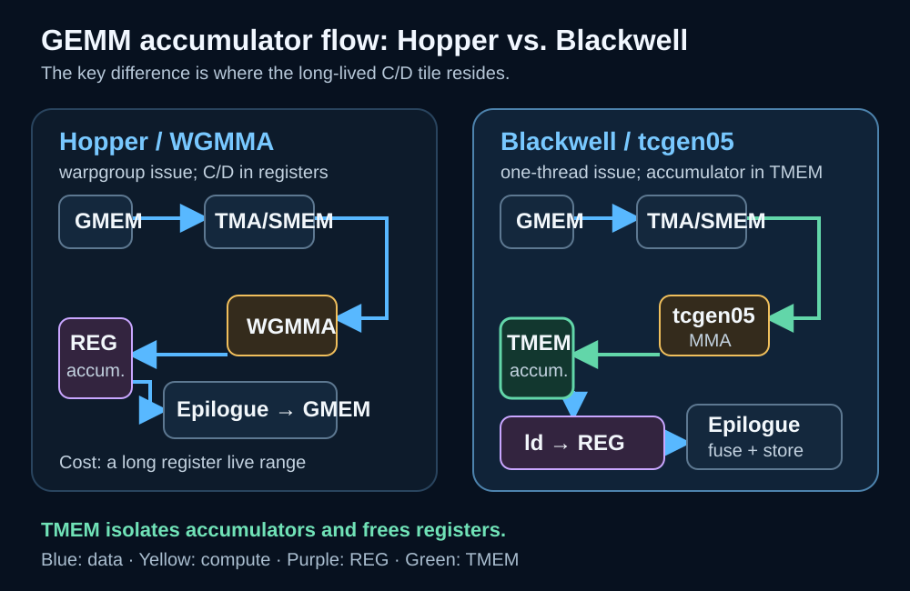
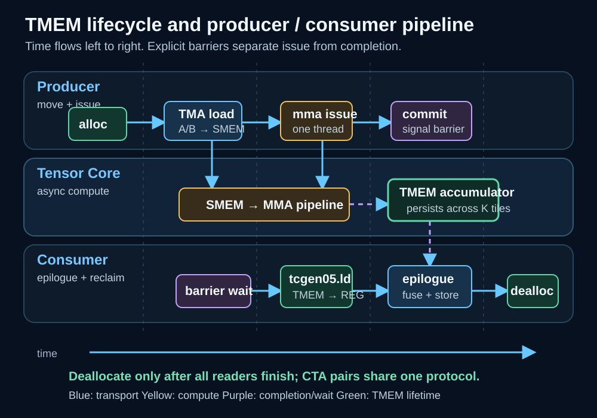

# Blackwell TMEM 与 tcgen05：第五代 Tensor Core 如何重写 GEMM 数据流

从 Ampere 的 `mma.sync` 到 Hopper 的 WGMMA，Tensor Core 编程一直在扩大一次矩阵乘加所覆盖的协作范围，并让数据搬运和计算更容易重叠。Blackwell 的变化又向前走了一步：第五代 Tensor Core 不只是提供更高的窄精度吞吐，还通过 **Tensor Memory（TMEM）** 与 `tcgen05` 指令族，重新安排 accumulator 在片上的落点、生命周期和生产者—消费者关系。

经典 GEMM kernel 把 A、B tile 从 global memory 搬到 shared memory，执行 Tensor Core MMA，把 C/D accumulator 保存在寄存器中，再由同一批线程完成 scale、bias、activation、类型转换和写回。这个模型很直接，但当 tile 变大、K 循环变深或 epilogue 更复杂时，accumulator 会长时间占据大量寄存器。寄存器预算同时还要容纳地址、TMA descriptor、pipeline 状态和融合计算临时值，最终可能限制 occupancy，甚至触发 spill。

Blackwell 将 accumulator 移入专用 TMEM。它并非“更快的 shared memory”或缓存，而是供第五代 Tensor Core 数据通路使用、由软件显式分配和释放的片上状态空间。GEMM 因而从“Tensor Core 直接写线程寄存器”变成“Tensor Core 写 TMEM，consumer 再分块读取并执行 epilogue”。性能机会来自资源解耦；复杂度也来自这套显式协议。

> **图源与许可：** 根据 NVIDIA [PTX ISA 9.4](https://docs.nvidia.com/cuda/parallel-thread-execution/) 与 [CUTLASS tcgen05 MMA Programming Guide](https://docs.nvidia.com/cutlass/latest/media/docs/pythonDSL/guides/mma/tcgen05_programming.html) 整理的原创示意图，不含第三方图像资产。

## 背景：真正稀缺的不只是 Tensor Core 周期

矩阵乘的算术量约为 `2MNK` FLOP，但 kernel 能否逼近峰值，取决于计算、搬运和尾处理能否同时供给。对一个 CTA 而言，至少有四本资源账：

1. **global memory / TMA 带宽**：A、B tile 能否提前到达；
2. **shared memory 容量和带宽**：多级 buffer、布局转换与 bank conflict 是否可控；
3. **Tensor Core issue / execution**：MMA pipeline 是否持续有工作；
4. **register file 与调度槽位**：accumulator、地址和 epilogue 临时值是否压低并发度。

Hopper WGMMA 已能让 warpgroup 以异步风格发射大粒度 MMA，但 accumulator 仍与寄存器预算紧密耦合。假设每线程持有 `R_acc` 个 32-bit accumulator，再加上 `R_base` 个地址与控制寄存器，一个 CTA 的粗略需求是：

`R_CTA ≈ threads_per_CTA × (R_base + R_acc + R_epi)`

当 `R_acc` 或融合 epilogue 的 `R_epi` 增大时，SM 上可同时驻留的 CTA 数会下降。TMEM 并没有消除 accumulator 的物理存储成本，而是将它从通用 register file 的竞争域中移开，让寄存器更集中地服务于搬运、控制和融合计算。

## TMEM 是什么：专用状态空间，而不是缓存

PTX 将 Tensor Memory 定义为 Blackwell Tensor Core 使用的专用片上存储。编程时应抓住三个边界。

第一，**TMEM 不是硬件自动管理的 cache**。程序通过 `tcgen05.alloc` 建立分配，通过 TMEM 地址访问对应区域，并在所有使用完成后执行 `tcgen05.dealloc`。忘记释放、提前释放或让不符合协议的线程访问，都是正确性问题。

第二，**TMEM 不替代 SMEM**。A、B operand 的主路径仍通常是 GMEM → TMA → SMEM；Tensor Core 从合法来源读取 operand，把累加结果放入 TMEM。Epilogue 使用 `tcgen05.ld` 把 subtile 拉回 registers，再做普通 CUDA 算术和写回。

第三，**TMEM 有自己的地址和布局语义**。它以 datapath 与 column 的二维视图组织，分配粒度、列数、数据格式和 MMA shape 共同决定 tile 映射。不能把普通指针算术或 shared-memory layout 直接套到 TMEM 上；布局必须由目标 `tcgen05.mma` 变体和框架 descriptor 推导。

完整生命周期为：

1. CTA 或 CTA pair 到达一致的分配点；
2. `tcgen05.alloc` 分配所需列并取得 TMEM 地址；
3. 一个或多个 K-tile 的 MMA 对该区域累加；
4. 完成事件通过 commit / mbarrier 交给 consumer；
5. consumer 用 `tcgen05.ld` 分批读出并完成 epilogue；
6. 所有读者结束后执行 `tcgen05.dealloc`。

## tcgen05.mma 如何改变执行模型

`tcgen05.mma` 的显著特征是 **单线程发射**：由一个线程提交描述符和操作数信息，硬件在更大的协作域内执行矩阵乘加。“单线程”描述的是指令发射接口，并不表示 MMA 只使用一个线程的算力，也不意味着其他线程可以忽略同步。负责准备 SMEM tile、维护 barrier 和消费结果的线程仍要共同遵守 pipeline 协议。

在概念上，一次操作仍是 `D = A × B + C`，但 C/D accumulator 驻留 TMEM，A、B 的来源和 descriptor 受具体 `kind`、shape、layout 与数据类型约束。Blackwell 覆盖 TF32、FP16、BF16、INT8，以及 FP8、FP6、FP4 和 block-scaled 窄精度路径。**格式受支持不等于任意 shape 都能达到同一吞吐**：对齐、转置组合、scale-factor layout、稀疏模式和目标架构都会改变可选 kernel。

`cta_group::1` 由一个 CTA 管理操作；`cta_group::2` 让一对 CTA 协作更大的工作单元。后者不是简单把网格 x 维设为 2：相邻 CTA 必须满足配对、共同驻留和同步约束，TMEM 分配、operand 准备和完成通知都要遵守 CTA pair 契约。它能扩大 tile 和数据复用，也会缩小调度器自由组合 CTA 的空间。

## 一条完整的 Blackwell GEMM 工程流水线

实践中可把 kernel 拆为 producer、MMA pipeline 和 consumer：

1. **分配资源**：进入主循环前初始化 mbarrier，为 accumulator 分配 TMEM；
2. **预取 operand**：TMA 把下一组 A/B tile 从 GMEM 异步搬到 SMEM 多级 buffer；
3. **等待输入 ready**：producer 在对应 stage 的 transaction 完成后发布 MMA；
4. **发射 MMA**：指定线程提交 `tcgen05.mma`，K 循环持续向同一 TMEM tile 累加；
5. **提交完成信号**：用 `tcgen05.commit` / mbarrier 建立完成事件，不能把 issue 当成 completion；
6. **读取 TMEM**：consumer 等待 barrier 后，用 `tcgen05.ld` 将 accumulator subtile 装入 registers；
7. **执行 epilogue**：完成 alpha/beta、bias、activation、clamp 和目标类型转换；
8. **写回与回收**：写回 GMEM，确认所有 consumer 完成后释放 TMEM。

> **图源与许可：** 根据 NVIDIA [PTX ISA 9.4](https://docs.nvidia.com/cuda/parallel-thread-execution/) 的 `tcgen05` 与 mbarrier 语义，以及 [CUTLASS tcgen05 MMA Programming Guide](https://docs.nvidia.com/cutlass/latest/media/docs/pythonDSL/guides/mma/tcgen05_programming.html) 整理的原创时序图，不含第三方图像资产。

图中并非所有步骤都串行。Tensor Core 对 stage i 做 MMA 时，TMA 可以填充 stage i+1，consumer 也可处理前一个已完成的 accumulator subtile。mbarrier 表达真正的数据依赖边界；若只依赖 warp 执行顺序或普通 CTA barrier，异步代理之间可能看到未完成的数据。

## 性能与资源模型：TMEM 节省什么，又增加什么

每个输出 tile 的 accumulator 字节数可粗略写作：

`B_acc = M_tile × N_tile × bytes(accumulator)`

寄存器 accumulator 模型要把这部分分摊到参与线程，并受每线程寄存器上限与 SM register-file 容量约束。TMEM 模型将其转化为 TMEM 列和布局约束，但 register file 仍需承接 `tcgen05.ld` 后的 epilogue subtile。目标并非“零 accumulator registers”，而是缩短大量 accumulator 同时存活于寄存器的区间。

端到端 tile 时间可近似为：

`T_tile ≈ max(T_TMA, T_MMA, T_epilogue) + T_sync + T_tail`

只有 TMA、MMA 与 epilogue 有效重叠，提高 Tensor Core 指令吞吐才会明显降低 `T_tile`。复杂反量化、布局重排或低效写回会让 `T_epilogue` 成为新瓶颈；K 很小时，pipeline 填充和排空的 `T_tail` 也可能盖过收益。

CUTLASS 文档提到部分 Blackwell `tcgen05` 路径相对 Hopper WGMMA 有 2×–4× 的**指令吞吐**提升。这个数字不能直接写成“应用 GEMM 快 2×–4×”：两代 GPU 的频率、内存系统、数据格式、tile shape、融合工作和问题规模都必须对齐，端到端还包括 launch、搬运与 epilogue。

Occupancy 也不能只看寄存器。官方调优指南对 compute capability 10.0 给出 64K 个 32-bit registers/SM、每线程最多 255 个寄存器，并提醒 cluster kernel 使用 `cudaOccupancyMaxActiveClusters` 计算可驻留 cluster。实际并发度至少是下列限制的最小值：

`active_CTAs = min(limit_REG, limit_SMEM, limit_threads, limit_blocks, limit_cluster/TMEM)`

TMEM 缓解 `limit_REG` 不保证并发度必然上升；大 SMEM staging、CTA pair、cluster shape 或其他资源仍可能先成为瓶颈。

## CUTLASS / CuTe 中如何落地

手写 PTX 适合验证指令语义、微基准和新布局研究，但生产 kernel 需要同时维护 descriptor、layout、barrier phase、TMEM 生命周期和 epilogue partition。CUTLASS / CuTe 将它们提升为可组合对象：

- TiledMMA 定义 MMA atom 如何铺到 tile；
- GMEM/SMEM tensor 与 copy atom 描述 TMA 搬运；
- TMEM tensor 表达 accumulator 的逻辑 shape 与地址映射；
- partition 规则把 consumer subtile 映射到 `tcgen05.ld`；
- collective mainloop 与 epilogue 编排 stage 和线程角色。

框架不会替代性能判断。生成 kernel 后仍应检查目标架构、实际 tile、stage 数、寄存器数、动态 SMEM 和 cluster launch 属性。对手写 PTX，先做小 shape 逐元素数值验证，再增加异步 overlap；否则出现 race 时很难定位。

## 基准与性能诊断方法

基准矩阵至少覆盖：

- 多组 M/N/K：大方阵、skinny GEMM、小 batch 与边界尺寸；
- FP16/BF16、TF32、FP8/FP6/FP4 及各自 accumulator 类型；
- TN/NT/NN/TT 等真实支持的 layout 与 alignment；
- 单 GEMM、grouped GEMM 和融合 bias/activation/quantization；
- `cta_group::1` 与适用时的 `cta_group::2`；
- 等价工作量的 Hopper/CUTLASS 基线，而非不同精度峰值。

诊断分三层：

1. **指令层**：Tensor Core active、MMA issue 间隔和依赖 stall；
2. **kernel 层**：TMA 吞吐、SMEM bank conflict、register/SMEM 占用、active CTA/cluster 和 epilogue 带宽；
3. **应用层**：真实 shape 分布、padding 浪费、launch 数、上下游转换和端到端延迟。

常见失败模式包括：小矩阵填不满 tile；K 太短使 pipeline 未稳态；`tcgen05.ld` 与 epilogue 串行化；错误 layout 引入 transpose；CTA pair 降低可调度并发；barrier phase 错误产生陈旧读；异常路径跳过 `dealloc`。后两类首先是正确性缺陷，不能当成偶发性能抖动。

## 局限与适用边界

TMEM 最适合 accumulator 很大、Tensor Core 工作足够长、且 epilogue 能被合理分块消费的 GEMM。对极小矩阵、memory-bound 算子或 accumulator 本来很小的 kernel，显式分配、同步和读取的固定成本可能不划算。

架构专用性也是现实约束。`tcgen05` 依赖特定 Blackwell target，发布时要保留其他架构的 fallback；即使都叫 Blackwell，不同 compute capability 的 SM 资源也不能混为一谈。窄精度格式还需单独验证误差、scale 粒度、饱和行为和训练/推理容忍度。

TMEM 把部分隐式硬件资源问题变成显式软件协议，提高了优化上限，也提高了维护门槛。应优先使用经过验证的 CUTLASS kernel；只有 shape、融合需求或研究目标确实超出库实现时，再下沉到 PTX。

## 实践检查表

- [ ] 目标 GPU、CUDA toolkit 与 PTX target 支持所用 `tcgen05` 变体；
- [ ] A/B 数据类型、layout、alignment、tile 与 MMA kind 合法；
- [ ] TMEM 分配列数和地址布局与 accumulator shape 一致；
- [ ] `cta_group::2` 的 CTA 配对、共同驻留和 cluster 形状满足约束；
- [ ] TMA producer 与 MMA consumer 使用正确的 mbarrier phase；
- [ ] issue、commit、wait 与 `tcgen05.ld` 之间有显式完成关系；
- [ ] 所有正常和异常控制流都在最后一次读取后释放 TMEM；
- [ ] Epilogue subtile 未制造新的高寄存器峰值或布局转换瓶颈；
- [ ] 数值测试覆盖边界 shape、非整 tile、NaN/Inf 和窄精度 scale；
- [ ] 基准分别报告指令、kernel 与端到端结果，并记录完整问题规模。

## 小结

Blackwell TMEM 的本质不是增加一层通用缓存，而是把 Tensor Core accumulator 从通用 register file 中解耦，并将分配、同步、消费和释放交给 kernel pipeline。与之配套的 `tcgen05` 让 producer、Tensor Core 和 epilogue consumer 形成更明确的异步分工。

收益取决于整套协同：tile 是否匹配数据类型和布局，TMA 是否持续供给，barrier 是否正确表达依赖，TMEM 是否降低真正的寄存器瓶颈，以及 epilogue 是否跟得上 MMA。第五代 Tensor Core 的峰值只是起点；同时对齐计算、存储和调度，才是 Blackwell GEMM 数据流真正的工程价值。

## 参考资料

- NVIDIA. *Parallel Thread Execution ISA 9.4*. <https://docs.nvidia.com/cuda/parallel-thread-execution/>
- NVIDIA CUTLASS. *tcgen05 MMA Programming Guide*. <https://docs.nvidia.com/cutlass/latest/media/docs/pythonDSL/guides/mma/tcgen05_programming.html>
- NVIDIA CUTLASS. *Blackwell SM100 GEMMs*. <https://docs.nvidia.com/cutlass/latest/media/docs/cpp/blackwell_functionality.html>
- NVIDIA. *Blackwell Tuning Guide*. <https://docs.nvidia.com/cuda/blackwell-tuning-guide/index.html>
