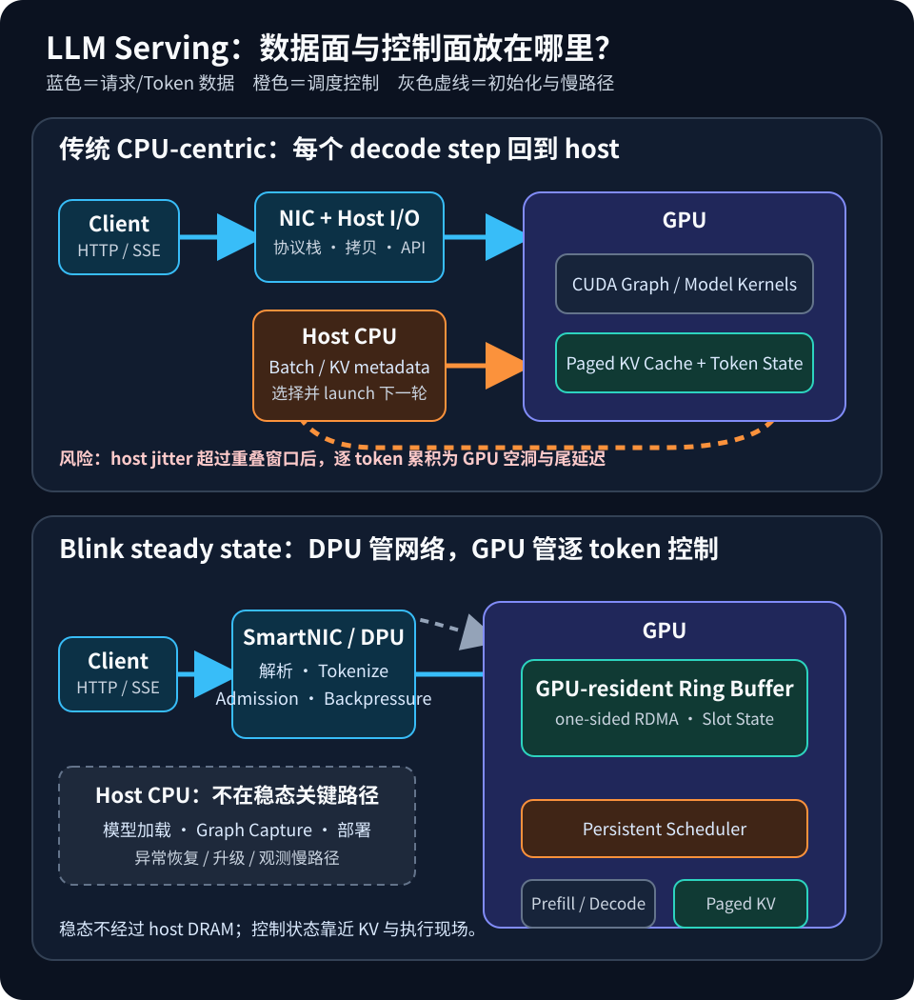
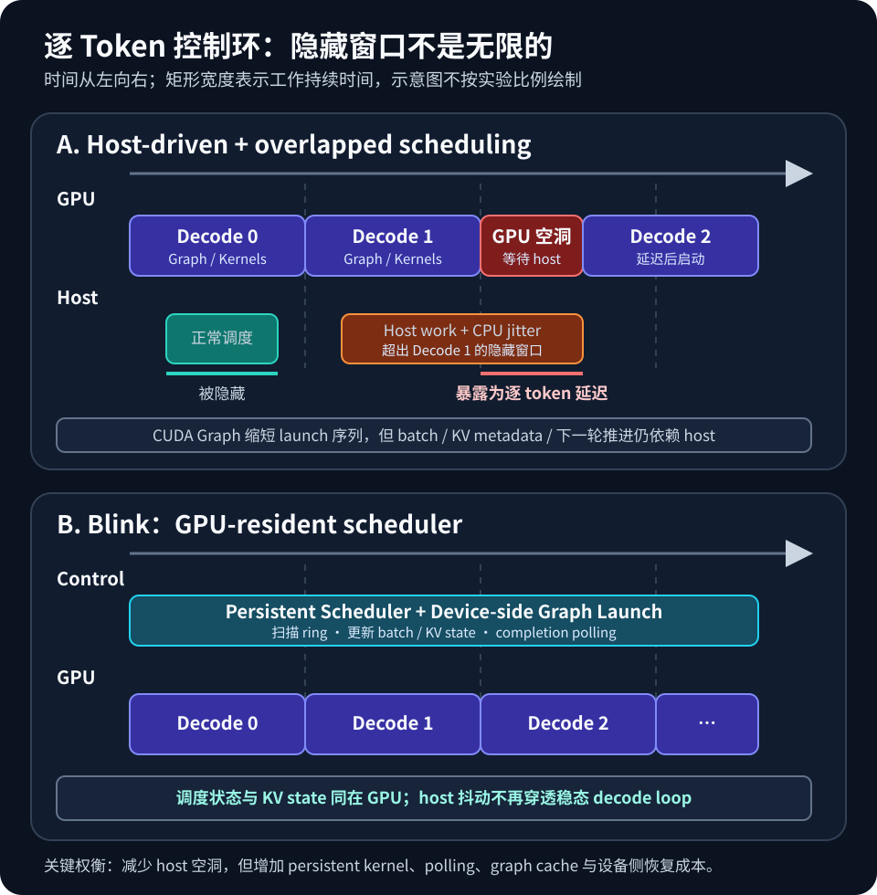

# Blink：把 LLM Serving 的控制面搬进 GPU 与 SmartNIC

大模型推理的大部分 FLOPS 发生在 GPU 上，但一次在线请求并不是把 prompt 交给 GPU 后就结束了。API 解析、tokenization、请求准入、continuous batching、KV-cache block 管理、每轮 decode 的调度与 token streaming，通常仍由 host CPU 推进。自回归生成每产生一个 token 都要进入下一轮控制循环，因此很短的 host 抖动也可能被重复数百次。

[Blink](https://arxiv.org/abs/2604.07609v1) 提出了一种更激进的职责划分：让 SmartNIC/DPU 接管网络前端与请求数据面，让 GPU 上的 persistent scheduler 接管逐 token 控制面。host CPU 只负责初始化、模型加载、CUDA Graph capture，以及故障处理等慢路径；进入稳定服务阶段后，请求关键路径只经过 DPU 与 GPU。

这里的 CPU-free 有严格限定：**它指 host CPU 不再位于 steady-state inference critical path，而不是整台系统不需要 CPU。** SmartNIC 自己也有 ARM 核，部署、升级、观测和异常恢复仍需要传统控制平面。

*图 1：传统 CPU-centric 路径与 Blink 的 DPU–GPU 稳态路径。本站原创；机制依据 Blink 论文 §4、Figure 2 的文字描述，以及 NVIDIA [GPUDirect RDMA 文档](https://docs.nvidia.com/cuda/gpudirect-rdma/)重新绘制，未复制或描摹论文原图。许可：原创站点插图，仅随本文使用。*

## 1. 背景：GPU 很忙，为什么 CPU 仍在关键路径

现代 serving engine 已经用 CUDA Graph 降低 launch overhead，也会把 CPU scheduling 与 GPU execution 重叠起来。然而 graph 只能复用一段已经捕获的 GPU 工作，不能自动决定下一轮 batch 里有哪些请求，也不会自己维护 KV block table、处理 early exit 或接收新 prompt。

典型 decode step 仍包含以下动作：

1. GPU 完成当前 token 的 forward 与 sampling；
2. host 读取完成状态，更新已结束和新加入的请求；
3. host 修改 batch metadata 与 KV-cache 映射；
4. host 选择并启动下一张 graph；
5. GPU 执行下一轮 decode。

当 host 工作短于当前 GPU iteration 时，overlapped scheduling 可以把它藏在计算后面；一旦 CPU 被同机任务抢占、LLC/TLB 状态被扰动，或者 Python/C++ runtime 出现尾部抖动，超出隐藏窗口的部分就会直接变成 inter-token gap。

Blink 论文的动机实验使用 H100、vLLM 0.13、启用 CUDA Graph，并用 pbzip2 制造 CPU 干扰。论文报告 kernel 间 dispatch gap 从约 1 微秒扩大到 40 微秒；更重要的是，GPU 上 matmul 时间基本不变，说明慢的是供给 GPU 的 host 控制链，而不是模型计算本身。这正是把控制面迁移到设备侧的出发点。

## 2. 先区分数据面与控制面

LLM serving 中有两条相互依赖的路径：

- **数据面**：HTTP/SSE 字节、token id、输出 token 与 tensor 在网络、host memory 和 GPU memory 之间移动；
- **控制面**：请求准入、排队、batch 形成、prefill/decode 切换、KV-cache 分配、完成检测、公平性与背压。

只用 SmartNIC 绕过 host network stack，能够减少数据复制和内核协议栈开销，但逐 token scheduling 若仍回到 CPU，decode loop 依然会受到 host 干扰。反过来，只把 scheduler 放进 GPU，若 prompt 和结果仍经过 host DRAM，也没有完成端到端的 CPU-free path。

Blink 因而同时重构两条路径：

- DPU 前端接收 OpenAI 风格 HTTP 请求，执行 tokenization、准入、slot tracking、detokenization 与 SSE streaming；
- one-sided RDMA 把 prompt 写入 GPU-resident ring buffer，并从同一共享区域读取结果；
- GPU persistent scheduler 发现请求后完成 batching、device-side graph launch、sampling、KV-cache metadata 管理与状态发布。

GPU ring buffer 是 DPU 与 GPU 的唯一 rendezvous point。这样可以避免在 host memory 中再做一次 staging，也把“谁拥有 slot、何时可读写、何时完成”变成显式协议。

## 3. Blink 的端到端职责重分配

### 3.1 SmartNIC/DPU：网络前端、准入与背压

论文原型将 frontend 运行在 BlueField-3 的 ARM 核上。它维护每个请求的 slot、token 数与完成状态；收到 prompt 后寻找空 slot，通过 RDMA 写入 token 与 metadata；后台 token reader 周期性读取 64 KB slot metadata，发现 generation count 变化后取回新 token 并向客户端流式输出。

为了不让 DPU 成为新的瓶颈，设计中使用了几项典型工程策略：

- 在 DPU 侧缓存 slot 可用性，用 hint-based circular scan 把查找摊销为 O(1)；
- 对突发请求合并 RDMA transfer，摊薄小消息开销；
- 对首 token 设 urgent slot，优先扫描 TTFT 敏感请求；
- 用 adaptive polling 和独立 completion progress thread，在延迟与 RDMA 流量之间折中；
- 使用预分配线程本地 buffer 与 ARM NEON tokenizer，避免请求路径上的频繁分配。

这些细节说明“把工作搬到 SmartNIC”并不等于免费。DPU 的核数、cache、内存与软件生态都弱于服务器 CPU，适合网络管理和 coarse-grained request lifecycle，却不适合承担每个 decode iteration 的全部调度。

### 3.2 GPU：常驻调度器与预捕获 graph

Blink 的 scheduler 是一个长期运行的 CUDA kernel：单个 thread block、256 个线程。它循环扫描 4096 个 ring slots，用 atomic compare-and-swap 认领请求，然后选择 prefill 或 decode CUDA Graph，从 device 侧直接发起执行，最后把 token 和状态写回 ring buffer。

论文报告完整 slot scan 需要 1–5 微秒。扫描与当前 decode graph 异步重叠；发现新 prompt 且 batch 有空位时，scheduler 在当前 step 后暂停 decode，执行 inline prefill，再把新请求合入 batch。调度策略采用 FCFS，目的是把实验差异尽量集中在架构位置，而不是更有利的调度算法。

模型计算仍由 TensorRT engine 完成。host 在启动阶段为一组 batch size 与 sequence length 捕获 graph，运行时 scheduler 通过 lookup table 选择最紧凑的 shape。论文中的单张 graph 约占 2–3 MB，650–1000 张 graph 合计约 2–4 GB；这是一项真实的 HBM 成本，换来 O(1) graph 选择与无 host launch。

### 3.3 一个容易忽略的限制：device-side launch 也有窗口

Blink 使用 CUDA device graph launch 的 fire-and-forget 模式。论文测得其代表性 graph launch 约 2 微秒，但单个 parent graph execution 最多只能累计 120 次 outstanding fire-and-forget launch。无限 decode loop 因此不能只靠一个 parent 实例。

论文的处理方法是 window-based recovery：前 120 轮使用 fire-and-forget，第 121 轮用一次 tail launch 替换当前 graph instance。ring 指针、KV metadata 与 in-flight request state 都存放在持久 GPU memory 中，新实例从同一逻辑状态继续。这个例子很有代表性：CPU-free 系统不只是把控制代码翻译成 CUDA，还必须重新满足设备运行时的生命周期约束。

## 4. GPU-resident scheduler 的协议问题

常驻 scheduler 的核心不是一个 while loop，而是四类不变量。

第一是**所有权**。slot 生命周期从 empty、prefill_pending、prefill_processing、decode_processing、decode_completed 再回到 empty，中间还有支持抢占的 decode_paused。DPU 与 GPU 必须通过 atomic state transition 交接所有权，避免一方覆盖另一方仍在读取的数据。

第二是**可见性与顺序**。RDMA write 完成不自动说明 GPU 的所有读操作都能按程序想象的顺序看到 metadata 与 payload。生产实现需要明确 payload、length、generation counter 和 state flag 的发布顺序，并在 CPU/DPU、PCIe 与 GPU memory model 之间使用对应 fence。论文说明其 layout 与更新规则使用 memory fence 保证 RDMA-visible update 的目标顺序；部署时仍应按实际 NIC、IOMMU 与 CUDA 支持矩阵验证。

第三是**前向进展**。persistent control block 会长期占用一部分 SM residency；计算 graph 又必须能够被设备侧 launch 并获得足够资源。控制 kernel 如果轮询太重，会消耗带宽和执行槽；如果轮询太慢，则 TTFT、TPOT 和流式输出延迟都会上升。

第四是**背压与公平性**。固定 slot 数与 token arena 容量要求 admission control；DPU 不能在 GPU 消费不及时时继续覆盖 ring。FCFS 容易解释，但长 prefill、长输出、不同优先级和取消请求仍会制造 head-of-line blocking。Blink 原型给出了状态机和 pause/resume batching，生产系统还需要租户配额、超时、取消和故障回收策略。

## 5. 时间线：减少 launch overhead 还不够

*图 2：传统 overlapped scheduling 只能隐藏不超过 GPU iteration 的 host 工作；host jitter 溢出后会暴露为 GPU 空洞，而 GPU-resident scheduler 把调度状态与执行推进放在同一设备。本站原创；依据 Blink 论文 §2–§4 的机制描述与 NVIDIA [CUDA Programming Guide](https://docs.nvidia.com/cuda/cuda-programming-guide/index.html)绘制，未复用第三方图片。许可：原创站点插图，仅随本文使用。*

可以用一个简单模型理解两条路径：

- host-driven：每轮耗时约为 GPU compute 与可重叠 host work 的较大者，再加同步、传输和无法隐藏的 jitter；
- GPU-resident：每轮耗时约为 GPU compute，加 device scheduling、轮询与资源竞争开销；
- 请求总 TPOT：不仅取决于平均 step，还取决于数百轮中累积的尾部空洞。

CUDA Graph 主要压缩 kernel dispatch 序列，overlapped scheduling 主要隐藏 host work；Blink 则改变控制权所在的位置。三者不是互斥关系：Blink 本身大量使用预捕获 graph，只是由 GPU 常驻 scheduler 发起它们。

## 6. 性能与资源模型：怎样读论文数字

论文在单张 NVIDIA H100 96 GB 上运行 backend，服务器使用双路 Xeon Gold 6336Y、256 GB DDR5 与 ConnectX-6 200 Gbps NIC；frontend 位于另一台 BlueField-3 DPU 机器，通过 200 Gbps RDMA 连接。模型包括 Llama-3 8B、Phi-4 15B、Qwen-3 32B 与 Qwen-3 30B-A3B，均使用 FP16 与 paged attention。

对比对象是 TensorRT-LLM 1.1.0、vLLM 0.13.0 和 SGLang 0.5.8。为了控制变量，TensorRT-LLM 使用与 Blink 相同的 TensorRT engine；所有 baseline 开启 CUDA Graph，但关闭 Blink 尚未实现的 chunked prefill、prefix caching 与 CPU offload。负载来自 ShareGPT v3，并扫描 1–32 requests/s 的 13 个 offered-load 点。

在这套设置下，论文报告：

- pre-saturation P99 TTFT **最高降低 8.47 倍**；
- pre-saturation P99 TPOT **最高降低 3.40 倍**；
- decode throughput **最高提升 2.1 倍**；
- 隔离环境 energy/token **最高降低 48.6%**；
- CPU 干扰下，Blink 的吞吐与延迟接近隔离结果，而 baseline 出现一到两个数量级的退化。

这些都是 up to 结果，不应被解释为任意模型、硬件和负载都能获得固定倍数。尤其要注意：

- 比较发生在单 GPU 原型上，多 GPU 扩展尚未实现与评估；
- baseline 特性被对齐，chunked prefill、prefix caching 等生产优化没有启用；
- Blink 需要额外 DPU，论文 energy/token 已计入 BlueField-3 功耗，但采购、部署与运维成本不是单一能耗指标；
- 预饱和 tail latency 与饱和吞吐是不同区间，不能用一个峰值同时代表两者；
- 当模型计算本身很长时，host 开销更容易被隐藏；CPU-free 的相对收益会随模型、batch 和输出长度变化。

资源上也要计算三笔账：persistent scheduler 占用的 GPU residency、graph cache 占用的 2–4 GB HBM，以及 DPU 轮询和 RDMA 所需的网络预算。Blink 的价值不是“零开销”，而是用可预测的设备侧开销替代受共享 CPU 干扰的长尾。

## 7. 工程落地流程

如果要评估类似架构，建议按以下顺序推进。

### 第一步：证明 CPU 真在关键路径

同时采集 Nsight Systems timeline、CPU perf counters、TTFT/TPOT 分位数和 GPU utilization。比较隔离、CPU 干扰与 core pinning 三组实验。如果 GPU kernel 时间稳定，但 inter-kernel gap 与 tail latency 随 host 干扰扩大，才说明迁移控制面有价值。

### 第二步：拆出明确的状态机

列出 request slot 的所有状态、每个状态的唯一 owner、允许的 transition、取消与超时路径，以及 payload 与 flag 的发布顺序。先用 host 模拟器和压力测试验证 ring protocol，再接入 RDMA 与 persistent kernel。

### 第三步：固定拓扑与能力矩阵

核对 GPU、NIC/DPU、PCIe switch、IOMMU、BAR mapping、peer-memory module 和 GPUDirect RDMA 支持。测量 NIC 到 GPU 的实际 read/write latency 与带宽，不要仅依据链路标称值。跨 NUMA socket 或经过额外 PCIe hop 都可能改变结论。

### 第四步：建立设备侧调度最小闭环

先做固定 batch 的 device-side graph launch 与 completion detection，再加入 dynamic admission、pause/resume prefill、KV block allocation 和 early exit。每一步都验证 forward progress、watchdog 行为和 kernel 资源占用。

### 第五步：加入背压、可观测性与恢复

至少暴露 ring occupancy、slot age、RDMA completion latency、graph launch window、KV block pressure、polling duty cycle 和取消数量。设计 DPU reset、GPU Xid、客户端断连、graph failure 与版本升级后的 slot 回收；否则快路径一旦卡住，就很难从 host 侧解释。

## 8. 局限与适用边界

Blink 当前最适合以下条件：模型可放入单 GPU HBM；服务对 P99 TTFT/TPOT 敏感；主机存在真实的 CPU contention；团队能够维护 BlueField/DOCA、RDMA、CUDA persistent kernel 与 TensorRT graph 工具链。

它的主要边界也很清楚：

- 原型是单 GPU，多 GPU tensor/pipeline parallel 仍是未来工作；
- 模型或 expert 权重需要 CPU/DRAM offload 时，host 又会回到数据路径；
- chunked prefill、prefix caching、speculative decoding 与 prefill/decode disaggregation 只讨论了扩展方向，尚未在原型中完整评估；
- 自定义 DPU tokenizer、HTTP/SSE frontend 和约 16K 行 GPU backend、17K 行 DPU frontend 增加了调试与升级面；
- persistent kernel 与 device graph launch 依赖较新的 CUDA 能力，跨 GPU 代际和跨厂商移植并不直接；
- 安全隔离从 host 进程边界移动到了 DPU–GPU shared memory protocol，必须重新审视 DMA 权限、tenant isolation 与输入验证。

截至 2026-10-02，arXiv 仍只有 v1；论文写明计划在正式发表时开源，公开 GitHub 搜索尚未找到对应实现。因此现阶段更适合把 Blink 当作系统架构与原型结果研究，而不是可直接部署的软件包。

## 9. 实践检查表

- [ ] CPU 干扰是否会扩大 inter-kernel gap、P99 TTFT 或 P99 TPOT？
- [ ] 数据面和控制面各有哪些 host round-trip？
- [ ] ring slot 的 owner、状态转换、memory fence 与回收条件是否完整？
- [ ] RDMA 写入 payload 与发布 metadata 的顺序是否经过硬件验证？
- [ ] persistent scheduler 是否保证计算 graph 的 forward progress？
- [ ] graph cache 的 HBM 占用和 shape coverage 是否可接受？
- [ ] fire-and-forget launch window 是否有无 host 的续接机制？
- [ ] DPU 侧 tokenization、polling、completion queue 与 SSE 是否有背压？
- [ ] GPU/NIC/PCIe/NUMA 拓扑是否支持目标 GPUDirect RDMA 路径？
- [ ] GPU、DPU 或客户端异常后，是否能安全回收 in-flight slot？
- [ ] 性能报告是否同时给出 offered load、模型、batch、分位数与饱和区间？
- [ ] energy/token 是否计入 DPU 与整机墙上功耗？

## 小结

Blink 的意义不只是省掉几次 CPU launch，而是把 LLM serving 中两个最频繁的 fast path 重新放置：网络与请求生命周期靠近 SmartNIC，逐 token 调度与 KV state 靠近 GPU。这样做切断了 host jitter 向每轮 decode 传播的路径，也为 CPU/GPU 资源解耦和多租户部署提供了新思路。

代价同样明确：更复杂的 RDMA 状态机、设备侧调度、graph cache、故障恢复和 DPU 运维。是否值得采用，取决于 CPU contention 是否真的是当前瓶颈，以及系统是否愿意用专用数据面和更强的设备侧控制换取更稳定的 tail latency。

## 参考资料

- Mohammad Siavashi, Mariano Scazzariello, Gerald Q. Maguire Jr., Dejan Kostić, Marco Chiesa. Blink: CPU-Free LLM Inference by Delegating the Serving Stack to GPU and SmartNIC. arXiv:2604.07609v1, 2026. <https://arxiv.org/abs/2604.07609v1>
- Blink HTML full text（架构、实现与实验设置）. <https://arxiv.org/html/2604.07609v1>
- NVIDIA. GPUDirect RDMA Documentation. <https://docs.nvidia.com/cuda/gpudirect-rdma/>
- NVIDIA. CUDA Programming Guide. <https://docs.nvidia.com/cuda/cuda-programming-guide/index.html>
- Woosuk Kwon et al. Efficient Memory Management for Large Language Model Serving with PagedAttention. arXiv:2309.06180, 2023. <https://arxiv.org/abs/2309.06180>
- Gyeong-In Yu et al. Orca: A Distributed Serving System for Transformer-Based Generative Models. OSDI 2022. <https://www.usenix.org/conference/osdi22/presentation/yu>
- Lianmin Zheng et al. SGLang: Efficient Execution of Structured Language Model Programs. arXiv:2312.07104, 2023. <https://arxiv.org/abs/2312.07104>
- arXiv. Non-exclusive Distribution License 1.0. <https://arxiv.org/licenses/nonexclusive-distrib/1.0/>
