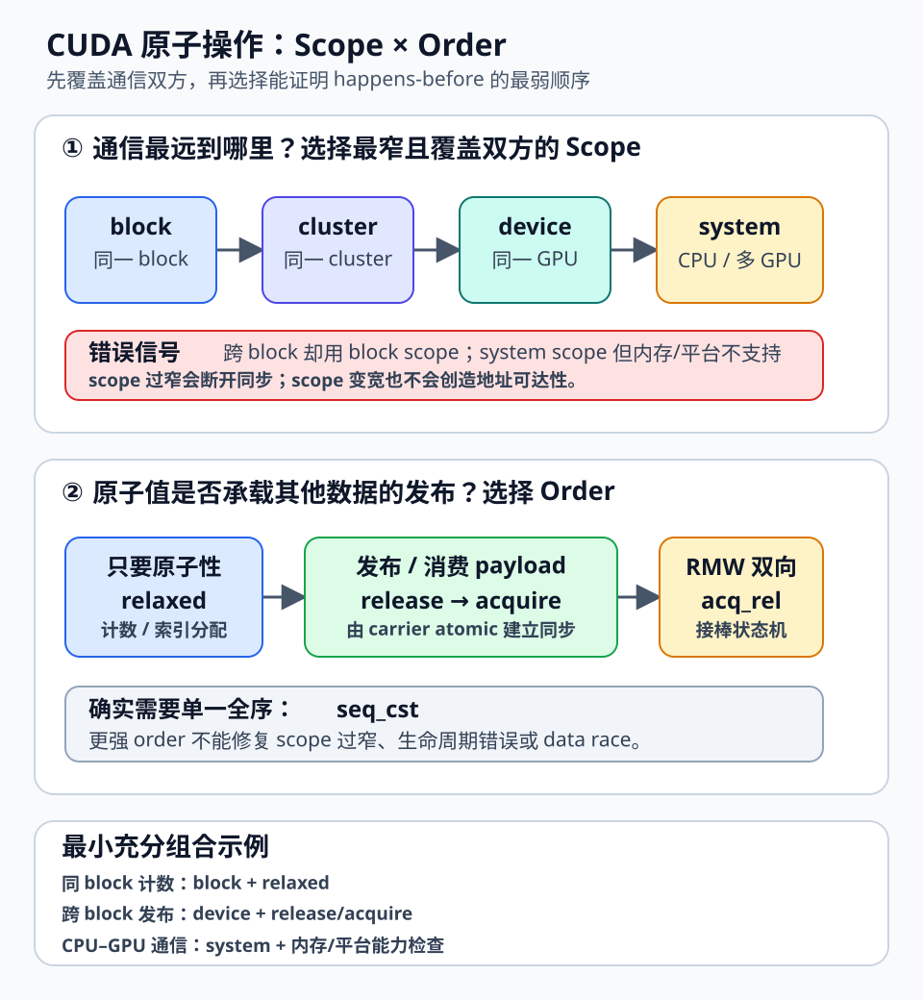
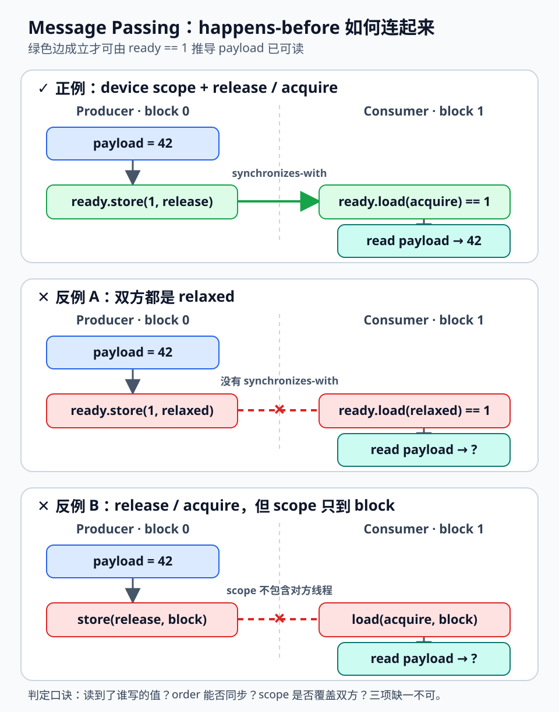

# CUDA 原子内存模型：Scope、Order 与 Fence 如何组合

<code>atomicAdd()</code> 能保证一次 read-modify-write 不被撕裂，却不自动保证另一个普通变量已经对消费者可见。许多 GPU 并发错误都来自把三个问题混在一起：

1. **原子性（atomicity）**：对同一对象的并发修改是否不可分割；
2. **顺序（memory order）**：原子操作前后的其他内存访问能否跨过它重排；
3. **作用域（thread scope）**：这份顺序保证覆盖哪些线程。

一个同步协议只有在三个维度同时正确时才成立。最稳妥的分析方法不是“在可疑位置补一个 <code>__threadfence()</code>”，而是画出 producer 到 consumer 的 **happens-before** 路径：哪些访问在同一线程内 sequenced-before，哪次 load 读到哪次 store，哪对操作 synchronizes-with，scope 是否覆盖通信双方。

> **图 1｜来源与许可：** 本站原创，依据 NVIDIA [CUDA C++ Memory Model](https://docs.nvidia.com/cuda/cuda-programming-guide/05-appendices/cuda-cpp-memory-model.html)、CCCL [cuda::atomic](https://nvidia.github.io/cccl/unstable/libcudacxx/extended_api/synchronization_primitives/atomic.html) 与 [PTX Memory Consistency Model](https://docs.nvidia.com/cuda/parallel-thread-execution/#memory-consistency-model) 整理；未复用第三方图像。原创站点内容，许可随本文使用。

## 1. 背景：atomicAdd 不等于“其他数据也可见”

考虑跨 block 的单生产者—单消费者通信。生产者先写 payload，再发布 ready flag：

~~~cpp
struct Mailbox {
  int payload;
  int ready;
};

__device__ Mailbox box;

__global__ void broken_message_passing() {
  if (blockIdx.x == 0 && threadIdx.x == 0) {
    box.payload = 42;
    atomicExch(&box.ready, 1);  // 原子更新 flag，但不要据此推导 payload 顺序
  }

  if (blockIdx.x == 1 && threadIdx.x == 0) {
    while (atomicAdd(&box.ready, 0) == 0) {}
    printf("%d\n", box.payload);
  }
}
~~~

即使 flag 的读写各自是原子的，也必须明确它们承担哪种 memory order 和 scope。正确协议要求：

~~~text
producer: payload write
      sequenced-before
producer: ready.store(1, release)
      synchronizes-with
consumer: ready.load(acquire) == 1
      sequenced-before
consumer: payload read
~~~

四条边连接后，payload write 才 happens-before payload read。若发布和观察 flag 都是 <code>relaxed</code>，中间没有 synchronizes-with 边；若使用 block scope 但双方位于不同 block，scope 又不能覆盖双方。两种情况都不能从“最终看见 ready == 1”推出 payload 可安全读取。

## 2. 三个正交维度

### 2.1 操作种类：load、store、RMW 与 fence

原子对象可以执行 load、store 和 read-modify-write（RMW，例如 <code>fetch_add</code>、<code>exchange</code>、<code>compare_exchange</code>）。fence 自身不访问 atomic object，只约束同一线程中它前后的内存操作。

RMW 解决的是“读旧值并写新值”整体不可分割的问题，并不天然要求最强顺序。例如，统计一个最终只在 kernel 完成后由 host 读取的计数器，<code>fetch_add(..., relaxed)</code> 往往已经足够：kernel completion 提供后续阶段边界，计数过程中并不借该计数器发布其他数据。

### 2.2 Memory order：从局部原子性到跨线程顺序

| Order | 典型用途 | 核心约束 |
|---|---|---|
| <code>relaxed</code> | 独立计数器、索引分配 | 只保证 atomic 本身与 modification order |
| <code>acquire</code> | 消费者 load/RMW | 后续访问不能越过 acquire 提前 |
| <code>release</code> | 生产者 store/RMW | 之前访问不能越过 release 推后 |
| <code>acq_rel</code> | 同时消费旧状态并发布新状态的 RMW | 同时具备 acquire 与 release |
| <code>seq_cst</code> | 需要单一全序的少数协议 | 在适用 scope 内增加 sequentially consistent 约束 |

普通 load 不能使用 release，普通 store 不能使用 acquire。<code>acq_rel</code> 主要用于 RMW 或 fence。不要把 <code>seq_cst</code> 当成“不理解协议时的保险”：它仍不能修复过窄 scope、错误生命周期或非原子 data race。

### 2.3 Thread scope：同步保证传播多远

常见层次从窄到宽为：

~~~text
thread ⊂ block ⊂ cluster ⊂ device ⊂ system
~~~

- **thread**：只涉及当前线程，主要服务于泛型代码和编译器约束；
- **block**：同一 thread block；
- **cluster**：同一 Thread Block Cluster，要求支持 cluster 的架构与工具链；
- **device**：同一 GPU 上的线程；
- **system**：系统中能够参与该内存通信的 GPU 与 CPU agent。

“scope 覆盖双方”是必要条件。跨 block 发布数据至少需要 device scope；CPU 与 GPU 通过可共同访问的内存通信时通常需要 system scope。为了避免非对称协议中的误判，工程上优先让 carrier atomic 两端采用同一最小充分 scope。

## 3. Scope 不匹配为什么会变成 data race

假设 producer 在 block 0，consumer 在 block 1，却都使用 block-scope atomic flag。每个操作在自己的 block 内可以是合法原子操作，但 producer 的 scope 不包含 consumer，consumer 的 scope 也不包含 producer。这对操作不能为两个 block 间的普通 payload 访问建立同步。

使用 <code>cuda::atomic_ref</code> 可以把 scope 写进类型：

~~~cpp
#include <cuda/atomic>

struct alignas(8) Mailbox {
  int payload;
  int ready;
};

__device__ Mailbox box;

__global__ void message_passing() {
  cuda::atomic_ref<int, cuda::thread_scope_device> ready(box.ready);

  if (blockIdx.x == 0 && threadIdx.x == 0) {
    box.payload = 42;
    ready.store(1, cuda::memory_order_release);
  }

  if (blockIdx.x == 1 && threadIdx.x == 0) {
    while (ready.load(cuda::memory_order_acquire) == 0) {}
    const int value = box.payload;
    printf("%d\n", value);
  }
}
~~~

<code>atomic_ref</code> 引用的对象必须满足类型、对齐和生命周期要求；同一存储位置也不能一边按不兼容的 atomic 表示访问，一边进行无同步的普通冲突访问。这里 payload 可以是普通 <code>int</code>，因为只有 producer 在 release 前写，consumer 只在 acquire 成功后读。

若两个通信线程在同一 block，scope 可收窄为 <code>thread_scope_block</code>。若它们属于同一 cluster，可在受支持的平台使用 cluster scope。若 block/cluster 归属在运行期并不确定，就不能靠“它们通常落得很近”收窄 scope。

## 4. Acquire–release：逐边证明消息传递

> **图 2｜来源与许可：** 本站原创，依据 NVIDIA [CUDA C++ Memory Model](https://docs.nvidia.com/cuda/cuda-programming-guide/05-appendices/cuda-cpp-memory-model.html) 与 ISO C++ [Order and consistency](https://eel.is/c++draft/atomics.order) 的关系定义整理；未复用第三方图像。原创站点内容，许可随本文使用。

正确示例可逐条证明：

1. <code>payload = 42</code> sequenced-before release store；
2. consumer 的 acquire load 读到 release store 写入的 <code>1</code>；
3. scope 覆盖双方时，release 与 acquire synchronizes-with；
4. acquire load sequenced-before payload read；
5. happens-before 具有传递性，因此 payload write happens-before payload read。

这也指出忙等循环的另一个工程问题：如果 producer 与 consumer 必须同时驻留，而 grid 或资源配置不能保证共驻，consumer 先占满可用资源时可能让 producer 无法运行。内存模型正确不等于调度必然前进。跨 block 自旋协议需要控制 occupancy、采用 cooperative launch/cluster，或改成 kernel 边界等不依赖未保证共驻的结构。

### relaxed 何时是正确选择

<code>relaxed</code> 适合只需原子性、不承担数据发布的场景：

- 计数器只需要最终值；
- 原子递增分配唯一索引，槽位另有生命周期协议；
- 引用计数的本次更新不负责对象销毁前的最终同步；
- 顺序已经由另一条明确的 acquire–release 链建立。

一旦程序从“观察某个原子值”推导“另一个位置的数据已准备好”，这个 atomic 就成为 carrier，通常需要 release/acquire 或等价 fence 协议。

## 5. Fence 不是“全局刷新按钮”

<code>__threadfence_block()</code>、<code>__threadfence()</code> 与 <code>__threadfence_system()</code> 在 CUDA Programming Guide 中分别对应 block、device 和 system scope 的 sequentially consistent fence。它们约束调用线程的内存顺序，但 fence 自身没有“让另一个线程自动看到”的目标对象。

生产者可把 release 放在 store 上：

~~~cpp
box.payload = 42;
ready.store(1, cuda::memory_order_release);
~~~

也可以拆成 fence 加 relaxed store：

~~~cpp
box.payload = 42;
cuda::atomic_thread_fence(
    cuda::memory_order_release, cuda::thread_scope_device);
ready.store(1, cuda::memory_order_relaxed);
~~~

consumer 仍以 device-scope acquire load 读到该 store 写入的值。按照 fence–atomic 同步规则，release fence 经由 carrier 建立顺序。该写法更容易在重构时把 fence 与 carrier 分开；没有特殊理由时，release store 更清晰。

孤立的 <code>box.payload = 42; __threadfence();</code> 没有发布事件和 acquire 端，不是完整协议。类似地，<code>volatile</code> 主要影响编译器访问行为，不能替代 atomic、memory order 或 happens-before。

## 6. 从 CUDA C++ 到 PTX

源码层优先使用 <code>cuda::atomic</code> / <code>cuda::atomic_ref</code>。编译器会根据架构与工具链映射到 PTX memory model：

~~~text
CUDA C++                         PTX 语义（示意）
device-scope relaxed RMW   ->   atom.relaxed.gpu...
device-scope acquire load  ->   ld.acquire.gpu... / 等价序列
system-scope release store ->   st.release.sys... / 等价序列
device-scope acq_rel fence ->   fence.acq_rel.gpu
~~~

重点是 order 与 <code>.cta/.cluster/.gpu/.sys</code> 限定符，而不是假设每个 C++ 操作必然对应一条固定机器指令。编译器可在保持语言语义的前提下合并、消除或改写指令；不同架构的 SASS 也可能不同。

~~~bash
nvcc -std=c++17 -O3 -lineinfo -keep atomic_example.cu
cuobjdump --dump-ptx atomic_example
cuobjdump --dump-sass atomic_example
~~~

PTX/SASS 检查适合发现 scope/order 意外变宽、额外 fence 或热点原子实现变化，但不能替代源码级正确性证明。PTX inline assembly 绕过一部分类型系统与编译器推理，只有高层 API 无法表达需求时才值得使用。

## 7. System scope 的边界

<code>thread_scope_system</code> 不自动创造地址可达性、缓存一致性能力或平台支持。CPU–GPU、多 GPU 协议至少要确认：

1. **内存能否被双方合法并发访问**：managed memory、mapped host memory、peer mapping 条件不同；
2. **原子类型和对齐是否兼容**：双方对同一对象采用受支持的原子访问；
3. **平台是否支持原生路径**：查询 <code>cudaDevAttrHostNativeAtomicSupported</code>、<code>cudaDevAttrConcurrentManagedAccess</code> 等 attributes；
4. **GPU peer atomics 是否支持**：查询 <code>cudaDevP2PAttrNativeAtomicSupported</code>；
5. **生命周期和迁移是否合法**：system scope 不能修复已释放、未映射或不允许并发访问的内存。

因此，“把 device 改成 system”不是通用跨设备修复。应先选定共享内存机制并查询能力，再设计双方支持的 atomic 协议，最后在目标 CPU、GPU、驱动和互连组合上验证。

## 8. Hopper 的 Memory Synchronization Domain 例外

Hopper（compute capability 9.0）与 CUDA 12 引入 memory synchronization domains，用来减少无关流量造成的 fence interference。kernel 可映射到 logical domain，driver 再映射到少量 physical domains。不同 domain 的写入彼此隔离，使某个 kernel 的 device-scope fence 不必等待另一个独立通信流量全部完成。

隔离也改变推理边界：**device-scope ordering 只覆盖当前 domain 内的相关写入，不能借它排序另一个 domain 的写入。** 当数据从一个 domain 交给另一个 domain，或最终提交给 CPU/其他系统 agent 时，需要按 NVIDIA 文档使用 system-scope fencing 跨越 domain。

这不是“所有 Hopper atomic 都改成 system”的理由。默认 domain 仍兼容旧代码；只有明确配置不同 domains 才把该边界纳入协议，并在必要交接使用 system scope、评估更宽 fence 的成本。

## 9. 工程流程：从通信关系推导实现

1. **枚举参与者与地址空间**：写清生产者、消费者位于同一 block、cluster、GPU、其他 GPU还是 CPU；确认 payload 与 carrier 的分配、对齐和生命周期。
2. **标出冲突访问**：列出每个共享对象的 reader、writer 与并发可能。冲突访问要么是 atomic，要么由 happens-before 排序。
3. **选择最窄且覆盖双方的 scope**：无法证明同 block/cluster 时提升到 device；确实跨 GPU/CPU 且平台支持时才用 system。
4. **选择最弱且足够的 order**：只要原子性用 relaxed；发布用 release；消费用 acquire；RMW 同时消费与发布用 acq_rel；确需单一全序才用 seq_cst。
5. **画 happens-before 图**：每条普通 payload 读写都要有完整路径。“硬件通常按这个顺序执行”不是证明。
6. **最后做性能优化**：尝试收窄 scope、减弱 order、分片热点或批量发布；每次改动重新验证。

## 10. 性能与资源模型

单次原子操作的成本可粗略写成：

~~~text
T_atomic ≈ T_address_path
         + T_serialization(same_address_contention)
         + T_ordering(order, scope, architecture)
         + T_queueing(memory_system_load)
~~~

热点地址的串行化常比 order 本身更昂贵。把 <code>seq_cst</code> 改成 <code>relaxed</code>，若仍有数千线程争抢一个 counter，收益可能远小于 warp aggregation、block-private counters 或分层归并。

scope/order 成本依赖架构、地址空间、缓存状态、编译器映射与拓扑，不能把某代 GPU 的周期数写成普遍常数。基准至少扫描：

- contention：每线程独立地址、每 warp、每 block、全局单热点；
- scope：block/cluster/device/system 中合法候选；
- order：relaxed、acq_rel、seq_cst 等协议允许候选；
- 通信距离：同 SM、同 GPC、跨 GPC、CPU–GPU、peer GPU；
- payload 大小、发布频率、occupancy、clock、MIG/MPS 与并发流量。

吞吐型原子报告 operations/s 与分位延迟；消息传递报告 hand-off latency；同时用 Nsight Compute 检查 memory stalls、atomic serialization 和 occupancy。只比较 kernel 总时间而不控制 contention pattern，通常无法解释结果。

## 11. 局限与验证方法

内存模型错误具有输入、时序和架构相关性，“连续运行一万次没错”仍不构成证明。建议建立 message passing、store buffering、对象发布、RMW 所有权传递，以及 scope mismatch 的同 block/跨 block 对照等 litmus tests。每个测试大量迭代，随机化 block、延迟和地址，并记录禁止结果。测试能暴露实现错误，不能替代形式化推理。

Compute Sanitizer 也有边界：<code>racecheck</code> 主要检测 shared-memory hazards，不能证明 global-memory scoped protocol 正确；<code>synccheck</code> 擅长 barrier/warp 同步误用；<code>memcheck</code> 处理越界与非法访问。它们应与源码审查、PTX/SASS 检查和硬件压力测试组合使用。

还要注意：

- kernel launch/stream/event 边界可能提供额外顺序，掩盖错误的 kernel 内协议；
- 调试输出和额外同步会改变时序；
- 一个 GPU 型号上的缓存行为不是语言保证；
- 更宽 scope 或更强 order 不能修复越界、use-after-free 或调度死锁；
- <code>volatile</code>、cache operator 和普通 load/store 不是 C++ atomic 的替代品。

## 12. 实践检查表

- [ ] 每个共享对象的 reader、writer、生命周期和地址空间已列出；
- [ ] 冲突访问要么是 compatible atomic，要么由 happens-before 排序；
- [ ] carrier atomic 的 scope 覆盖双方，未依赖偶然的 block/SM 落点；
- [ ] release 前完成 payload 写入，acquire 成功后才读取 payload；
- [ ] acquire 确实读到对应 release sequence 中的值；
- [ ] fence 通过明确 carrier 与另一端连接，不是孤立“刷新”；
- [ ] system-scope 协议已验证内存映射、原生 atomic、managed/peer 能力；
- [ ] 使用 memory synchronization domains 时已处理跨-domain 交接；
- [ ] 自旋协议不会因未保证共驻导致 forward-progress 问题；
- [ ] <code>atomic_ref</code> 的对象类型、对齐和生命周期满足要求；
- [ ] correctness test、litmus test 与禁止结果检查已自动化；
- [ ] PTX/SASS 只用于核对实现映射，没有替代语言级证明；
- [ ] 性能基准区分 contention、scope、order 与通信距离；
- [ ] 优化后重新验证 happens-before 图和目标架构。

## 参考资料

1. NVIDIA, [CUDA Programming Guide — CUDA C++ Memory Model](https://docs.nvidia.com/cuda/cuda-programming-guide/05-appendices/cuda-cpp-memory-model.html)
2. NVIDIA CCCL, [cuda::atomic extended API](https://nvidia.github.io/cccl/unstable/libcudacxx/extended_api/synchronization_primitives/atomic.html)
3. NVIDIA, [PTX ISA — Memory Consistency Model](https://docs.nvidia.com/cuda/parallel-thread-execution/#memory-consistency-model)
4. NVIDIA, [PTX ISA — atom instruction](https://docs.nvidia.com/cuda/parallel-thread-execution/#parallel-synchronization-and-communication-instructions-atom)
5. NVIDIA, [CUDA Programming Guide — Memory Synchronization Domains](https://docs.nvidia.com/cuda/cuda-programming-guide/04-special-topics/memory-sync-domains.html)
6. ISO C++ Working Draft, [Order and consistency](https://eel.is/c++draft/atomics.order)
