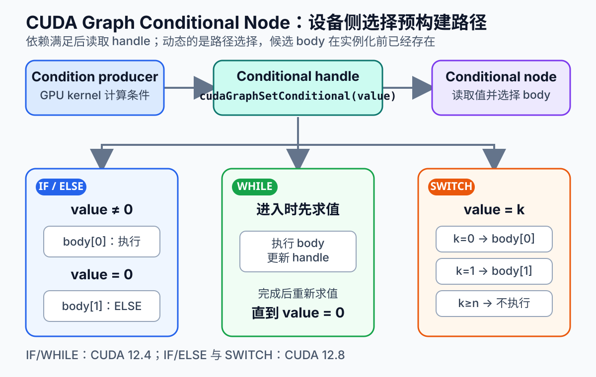
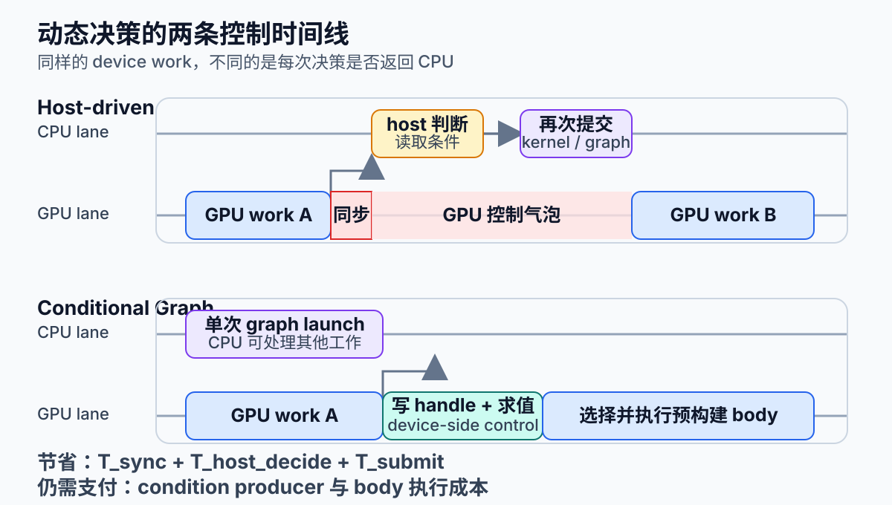

# CUDA Graph 条件节点：把动态控制流留在 GPU 上

CUDA Graph 擅长把重复工作流预先定义、实例化，再以很低的 CPU 提交开销反复启动。它特别适合由许多短 kernel 组成、依赖关系稳定的 timestep、推理流水线和迭代计算。不过，真实算法很少完全静态：迭代求解器要检查残差，稀疏计算会依据活跃元素选择路径，自适应网格也会在运行时决定是否继续细化。

传统实现通常在 GPU 计算完条件后，把结果同步给 CPU，由 host 判断下一步，再提交后续工作。这样会切断一张完整的 graph，并引入设备到主机的同步、host 决策和再次提交。Conditional Node 的作用，就是把结构化的 IF/ELSE、WHILE 和 SWITCH 放进已经实例化的 CUDA Graph：GPU kernel 写入 condition handle，运行时在设备侧选择预先构建好的 body graph。

它优化的是**控制路径**，不是算法本身。Conditional Node 能减少 host round-trip 和重复 launch，却不会自动减少 body kernel 的计算量，也不会替程序修正错误依赖或保证循环收敛。

*图 1：Conditional Node 的结构与 IF/ELSE、WHILE、SWITCH 语义。图源：本站原创示意图，依据 [CUDA Programming Guide：Conditional Graph Nodes](https://docs.nvidia.com/cuda/cuda-programming-guide/04-special-topics/cuda-graphs.html#cuda-graphs-conditional-graph-nodes) 与 NVIDIA Technical Blog 的 [Dynamic Control Flow in CUDA Graphs with Conditional Nodes](https://developer.nvidia.com/blog/dynamic-control-flow-in-cuda-graphs-with-conditional-nodes) 整理；未复用第三方图像。*

## 1. 背景：静态 Graph 为什么会被动态算法切断

CUDA Graph 的生命周期可以分成三个阶段：

1. **definition**：创建节点以及节点间依赖；
2. **instantiation**：校验并把 source graph 转换成 executable graph；
3. **execution**：把 executable graph 提交到 stream，可重复 launch 多次。

把逐 kernel 提交变成整图提交后，驱动可以把许多准备工作放到实例化阶段摊销。对单个执行时间很短的 kernel，这往往比继续优化几微秒的 device code 更有效。

问题出现在数据相关控制流。以收敛迭代为例：

~~~text
计算 residual（GPU）
    ↓
复制/同步 residual（GPU → CPU）
    ↓
host 判断是否收敛
    ↓
再次提交下一轮 kernel 或下一张 graph
~~~

如果每轮计算只需要几十微秒，而每轮都要同步和重新提交，CPU 与 GPU 之间的控制气泡就可能成为主要成本。更严重的是，host 同步会阻止 CPU 同时处理其他请求或其他 GPU 的工作。

Conditional Node 把候选路径预先放进 source graph，在 executable graph 运行时只读取条件值并选择 body。外层拓扑仍是预实例化的，动态的是“这一轮执行哪个预构建 body”。

## 2. 心智模型：handle、容器节点与 body graph

理解 Conditional Node，可以把它拆成三个对象：

- **cudaGraphConditionalHandle**：保存条件状态，必须先于 conditional node 创建，并归属于创建它的 graph；
- **conditional node**：读取 handle 并执行控制语义的容器节点；
- **body graph**：创建 conditional node 时由 CUDA 返回的空 graph，随后用显式 Graph API 或 cudaStreamBeginCaptureToGraph 填充。

设备代码通过 cudaGraphSetConditional(handle, value) 写条件值。Conditional Node 的前置依赖满足后，CUDA 在 device 侧求值；因此，负责写 handle 的 kernel 必须在依赖图上先于 conditional node 完成。仅仅“代码中先 launch”而没有正确 graph edge，不构成可靠的数据依赖。

还要区分 source graph 和 executable graph。source graph 描述结构；cudaGraphInstantiate 获取其快照并建立 executable graph；cudaGraphLaunch 执行的是后者。如果改变 source graph，旧 executable graph 不会自动同步变化，需要重新实例化，或在支持的范围内进行 graph exec update。

handle 的初值也不是可忽略的细节。创建 handle 时如果使用 cudaGraphCondAssignDefault，则每次 graph execution 开始都会写入指定默认值；如果不使用该 flag，每次执行开始时的值是未定义的，不能假设它会保留上一轮 launch 的结果。最稳妥的工程规则是：**每次读取前都由依赖链中的 kernel 明确设置，或者显式启用默认赋值。**

## 3. IF/ELSE、WHILE 与 SWITCH 的精确语义

### 3.1 IF 与 IF/ELSE

IF 在节点被求值时读取 handle：

- 非零：执行第 0 个 body 一次；
- 零：单 body 的 IF 什么也不做；
- CUDA 12.8 起，size 设为 2 时可提供第 1 个 ELSE body，条件为零时执行一次。

CUDA 12.4 首次提供 IF 与 WHILE；CUDA 12.8 增加 IF/ELSE 和 SWITCH。这里的版本描述是 Toolkit/API 功能演进，不等于“所有安装了对应 Toolkit 的 GPU 都自动满足部署条件”。上线前仍应核对目标驱动、Toolkit、设备支持和实际运行环境。

### 3.2 WHILE

WHILE 在进入节点时先求值。值为非零才执行 body；body 完成后再次求值，直到值变成零。因此真正的 while 语义需要在节点上游写好首次条件，并在 body 内更新下一轮条件。

如果 handle 用非零默认值初始化，同时上游不覆盖它，那么 body 至少执行一次，行为更接近 do-while。无论哪种写法，body 内都必须存在可到达的退出路径。对浮点残差，建议同时设置收敛阈值与 max_iter，避免 NaN、数值停滞或逻辑错误造成不可终止循环。

### 3.3 SWITCH

SWITCH 的 size 决定 body 数量 n。条件值等于零基索引 k 时，执行第 k 个 body 一次；值大于等于 n 时不执行任何 body。这个“越界即 no-op”的语义适合保留一个显式 skip 状态，但也可能掩盖错误分类值，因此调试版本应记录或检查越界计数。

SWITCH 并不是运行时创建新拓扑。所有 body 都在实例化前存在，运行时只选择其中一个。这也是 Conditional Node 能保留 graph 优势的根本原因。

## 4. 工程流程：构造一张收敛循环 Graph

典型构图顺序如下：

~~~text
cudaGraphCreate
  → cudaGraphConditionalHandleCreate
  → 添加负责初始化条件的上游 kernel
  → cudaGraphAddNode（cudaGraphNodeTypeConditional）
  → 取得 conditional.phGraph_out[i]
  → 填充一个或多个 body graph
  → cudaGraphInstantiate
  → cudaGraphLaunch（可重复）
~~~

下面是省略错误处理和普通 kernel 参数的结构化伪代码，展示 WHILE body 的关键关系：

~~~cpp
cudaGraph_t graph;
cudaGraphCreate(&graph, 0);

cudaGraphConditionalHandle handle;
cudaGraphConditionalHandleCreate(
    &handle, graph, 0, cudaGraphCondAssignDefault);

// initNode 计算初始 residual，并调用 cudaGraphSetConditional(handle, continue_flag)
cudaGraphNode_t initNode = addInitResidualNode(graph, handle);

cudaGraphNodeParams cond = { cudaGraphNodeTypeConditional };
cond.conditional.handle = handle;
cond.conditional.type = cudaGraphCondTypeWhile;
cond.conditional.size = 1;

cudaGraphNode_t whileNode;
cudaGraphAddNode(
    &whileNode, graph, &initNode, nullptr, 1, &cond);

cudaGraph_t body = cond.conditional.phGraph_out[0];
auto update = addSolverUpdateNode(body);
auto reduce = addResidualReductionNode(body, update);
addSetConditionNode(body, reduce, handle, tolerance, max_iter);

cudaGraphExec_t exec;
cudaGraphInstantiate(&exec, graph, 0);
cudaGraphLaunch(exec, stream);
~~~

body graph 可以全部用显式 Graph API 构造，也可以调用 cudaStreamBeginCaptureToGraph，把现有异步 stream 代码捕获到 CUDA 已创建的 body graph 中。前者便于精确控制依赖和参数，后者适合迁移已有 pipeline。无论采用哪种方式，都应在构图后使用 cudaGraphDebugDotPrint 或等价检查确认边没有遗漏。

销毁顺序通常是先确保所有 launch 已完成，再销毁 cudaGraphExec_t，随后销毁 source cudaGraph_t，最后释放 body 使用的内存与其他资源。conditional handle 没有独立 destroy API，它随所属 graph 管理；不要把一个 handle 绑定给多个 conditional node。

## 5. 正确性、上下文与生命周期约束

Conditional Node 不是任意代码容器。当前 Programming Guide 对 body graph 给出明确边界：

- graph 中的节点必须位于同一设备；
- body 可包含 kernel、empty、memcpy、memset、child graph 和 conditional node；
- body 可嵌套 conditional node，但要控制层次，避免难以验证的递归式结构；
- body 内 kernel 不允许使用 CUDA Dynamic Parallelism 或 Device Graph Launch；
- memcpy/memset 只能涉及 device memory 或 pinned device-mapped host memory，不能涉及 CUDA array；
- memcpy 两端必须在实例化时可由当前 device 访问，执行位置仍是 conditional graph 所在 device。

从工程角度，还应把以下约束写进 code review：

**第一，condition producer 必须在正确依赖链上。** 写 handle 的 kernel 与 conditional node 之间应有显式 full dependency。若 body 在每轮末尾更新条件，更新节点必须是 body 的必经末端，不能让某条并发支路尚未完成时提前进入下一轮。

**第二，不要把普通 host flag 当成 device-side 条件。** CPU 内存里的布尔值并不会自动获得 Conditional Node 语义。条件应通过 cudaGraphSetConditional 在设备代码中写入 handle。

**第三，退出条件必须防御异常数值。** 对 residual 检查 isfinite；对迭代数设置硬上限；必要时把退出原因写入 device buffer，graph 结束后再统一读取。

**第四，资源必须覆盖 executable graph 的使用期。** kernel 参数指向的 device allocation、映射内存与上下文，不能在 graph 仍可能执行时释放。更新参数后还要验证旧的 executable graph 是否仍引用旧对象。

## 6. 性能与资源模型：省掉什么，还要付什么

把每轮都回到 host 的方案近似写成：

~~~text
T_host = T_work
       + N_decision × (T_sync + T_host_decide + T_submit)
~~~

使用 Conditional Node 后，可以近似写成：

~~~text
T_cond = T_instantiate / N_reuse
       + T_work
       + N_decision × T_device_control
~~~

其中 T_device_control 包括写 handle 的 kernel、条件求值与 body 调度成本。它不是零，只是通常比 GPU→CPU 同步和再次提交更容易留在连续的 device 时间线上。实例化成本只有在 executable graph 被重复使用时才容易摊薄。

*图 2：Host-driven 决策与 device-side Conditional Graph 的控制时间线。图源：本站原创示意图，依据 NVIDIA Technical Blog 的 [Getting Started with CUDA Graphs](https://developer.nvidia.com/blog/cuda-graphs/) 与 [Enabling Dynamic Control Flow in CUDA Graphs with Device Graph Launch](https://developer.nvidia.com/blog/enabling-dynamic-control-flow-in-cuda-graphs-with-device-graph-launch/) 整理；未复用第三方图像。*

收益最可能出现在以下组合中：

- 每个阶段由大量短 kernel 组成；
- 决策频繁，并且条件来自 device 数据；
- body 拓扑稳定，可跨许多 timestep 或请求重复使用；
- host 同时管理多 GPU、多请求或通信任务，CPU 提交压力明显。

反过来，以下场景收益可能有限：

- 单个 body kernel 已经很重，host 控制只占极小比例；
- 每轮拓扑、临时内存或库调用参数剧烈变化，难以复用 executable graph；
- graph 只执行一两次，实例化无法摊销；
- condition producer 是低并行度 reduction，反而成为串行瓶颈；
- 条件分布极不均衡，某个昂贵 body 几乎总被选择，控制优化掩盖不了工作量。

资源模型也不能只看 launch 数。不同 body 仍会占用各自的寄存器、shared memory、workspace、L2/HBM 带宽；Conditional Node 不会预留“最优资源组合”。嵌套 body 很深时，调试信息和 profile 可读性也会下降。

## 7. 与其他动态执行机制怎么选

| 机制 | 决策位置 | 适合的问题 | 主要代价 |
| --- | --- | --- | --- |
| host-side graph exec update | CPU | CPU 已知的参数或有限拓扑变化 | 仍需要 host 参与，更新存在兼容性边界 |
| Conditional Node | GPU 条件值 | 固定外层拓扑中的结构化分支与循环 | body 必须预构建，节点类型受限 |
| Device Graph Launch | GPU kernel | 选择、尾启动或并发启动独立 executable graph | 规则和生命周期更复杂，不能在 conditional body kernel 内使用 |
| persistent kernel | GPU kernel 内部 | 极细粒度、低延迟、自定义调度 | 侵入性高，长期占用资源，调试更难 |

选择原则是看“动态性发生在哪里”。如果只是 kernel 参数变化，优先更新参数；如果 GPU 数据决定是否执行固定路径，Conditional Node 最贴合；如果要从设备侧组织多个独立 executable graph，考虑 Device Graph Launch；只有当控制粒度细到 graph 节点都嫌粗，并且团队能承担长期维护成本时，才考虑 persistent kernel。

## 8. HPC 案例与可复现实验

### 8.1 自适应迭代求解器

以预条件迭代法为例，WHILE body 可以包含：

1. 稀疏矩阵向量乘；
2. 向量更新；
3. residual reduction；
4. 检查 tolerance、isfinite 与 max_iter，并写 handle。

上游先计算初始 residual；若已经收敛，WHILE 一次也不进入。这样既保留严格 while 语义，也避免空跑第一轮。

### 8.2 稀疏或自适应 pipeline

一个轻量分类 kernel 可以统计活跃元素并写 SWITCH handle：

- body 0：无活跃元素，快速跳过；
- body 1：稀疏路径；
- body 2：稠密路径；
- 越界：调试模式记错，发布模式 no-op 或进入安全路径。

关键是保证各路径输出契约一致：后续节点不能依赖某个 body 才会写出的未初始化数据。

### 8.3 Benchmark 方案

至少比较三组：

1. 普通 stream：每轮 host 同步、判断、launch；
2. host-driven graph：每段使用 graph，但由 CPU 判断并再次 launch；
3. conditional graph：一次 launch 内由 device 控制 IF/WHILE/SWITCH。

控制变量包括输入数据、实际迭代数、kernel 配置、频率状态和 warm-up 次数。报告以下指标：

- CPU wall time 与 GPU event time；
- 每次决策平均延迟与 P50/P95/P99；
- Nsight Systems 中 host sync、launch gap 和 GPU idle gap；
- 总迭代数、退出原因和最终数值误差；
- graph definition/instantiation 的一次性成本与复用次数；
- 各 body 的命中率、单独耗时与 condition producer 耗时。

不要只报告“launch 次数减少”。先验证三种实现输出等价、迭代数一致，再看端到端时间。GPU event 不包含所有 host 等待，所以必须同时记录 wall-clock；短任务还应批量运行多次，扣除或单独报告 warm-up。

## 9. 局限与常见误区

- **不是任意动态拓扑。** 运行时只能在预建 body 中选择，不能根据数据临时创建新节点。
- **不是零开销分支。** handle producer、条件求值和 body 调度都有成本。
- **不是自动收敛器。** WHILE 的终止完全依赖程序正确更新 handle。
- **不是自动负载均衡。** SWITCH 选择不同工作量的 body 时，批次间延迟仍可能抖动。
- **不是 host 逻辑的无条件替代。** 文件 I/O、复杂控制面、跨进程协调仍更适合 CPU。
- **不是版本号检查就够了。** 需要在实际 driver、Toolkit、GPU 和部署容器组合上编译、运行并 profile。

## 10. 实践检查表

- [ ] 目标环境支持所需的 Conditional Node 类型；IF/WHILE 与 IF/ELSE/SWITCH 的 Toolkit 版本要求已区分。
- [ ] 外层拓扑与 body 能跨足够多次 launch 复用，实例化成本可摊销。
- [ ] 每个 handle 只关联一个 conditional node，初值由上游 kernel 或 cudaGraphCondAssignDefault 明确定义。
- [ ] condition producer 到 conditional node 有显式依赖，WHILE body 每条路径最终都会更新或终止条件。
- [ ] 循环同时检查 tolerance、isfinite 与 max_iter，并能记录退出原因。
- [ ] body 节点类型、单设备要求、memcpy/memset 可达性满足文档约束。
- [ ] 所有 device allocation、映射内存、context 与 executable graph 生命周期匹配。
- [ ] SWITCH 越界语义已显式处理，各 body 的输出契约一致。
- [ ] benchmark 同时记录 wall-clock、GPU event、迭代数与数值误差。
- [ ] Nsight Systems 证明 host sync/launch gap 确实减少，而不是只把瓶颈移到 condition kernel。

## 参考资料

1. NVIDIA, [CUDA Programming Guide — CUDA Graphs / Conditional Graph Nodes](https://docs.nvidia.com/cuda/cuda-programming-guide/04-special-topics/cuda-graphs.html#cuda-graphs-conditional-graph-nodes).
2. NVIDIA, [CUDA Runtime API — Graph Management](https://docs.nvidia.com/cuda/cuda-runtime-api/group__CUDART__GRAPH.html).
3. NVIDIA Technical Blog, [Dynamic Control Flow in CUDA Graphs with Conditional Nodes](https://developer.nvidia.com/blog/dynamic-control-flow-in-cuda-graphs-with-conditional-nodes).
4. NVIDIA Technical Blog, [Enabling Dynamic Control Flow in CUDA Graphs with Device Graph Launch](https://developer.nvidia.com/blog/enabling-dynamic-control-flow-in-cuda-graphs-with-device-graph-launch/).
5. NVIDIA Technical Blog, [Getting Started with CUDA Graphs](https://developer.nvidia.com/blog/cuda-graphs/).
