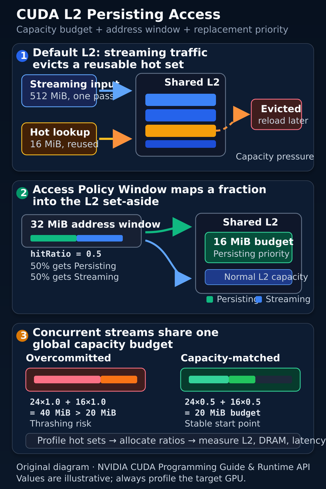

# CUDA L2 持久化缓存：用 Access Policy Window 管住热点数据

许多 GPU 程序同时包含两类访问：体量大、只读一遍或少量几遍的流式数据，以及体量较小、会被多个 thread block 反复读取的 lookup table、参数块或索引结构。默认 L2 替换策略并不知道哪一类数据对应用更重要。当大型流式访问持续进入 L2，小型热点集可能在两次复用之间被驱逐，随后又从显存重新取回。

CUDA 在 compute capability 8.0 及以上设备上提供 **L2 persisting access**。它不是把某段内存锁死在缓存中，而是给替换策略增加优先级提示：

1. 从共享 L2 中划出一部分 set-aside 容量；
2. 用 Access Policy Window 描述一个连续虚拟地址区间；
3. 通过 <code>hitRatio</code> 让窗口中的一部分 cache line 获得 <code>Persisting</code> 属性，其余访问采用 <code>Streaming</code> 或 <code>Normal</code> 属性。

真正的优化目标不是把每个窗口的 <code>hitRatio</code> 都设成 1，而是让“被标记为 persisting 的活跃数据量”与有限的 set-aside 容量匹配，并为并发 stream 留出预算。

> **图 1｜来源与许可：** 本站原创，依据 NVIDIA [CUDA Programming Guide 13.1：L2 Cache Control](https://docs.nvidia.com/cuda/archive/13.1.0/cuda-programming-guide/04-special-topics/l2-cache-control.html) 与 [CUDA Runtime API：cudaAccessPolicyWindow](https://docs.nvidia.com/cuda/cuda-runtime-api/cuda_runtime_api/structcudaAccessPolicyWindow.html) 整理；未复用第三方图像。原创站点内容，许可随本文使用。图中的容量与比例只用于解释机制，不代表通用最优配置。

## 1. 背景：流式流量如何淹没热点集

考虑一个反复执行的 kernel：

~~~text
每轮读取 512 MiB 输入流
+ 反复查询 16 MiB 表
+ 写出结果
~~~

若查询表在每轮中有较高 temporal reuse，理想情况是它在第一次装入后尽量留在 L2；输入流则读完即可被替换。但在普通替换策略下，两类 cache line 共享同一容量和替换优先级。输入流的 working set 远大于 L2 时，会持续制造 capacity pressure，热点表可能在下一次查询前已经被冲走。

这个问题并不总值得用 persisting L2。至少要先确认：

- 热点区间在一段时间内稳定，且具有可观复用；
- 热点规模与可用 L2 容量处于同一数量级；
- 复用距离没有长到使保留失去意义；
- kernel 的瓶颈确实与 L2 miss、DRAM 流量或 memory latency 有关；
- 地址窗口是连续区间，或能够拆成少量连续区间。

若工作集几乎没有复用，或者 kernel 受 Tensor Core、整数流水线、同步或 launch latency 限制，调整 L2 属性通常不会带来有效收益。

## 2. 机制：容量、窗口与访问属性是三层控制面

### 2.1 Set-aside 只是在共享 L2 中预留替换空间

host 侧用 <code>cudaDeviceSetLimit(cudaLimitPersistingL2CacheSize, bytes)</code> 请求 set-aside。请求值不能超过设备属性 <code>persistingL2CacheMaxSize</code>，工程上常从下式起步：

~~~text
set_aside =
  min(0.75 × l2CacheSize,
      persistingL2CacheMaxSize)
~~~

这里的“预留”不是创建一块只能由某个 stream 使用的私有 cache。多个 stream、多个 Access Policy Window 仍共享同一份 set-aside；正常 L2 流量和实际替换行为也受架构与运行状态影响。该 API 表达的是容量上限和替换优先级，不是命中保证。

### 2.2 Access Policy Window 描述连续地址区间

<code>cudaAccessPolicyWindow</code> 包含五个关键字段：

| 字段 | 含义 | 工程约束 |
|---|---|---|
| <code>base_ptr</code> | 窗口起始地址 | 必须指向有效设备可访问区间 |
| <code>num_bytes</code> | 窗口长度 | 不得超过 <code>accessPolicyMaxWindowSize</code> |
| <code>hitRatio</code> | 应用 <code>hitProp</code> 的近似比例 | 范围为 0 到 1；不是实测命中率 |
| <code>hitProp</code> | “命中段”采用的属性 | 常设为 <code>cudaAccessPropertyPersisting</code> |
| <code>missProp</code> | 其余段采用的属性 | 常设为 <code>Streaming</code> 或 <code>Normal</code> |

stream 属性作用于之后提交到该 stream 的 kernel。它不会改变指针本身，也不会把数据立即搬进 L2；cache line 仍要由实际 load 首次填入。

### 2.3 Persisting、Streaming、Normal 都是替换提示

- <code>Persisting</code>：提高对应 line 留在 L2 中的优先级；
- <code>Streaming</code>：降低保留优先级，让一次性数据更容易被替换；
- <code>Normal</code>：恢复普通访问属性，用于撤销此前的持久化倾向。

因此，“persisting”不能翻译成 cache pinning。line 仍可能因容量竞争、其他窗口、上下文状态或硬件策略被驱逐。

## 3. hitRatio：概率分配，不是观测命中率

<code>hitRatio=0.5</code> 不表示“希望 L2 hit rate 达到 50%”。它表示 CUDA 对窗口内地址做近似比例划分：约一半地址段采用 <code>hitProp</code>，其余采用 <code>missProp</code>。具体哪些 line 被选中不应成为程序正确性的依赖。

假设：

~~~text
window = 32 MiB
set-aside budget = 16 MiB
~~~

若 <code>hitRatio=1.0</code>，32 MiB 窗口都倾向于占用只有 16 MiB 的 set-aside。热点 line 会彼此竞争和自相驱逐，保留效果可能反而不稳定。以 <code>hitRatio=0.5</code> 起步，期望 persisting footprint 约为 16 MiB，更符合容量约束。

单窗口的第一版估算可以写成：

~~~text
hitRatio_start =
  min(1,
      allocatable_set_aside / active_window_bytes)
~~~

这只是容量模型，不是性能结论。窗口内部访问分布若高度偏斜，等概率选择未必正好命中最热的 line；更好的办法可能是重新布局数据，把真正热点压缩到独立连续区间，再给这个区间更高比例。

## 4. Stream 工程流程：先查询，再约束，再配置

下面的骨架完整检查 compute capability、set-aside 上限、窗口上限和 CUDA API 返回值。示例假设 <code>hot_ptr</code> 指向一段已分配的热点设备内存。

~~~cpp
#include <cuda_runtime.h>

#include <algorithm>
#include <cstdio>
#include <cstdlib>

#define CUDA_CHECK(call) do {                                      \
  cudaError_t err__ = (call);                                      \
  if (err__ != cudaSuccess) {                                      \
    std::fprintf(stderr, "%s:%d: %s\n", __FILE__, __LINE__,       \
                 cudaGetErrorString(err__));                        \
    std::exit(EXIT_FAILURE);                                       \
  }                                                                \
} while (0)

static cudaStream_t make_persisting_stream(
    int device, void* hot_ptr, size_t hot_bytes,
    size_t requested_set_aside) {
  CUDA_CHECK(cudaSetDevice(device));

  cudaDeviceProp prop{};
  CUDA_CHECK(cudaGetDeviceProperties(&prop, device));

  if (prop.major < 8 || prop.persistingL2CacheMaxSize == 0) {
    std::fprintf(stderr, "persisting L2 is unavailable\n");
    std::exit(EXIT_FAILURE);
  }
  if (hot_ptr == nullptr || hot_bytes == 0) {
    std::fprintf(stderr, "invalid access-policy window\n");
    std::exit(EXIT_FAILURE);
  }
  if (hot_bytes > prop.accessPolicyMaxWindowSize) {
    std::fprintf(stderr,
        "window=%zu exceeds device maximum=%d\n",
        hot_bytes, prop.accessPolicyMaxWindowSize);
    std::exit(EXIT_FAILURE);
  }

  const size_t recommended_cap = std::min(
      static_cast<size_t>(prop.l2CacheSize) * 3 / 4,
      static_cast<size_t>(prop.persistingL2CacheMaxSize));
  const size_t set_aside =
      std::min(requested_set_aside, recommended_cap);

  if (set_aside == 0) {
    std::fprintf(stderr, "zero persisting-L2 budget\n");
    std::exit(EXIT_FAILURE);
  }

  CUDA_CHECK(cudaDeviceSetLimit(
      cudaLimitPersistingL2CacheSize, set_aside));

  size_t effective_limit = 0;
  CUDA_CHECK(cudaDeviceGetLimit(
      &effective_limit, cudaLimitPersistingL2CacheSize));

  cudaStream_t stream{};
  CUDA_CHECK(cudaStreamCreateWithFlags(
      &stream, cudaStreamNonBlocking));

  cudaStreamAttrValue attr{};
  attr.accessPolicyWindow.base_ptr = hot_ptr;
  attr.accessPolicyWindow.num_bytes = hot_bytes;
  attr.accessPolicyWindow.hitRatio = std::min(
      1.0, static_cast<double>(effective_limit) /
               static_cast<double>(hot_bytes));
  attr.accessPolicyWindow.hitProp =
      cudaAccessPropertyPersisting;
  attr.accessPolicyWindow.missProp =
      cudaAccessPropertyStreaming;

  CUDA_CHECK(cudaStreamSetAttribute(
      stream, cudaStreamAttributeAccessPolicyWindow, &attr));
  return stream;
}
~~~

生产实现还应做到：

1. 对窗口大小超过设备上限的情况显式分段或重新布局，而不是静默截断；
2. 让同一 stream 上真正消费热点数据的 kernel 位于配置之后；
3. 在所有失败路径上销毁已经创建的 stream 和 allocation；
4. 记录设备、driver、toolkit、L2 大小、实际 limit 与窗口参数，保证实验可复现；
5. 不把 <code>requested_set_aside</code> 当成最终生效值，应读取并记录有效 limit。

## 5. CUDA Graph：属性属于 kernel node

Graph 场景不能只在 launch stream 上设置一次属性并假设所有既有节点都会改变。应给目标 kernel node 设置 <code>cudaKernelNodeAttributeAccessPolicyWindow</code>：

~~~cpp
cudaKernelNodeAttrValue value{};
value.accessPolicyWindow.base_ptr = hot_ptr;
value.accessPolicyWindow.num_bytes = hot_bytes;
value.accessPolicyWindow.hitRatio = hit_ratio;
value.accessPolicyWindow.hitProp =
    cudaAccessPropertyPersisting;
value.accessPolicyWindow.missProp =
    cudaAccessPropertyStreaming;

CUDA_CHECK(cudaGraphKernelNodeSetAttribute(
    kernel_node,
    cudaKernelNodeAttributeAccessPolicyWindow,
    &value));
~~~

属性属于 node，而不是普通 kernel 参数。若 graph 会 update、clone 或重新实例化，应把节点属性纳入回归检查；不要只验证一次 graph launch 的总时间。

## 6. 并发 stream：共享预算必须按总量计算

设有两个同时活跃的窗口：

~~~text
window_A = 24 MiB, hitRatio_A = r_A
window_B = 16 MiB, hitRatio_B = r_B
set-aside = 20 MiB
~~~

粗略容量约束为：

~~~text
24 MiB × r_A + 16 MiB × r_B <= 20 MiB
~~~

如果两个窗口都设为 1.0，期望 persisting footprint 为 40 MiB，超过预算一倍。两个 workload 会争用同一 set-aside，并使彼此的热点 line 抖动。更合理的起点可能是 <code>r_A=0.5</code>、<code>r_B=0.5</code>，总量约 20 MiB；随后根据业务优先级和实测收益重新分配。

这个模型还要乘上“同时活跃”的时间关系。若 A 与 B 严格串行，可以复用同一预算并在阶段边界更换窗口；若二者只偶尔重叠，则需要重点观察重叠区间的 tail latency，而不只是整段平均吞吐。

推荐调参顺序：

1. 用 profile 找出稳定热点集和复用阶段；
2. 决定全局 set-aside，不先为每个 stream 独立最大化；
3. 为所有可能并发的窗口分配 <code>window_bytes × hitRatio</code>；
4. 从容量匹配点向两侧扫描比例；
5. 同时记录性能收益与其他 workload 的退化；
6. 并发形态变化时重新预算。

### MPS 与 MIG 边界

根据 CUDA Programming Guide 的限制：

- **MIG 模式下，L2 set-aside 功能被禁用；**
- **MPS 模式下，不能在 client 进程内用 <code>cudaDeviceSetLimit</code> 修改该容量。** 需要在 MPS server 启动时通过 NVIDIA 指定的配置方式设置默认 persisting L2 百分比限制。

因此，运行模式是实验元数据的一部分。裸卡、MPS 与 MIG 结果不能直接混为一谈。

## 7. 生命周期：阶段结束后显式复位

过期 persisting line 可能继续占用替换优先级，挤压后续普通 workload。官方文档不保证它们会在某个确定时间自动恢复，所以应用应在阶段边界显式清理。

仅撤销某个 stream 的窗口：

~~~cpp
CUDA_CHECK(cudaStreamSynchronize(stream));

cudaStreamAttrValue reset{};
reset.accessPolicyWindow.num_bytes = 0;

CUDA_CHECK(cudaStreamSetAttribute(
    stream, cudaStreamAttributeAccessPolicyWindow, &reset));
~~~

若需要把一个区间恢复为普通属性，可对同一区间设置 <code>Normal</code> 属性；若确定当前 context 中所有 persisting 状态都应清除，可在相关工作完成后调用：

~~~cpp
CUDA_CHECK(cudaCtxResetPersistingL2Cache());
~~~

全局 reset 的作用域更大，不应在仍依赖 persisting 属性的并发阶段中随意调用。安全流程是：停止新提交，等待相关 stream 或 event，撤销窗口，再按所有权决定是否执行 context 级 reset。

## 8. 性能与资源模型：收益来自减少昂贵 miss

一个简化时间模型是：

~~~text
T_total =
  T_compute
  + N_L2_hit  × L_L2
  + N_DRAM     × L_DRAM
  + T_memory_queueing
  + T_launch_and_sync
~~~

Access Policy Window 主要尝试把一部分可复用访问从 DRAM 路径转成 L2 路径，并减少 DRAM bytes 与排队压力。它不会增加算力，也不会修复低 occupancy、分支发散或同步串行化。

容量模型可写为：

~~~text
P = Σ(active_window_i × hitRatio_i)

当 P << set-aside：
  可能仍有可分配空间，但收益受真实复用限制。

当 P ≈ set-aside：
  通常是值得测试的容量匹配点。

当 P >> set-aside：
  persisting line 互相竞争，自相驱逐风险上升。
~~~

<code>P</code> 只是期望 footprint。cache line 粒度、地址映射、访问偏斜、其他 L2 用户和阶段重叠都会让实测偏离模型。

## 9. 可复现实验：四组配置与联合指标

建议至少比较四组：

1. **Baseline**：不设置 set-aside 和窗口；
2. **Single-window**：一个热点窗口，扫描 <code>hitRatio</code>；
3. **Capacity-matched**：令期望 footprint 接近 set-aside；
4. **Concurrent**：两个或更多真实 stream 同时运行，比较独立最大化与共享预算。

固定输入、clock policy 和并发形态，预热后重复测量，并同时记录：

- 端到端吞吐、平均延迟与 P95/P99；
- kernel duration 与阶段边界；
- L2 hit rate、L2 read sectors/bytes；
- DRAM read/write bytes 与 memory throughput；
- memory dependency/queueing stall；
- 功耗、频率、温度；
- GPU 型号、compute capability、driver、toolkit、MPS/MIG 模式；
- set-aside、窗口地址/大小、<code>hitRatio</code>、<code>hitProp</code> 与 <code>missProp</code>。

Nsight Systems 用于确认 stream 重叠和阶段关系；Nsight Compute 用于观察 L2、DRAM 与 stall 指标。不要只看 L2 hit rate：若额外命中没有落在关键路径，或者牺牲了另一个更重要 workload，命中率变高也不代表系统更快。

## 10. 局限与反例

以下情形通常不适合这项优化：

- 工作集远大于 L2，且没有可分离的小型热点；
- 数据几乎只访问一次，缺少 temporal reuse；
- 访问完全随机，热点集合随请求快速变化；
- kernel 主要受计算、同步、launch latency 或网络限制；
- 热点窗口超过设备窗口上限，又无法合理分段或重排；
- 多个并发窗口的总预算无法稳定控制；
- 运行在禁用 set-aside 的 MIG 配置；
- 应用无法在生命周期结束时可靠撤销属性。

即使条件合适，收益也依赖 GPU 架构、L2 容量、地址分布和并发压力。文档给出的机制不能替代目标平台实测，更不能承诺固定加速比。

## 11. 实践检查表

- [ ] 目标设备 compute capability 为 8.0 或更高；
- [ ] 已查询 <code>l2CacheSize</code>、<code>persistingL2CacheMaxSize</code> 与 <code>accessPolicyMaxWindowSize</code>；
- [ ] 热点区间连续、稳定且确有 temporal reuse；
- [ ] <code>num_bytes</code> 未超过设备窗口上限；
- [ ] <code>hitRatio</code> 被理解为属性分配比例，而不是 L2 命中率；
- [ ] 没有把 <code>Persisting</code> 描述或依赖为 cache lock；
- [ ] 所有并发窗口按 <code>Σ(window × ratio)</code> 共用同一容量预算；
- [ ] Graph 属性设置在正确的 kernel node 上；
- [ ] MPS/MIG 模式和对应限制已记录；
- [ ] 阶段结束后撤销窗口，并按所有权决定是否 context 级 reset；
- [ ] baseline、单窗口、容量匹配和并发竞争四组实验均可复现；
- [ ] 同时报告端到端性能、L2、DRAM、stall 和其他 workload 退化；
- [ ] 每个 CUDA API 返回值与清理路径都已检查；
- [ ] 真实生产并发形态变化时重新做容量预算。

## 小结

CUDA L2 persisting access 的本质是“容量预算 + 地址窗口 + 替换优先级”，不是 cache locking。set-aside 决定共享预算，Access Policy Window 决定作用区间，<code>hitRatio</code> 决定其中约有多少数据采用 persisting 属性。

最容易犯的错误是把所有窗口都设成 <code>hitRatio=1.0</code>。当期望 persisting footprint 超过 set-aside 时，热点会彼此驱逐，多个 stream 还会互相争抢。可靠的工程方法是先 profile 热点与复用，再按并发总量分配比例，用端到端性能和 L2/DRAM 指标联合验证，最后在生命周期结束时显式复位。

## 参考资料

1. NVIDIA, [CUDA Programming Guide 13.1 — L2 Cache Control](https://docs.nvidia.com/cuda/archive/13.1.0/cuda-programming-guide/04-special-topics/l2-cache-control.html)
2. NVIDIA, [CUDA Runtime API — cudaAccessPolicyWindow](https://docs.nvidia.com/cuda/cuda-runtime-api/cuda_runtime_api/structcudaAccessPolicyWindow.html)
3. NVIDIA, [CUDA Runtime API — Device Management](https://docs.nvidia.com/cuda/cuda-runtime-api/cuda_runtime_api/group__CUDART__DEVICE.html)
4. NVIDIA, [Hopper Tuning Guide — Memory System](https://docs.nvidia.com/cuda/hopper-tuning-guide/index.html#memory-system)
