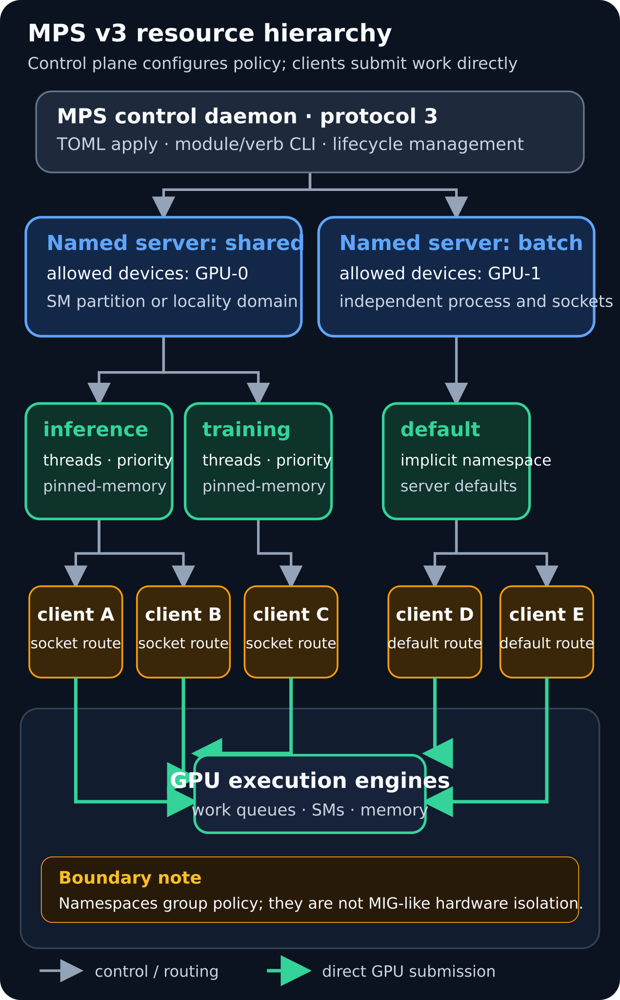
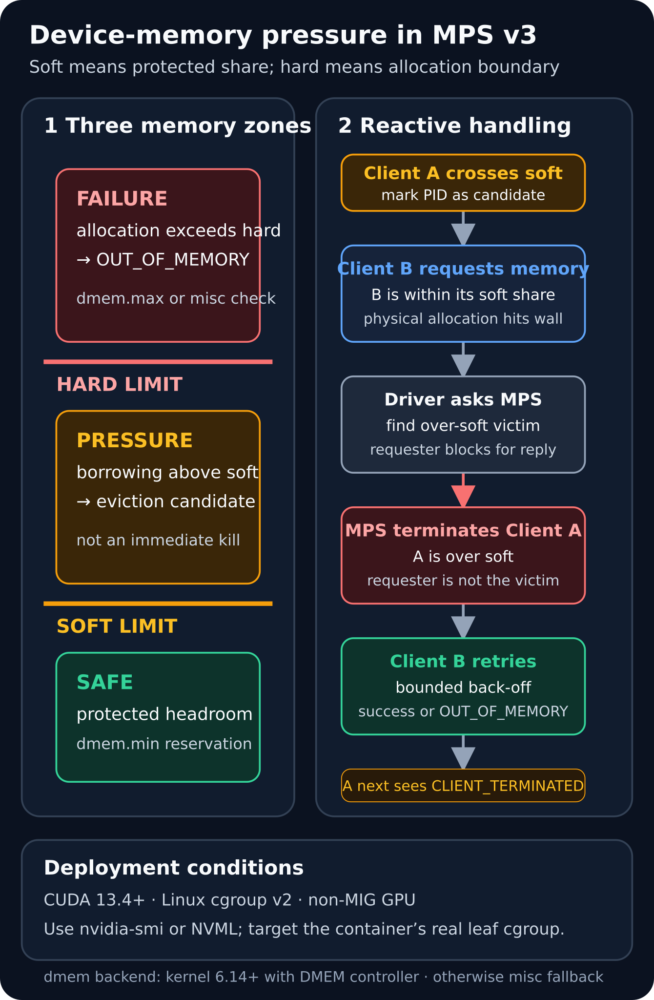

# CUDA MPS v3：把共享 GPU 变成可声明的多租户资源层

在 MPI、推理微服务和多实验并行场景里，“多个进程都能看到同一张 GPU”并不等于“GPU 被高效、可预测地共享”。每个 CUDA 进程通常拥有独立 context；没有 MPS 时，不同 context 的计算工作由 GPU 的 time-sliced scheduler 调度，不能像同一 context 内的 Hyper-Q work queue 那样自然并发。某个进程的 kernel 没有填满设备时，空闲 SM 也可能无法被另一个 context 及时利用。

Multi-Process Service（MPS）的基本价值，是让多个 CUDA 进程的工作可以在 GPU 上并发调度。Volta 及更新架构中，客户端保留独立 GPU 地址空间，并直接向硬件提交工作；MPS server 协调共享资源，但不经过关键执行路径。MPS v3 进一步把管理方式升级为显式选择的 protocol 3：具名 server、namespace、module/verb CLI、TOML 启动配置、静态 SM 分区，以及基于 cgroup v2 的显存治理共同组成一层可脚本化控制面。

这并不把 MPS 变成 MIG。MPS 提高的是并发效率和资源治理能力；安全、故障、缓存和带宽隔离仍有限。正确的工程问题不是“是否打开 MPS”，而是：哪些资源能被限制、哪些能被保留、哪个边界承担故障，以及如何证明吞吐与 P99 同时满足目标。

*图源与许可：本站原创，许可随本文使用；未复用、裁切或描摹第三方图像。机制依据 NVIDIA [MPS Architecture](https://docs.nvidia.com/deploy/mps/latest/architecture.html)、[MPS v3 Interface](https://docs.nvidia.com/deploy/mps/latest/mpsv3-interface.html)、[MPS v3 Namespaces](https://docs.nvidia.com/deploy/mps/latest/mpsv3-namespaces.html) 与 [MPS v3 Configuration File](https://docs.nvidia.com/deploy/mps/latest/mpsv3-configuration-file.html) 整理。*

## 1. 背景：默认多进程共享为什么仍会留下空洞

CUDA stream 是 context 内的有序命令序列。驱动把 stream 映射到 GPU work queue；支持 Hyper-Q 的 GPU 可以并发调度同一 context 的多个 work queue。跨 context 则是另一条路径：GPU 用 time slicing 在 context 之间切换，来自不同 context 的计算工作不能按同一 context 的方式同时执行。

这会带来两类损失：

1. **空间空洞**：当前 context 的 kernel 只有少量 block，无法占满全部 SM，但其他 context 仍在等待其时间片；
2. **时间空洞**：短 kernel、同步点和 CPU 提交间隙使时间片内没有足够工作，context 切换又增加可见等待。

MPS 让各客户端的工作具备并发调度条件，尤其适合单进程无法填满 GPU 的 MPI rank、多个中小推理实例和包含大量短 kernel 的流水线。它并不保证“进程数越多越快”：如果单个作业已经压满 SM、HBM 或 copy engine，再增加客户端只会制造竞争。

评估共享方案至少要同时观察四个维度：

- **利用率**：GPU active、SM active、occupancy 与 work queue 是否存在空洞；
- **服务质量**：吞吐之外的 P50/P95/P99/P99.9、排队时间与抖动；
- **资源可预测性**：SM、显存、pinned memory、连接数和进程数能否被约束；
- **隔离边界**：地址空间、故障传播、缓存/带宽争用和租户信任关系。

## 2. 控制面：daemon、named server、namespace 与 client

MPS v3 是 opt-in 接口。Legacy MPS v2 仍是默认 protocol 2；启动时必须显式选择 protocol 3：

    nvidia-cuda-mps-control -d -p 3

也可以在控制进程环境中设置 CUDA_MPS_PROTOCOL_VERSION=3。若 daemon 已经运行，之后的控制命令会跟随现有 daemon 的协议版本，不能靠单次命令的 -p 参数切换。

### 2.1 named server 决定设备与进程边界

Legacy MPS v2 的典型模型是每个 UID 同时只有一个活动 server。MPS v3 可以创建多个并发运行、独立管理的 named server。server 可以指定：

- owner UID；
- allowed devices；
- 默认 namespace 的 pinned-memory limit、active-thread percentage 和 client priority；
- 是否启用 locality domains；
- server 进程、日志和 socket 目录。

allowed devices 是设备可见边界，不是容量保证。把 GPU-0 分给某个 named server，只说明该 server 可以管理它；若系统还有绕过 MPS 的普通 CUDA 进程，仍可能发生竞争。生产环境通常配合 EXCLUSIVE_PROCESS compute mode，让 MPS server 成为该 GPU 的主要仲裁点。

### 2.2 namespace 是客户组策略，不是硬件隔离实例

每个 server 都有隐式 default namespace，还可以建立 training、inference 等自定义 namespace。每个 namespace 独立设置：

- pinned-memory limit；
- active-thread percentage；
- client priority，取值 0（normal）或 1（below normal）。

客户端通过 UNIX domain socket 选择 namespace。例如 server 名为 shared、namespace 名为 inference，则客户端把 CUDA_MPS_PIPE_DIRECTORY 指向 server pipe directory 下的 shared/inference。指向 shared 本身会进入 default namespace；指向顶层 control socket 则保留按 UID 自动路由的兼容行为。

namespace 的价值是把一组客户端绑定到同一策略和审计视图。它不分离 L2、HBM 通道、copy engine、功耗或故障域，也不会自动把某个静态 SM partition“分配给 namespace”。静态分区由 client 使用 MPS v3 返回的 CUDA_MPS_SM_PARTITION 标识选择，两者要由调度器共同编排。

### 2.3 控制路径和数据路径必须分开理解

daemon、server、namespace 负责生命周期、路由与资源参数；客户端的 kernel 提交不经 server 转发。Volta MPS 中，客户端 context 管理大部分硬件资源并直接提交，server 仅协调剩余共享资源。

因此性能模型不能把 MPS server 当成每次 launch 的代理进程。更实际的开销来源是：

- 多客户端各自的 context storage 与 host 线程；
- work queue、连接数及调度资源；
- 多个工作负载同时争用 SM、L2、HBM、互连与功耗；
- namespace、SM partition 和显存策略过紧造成的人为排队。

## 3. 计算资源控制：限制、静态切分与局部性不是一回事

### 3.1 active-thread percentage：容量上限，不是独占预留

active-thread percentage 将客户端可使用的执行线程资源限制在设备的一部分，并能减少每个 client context 的资源占用。硬件会把百分比向支持的线程数量粒度取整。

关键语义是：**它不为客户端保留专属 SM**。不同客户端的 kernel 仍可能落在同一 SM 上。把训练 namespace 设为 70%、推理 namespace 设为 30%，不能据此宣称得到一组固定的 70/30 物理 SM。它适合限制计算带宽、降低 context footprint 和为 load balancer 留出重叠空间，但不构成静态空间隔离。

### 3.2 client priority：排队偏好，不是资源份额

MPS v3 的 client priority 为 0 或 1，分别表示 normal 和 below normal。它可以让批处理客户端在调度上让位，但不能制造空闲资源，也不能代替 SM 或显存边界。若低优先级训练 kernel 已占据大量资源，推理尾延迟仍受 block 粒度、共享带宽和功耗影响。

### 3.3 static SM partition：按 chunk 切出可选择分区

MPS v3 的 sm-partition 模块可按设备支持的 chunk 创建静态分区。配置要求给出正整数 chunks，并可选择 include_remainder。未被领取的 chunk 会显示为 unallocated；分区创建后，CLI 返回当前协议编码的 CUDA_MPS_SM_PARTITION 值，客户端以此选择分区。

需要注意：

- v3 和 Legacy v2 的 partition ID 编码不同，不可混用；
- 设备已有 active client 时不能再创建静态分区；
- partition 受设备 chunk 粒度约束，不应硬编码 SM 数；
- static partition 与 locality domains 在同一 server 上互斥；
- include_remainder 会影响尾部未整除资源归属，部署前必须核对实际 sm-count。

static partition 比 active-thread percentage 更接近“具体计算位置”，但它仍不是 MIG：内存系统、故障和许多片上资源没有随之形成硬件实例边界。

### 3.4 locality domain：用容量换局部性

MPS v3 把 Legacy MPS v2 的 MLOPart 称为 locality domains。它让客户端在较小、物理局部的 GPU 资源域中执行，以减少部分数据访问延迟；代价是客户端可见的 SM、显存和带宽可能减少。它适合对访问局部性敏感的工作负载，不应与“分得越小越快”混为一谈。

locality domains 与 static SM partitions 互斥。若目标是确定的计算份额，优先评估 static partition；若目标是物理局部性与延迟，评估 locality domain，并用实际访问模式证明收益。

## 4. 显存治理：userspace 上限与 cgroup v2 partitioning

MPS 文档中的“pinned memory limit”容易产生歧义。传统 MPS 限额约束 client 的 pinned device memory 分配，并可由 daemon、server 或 client 环境进一步收紧。MPS v3 device-memory partitioning 则是 CUDA 13.4 引入的另一层机制：它按 Linux cgroup/container 统计全部 device memory，并把显存配额交给调度系统管理。

启用新机制需要：

- Linux cgroup v2 挂载在 /sys/fs/cgroup；
- CUDA 13.4 或更新版本；
- non-MIG device；MIG handle 明确不支持；
- 正确识别容器真实 leaf cgroup；
- 对 managed/UVM memory 的限制保持警惕，cudaMallocManaged 目前只由 memory controller 在系统内存侧跟踪。

### 4.1 soft 与 hard 定义三个区域

*图源与许可：本站原创，许可随本文使用；未复用第三方图像。事实流程依据 NVIDIA [MPS v3 Memory Partitioning](https://docs.nvidia.com/deploy/mps/latest/mpsv3-memory-partitioning.html) 的 Soft and Hard Limits、Enforcement、Hierarchy and Containers、MPS Pressure Handling and Eviction 与 Known Limitations 小节整理。图中 Client A/B 仅为机制示例。*

hard limit 是确定的分配边界。dmem backend 把它映射到 dmem.max；一次分配若会越界，返回 CUDA_ERROR_OUT_OF_MEMORY。misc backend 由 driver 内部检查预算，结果相同。

soft limit 是受保护份额/借用边界。dmem backend 把它映射到 dmem.min。客户端越过 soft 后仍可继续分配，但会成为 eviction candidate；只有出现真实内存压力时，MPS 才执行 reactive handling。soft 不是“温和降速”，也不是“到线立刻 OOM”。

当前压力路径是：

1. Client A 越过 soft，MPS 将其 PID 标记为候选；
2. Client B 仍在自身 soft 内，但新分配撞到物理 hard wall；
3. driver 向 MPS 请求 eviction，并等待回复；
4. MPS 选择一个 over-soft victim，强制终止它；
5. requester 以有界 back-off 重试，成功则返回 CUDA_SUCCESS，否则仍返回 OOM；
6. victim 下一次 CUDA 调用收到 CUDA_ERROR_MPS_CLIENT_TERMINATED。

调度器必须把“可借用”解释成可被终止的 opportunistic 容量。若作业不能承受进程终止，就不能依赖越过 soft 的显存继续稳定运行。

### 4.2 dmem 与 misc backend

backend 在 driver 加载时自动选择：

| backend | 使用条件 | 限额存储与层级 |
| --- | --- | --- |
| dmem | Linux kernel 6.14+ 且存在 DMEM cgroup controller | dmem.* 文件；内核层级保护，driver 传播祖先 dmem.min |
| misc | 无 DMEM controller 时回退 | driver 内部 map；最近受限祖先，限额不嵌套 |

dmem 的层级传播是运维重点。leaf 的 dmem.min 只有在祖先保留足够额度时才有效，因此 NVIDIA 工具链会沿父层级累加 reservation。直接写 dmem.* 文件不会完成这套传播；应通过 nvidia-smi 或 NVML 设置。

容器退出前还要先把 leaf soft 清零。直接删除 cgroup 不会触发 driver 的 down-delta，祖先可能继续保留已经不存在的 leaf 贡献。共享 root 下的多工作负载应选择独立 root、按文档重置 root reservation，或在适合场景下使用 flat 的 misc backend。

### 4.3 设置和审计示例

nvidia-smi 以 MiB 接受限额。下面把某个真实 leaf cgroup 的 soft/hard 设为 4096/8192 MiB，并读回：

    sudo nvidia-smi memory-limits --set --namespace /sys/fs/cgroup/mygroup --soft-limit 4096 --hard-limit 8192 -i 0
    nvidia-smi memory-limits --get --namespace /sys/fs/cgroup/mygroup -i 0

不要在容器创建前猜测路径。Docker 或 Kubernetes 可能在更深层创建启用了 dmem 的 leaf，其 dmem.max=max 会遮蔽祖先值。正确流程是先启动容器、读取其真实 cgroup 路径，再对 leaf 应用限额并回读 current/soft/hard。

## 5. 一份可部署的声明式配置

MPS v3 可以在 daemon 启动时用 -a/--apply 一次性载入 TOML。下面的骨架建立一个 shared server、两个 namespace，并为目标 GPU 声明一个 static SM partition。UUID、UID、chunk 数和资源比例都必须由部署环境替换。

    schema_version = "1.0"

    [servers.shared]
    allowed_devices = "GPU-REPLACE-WITH-UUID"
    pinned_memory_limit = "24G"
    active_thread_percentage = "100"
    client_priority = "0"
    uid = 1000
    locality_domains = false

    [servers.shared.namespaces.inference]
    pinned_memory_limit = "8G"
    active_thread_percentage = "30"
    client_priority = "0"

    [servers.shared.namespaces.training]
    pinned_memory_limit = "20G"
    active_thread_percentage = "70"
    client_priority = "1"

    [[servers.shared.devices]]
    uuid = "GPU-REPLACE-WITH-UUID"

    [[servers.shared.devices.sm_partitions]]
    name = "latency_pool"
    chunks = 2
    include_remainder = false

    [features.memacct]
    enabled = true
    audit_log = true

    [features.context-share]
    enabled = true
    default_socket = "on"

这里的 namespace percentage 是客户端执行容量上限，static partition 是另一个可选择的资源对象；TOML 并没有把 latency_pool 自动绑定到 inference。部署系统应从 sm-partition list 读取 v3 partition ID，再把 CUDA_MPS_SM_PARTITION 与 namespace socket 一起注入目标客户端。

启动与基本审计：

    nvidia-cuda-mps-control -d -p 3 -a /etc/nvidia-mps/config.toml
    nvidia-cuda-mps-control server list --format=csv
    nvidia-cuda-mps-control namespace list --server=shared --format=csv
    nvidia-cuda-mps-control sm-partition list --server=shared --all
    nvidia-cuda-mps-control feature describe
    nvidia-cuda-mps-control memacct describe

路由推理客户端时，先查询 server pipe directory，再把 CUDA_MPS_PIPE_DIRECTORY 指向其 inference 子目录。不要把示例路径写死为所有机器都相同：root daemon 默认常见路径是 /run/nvidia-mps，非 root 默认常见路径是 /tmp/nvidia-mps，但配置和运行环境都可能改变它。

MPS v3 的 CLI 变更不会自动回写 TOML。server、namespace 或 partition 在运行期被增删后，只在当前 daemon 生命周期有效，除非运维系统同步更新配置源。生产环境应坚持单一事实来源：

1. Git/配置系统维护 TOML；
2. 启动时 apply；
3. 运行后 list/get 回读；
4. 将实际状态与期望状态做差异检查；
5. 动态应急变更完成后回填配置，或在维护窗口恢复声明状态。

## 6. 性能与资源模型：优化目标不是平均利用率

可以把客户端 i 的有效吞吐粗略写成：

    throughput_i ≈ min(
        compute_capacity_i,
        memory_bandwidth_share_i,
        copy_or_fabric_share_i,
        launch_and_queue_rate_i
    )

active-thread percentage 或 static SM partition 主要改变 compute_capacity；device-memory limit 改变可分配容量和压力行为；它们不会自动划分 HBM 带宽、L2 容量、copy engine、PCIe/NVLink 或功耗。

对延迟敏感请求，更有用的分解是：

    L_request =
        L_host_submit
      + L_context_or_queue_wait
      + L_SM_wait
      + L_memory_interference
      + T_kernel
      + L_sync

MPS 通常降低跨 context 串行造成的等待，static partition 可减少计算位置争用，locality domain 可能改善局部访问延迟；但 HBM 饱和、功耗降频或过粗 thread block 仍会推高尾延迟。

上线前至少做三组对照：

1. 默认多进程、无 MPS；
2. Legacy MPS 或 MPS v3 默认 namespace，无额外资源限制；
3. 目标 MPS v3 配置：namespace、priority、SM/locality 策略与显存限额。

每组固定输入和到达分布，记录：

- aggregate 与 per-client throughput；
- request P50/P95/P99/P99.9；
- GPU active、SM active、occupancy 与 context/queue 等待；
- DRAM throughput、L2 hit rate、copy engine、PCIe/NVLink；
- device-memory current、soft/hard headroom、OOM、eviction 与 no-victim 事件；
- 功耗、频率、温度以及 clock/power policy；
- client 数、context 数与 CUDA_DEVICE_MAX_CONNECTIONS。

只有 aggregate throughput 提升、某个租户 P99 恶化的配置，不应被称为共享效率改善。资源策略应写成约束优化，例如：

    maximize aggregate_throughput
    subject to inference_P99 <= SLA
               training_throughput >= floor
               memory_evictions <= budget
               power <= limit

## 7. MPS、Green Context 与 MIG 怎么选

| 机制 | 主要作用域 | 计算资源语义 | 隔离强度与代价 | 典型用途 |
| --- | --- | --- | --- | --- |
| MPS v3 | 多进程 | 并发调度；percentage 限制；可选 static SM partition/locality domain | 地址空间分离但共享大量硬件与故障边界；动态、粒度细 | MPI ranks、同信任域服务、多作业 GPU packing |
| Green Context | 单进程或受控进程内 | 创建 execution context 时供应具体 SM 集合和可选 work queue 配置 | 不隔离 L2/HBM/故障；应用改造但控制直接 | 同一应用内 bulk 与 latency-sensitive QoS |
| MIG | 支持 MIG 的 GPU | 创建硬件 GPU instance，拥有固定计算与内存资源 | 隔离最强、分区粒度更粗、重配置成本高 | 不同信任租户、稳定资源承诺、故障域要求 |

选择顺序可以从信任边界开始：

- **互不信任租户或明确故障域要求**：优先 MIG，而不是靠 MPS namespace 模拟硬隔离；
- **同一应用内需要固定 SM 组**：优先 Green Context；
- **同一信任域的多进程需要提高并发与可编排性**：MPS v3；
- **需要快速调节细粒度份额**：MPS percentage/priority；
- **需要具体 SM chunk**：MPS static partition，但接受共享内存系统；
- **访问延迟受物理局部性影响**：测试 locality domain，且不要同时配置 static partition。

MIG 与 CUDA 13.4 MPS device-memory partitioning 也有明确边界：后者不支持 MIG device。不要把两套显存切分机制叠加描述为受支持组合。

## 8. 局限与故障边界

MPS v3 仍有以下工程限制：

- 仅支持 Linux 和 QNX；不是跨平台通用调度层；
- active-thread percentage 不预留专属资源；
- namespace 不是安全或硬件隔离单元；
- static SM partition 不划分 L2、HBM、copy engine、互连和功耗；
- locality domain 会减少可用容量，并与 static partition 互斥；
- fatal GPU fault 的影响可能传播到共享受影响 GPU 集合的客户端；
- 普通系统监控可能把客户端行为归因到 MPS server，需要结合 MPS client/memacct 视图；
- 单个 server 的 client CUDA context 数受 CUDA_DEVICE_MAX_CONNECTIONS 等条件约束；
- client 被信号或异常提前终止且仍有未完成 GPU 工作时，可能让 server 和其他 client 进入未定义状态；
- cuda-gdb 调试需要绕过 MPS；Compute Sanitizer 与 CUPTI-based profiler 支持 MPS，但应在目标配置下验证；
- cgroup device-memory partitioning 不支持 MIG，managed/UVM memory 也存在额外限制；
- soft-limit pressure policy 可能终止客户端，不能当作平滑 throttle；
- 运行期 CLI 配置不持久化，daemon 重启后以 TOML 为准。

对客户端做维护或回收时，应先停止新请求并同步所有 CUDA stream。若进程已经失控，应使用 MPS v3 的 client terminate，让 server 安全终止目标 CUDA context，而不是直接发送普通进程信号后假定其他租户不受影响。

## 9. 工程上线流程

一套可审计的落地流程可以分为六步。

### 步骤一：建立无 MPS 基线

记录 GPU/driver/toolkit、workload、arrival pattern、CPU affinity、clock/power policy。采集吞吐、P99、SM/HBM、显存和 context 相关指标。

### 步骤二：确认设备与信任边界

决定哪些 GPU 属于哪个 named server，是否允许 multiuser，是否需要 MIG。若租户不可信，不要以 namespace 代替硬隔离。

### 步骤三：声明控制面

用 TOML 定义 server、allowed devices、namespace 和 feature。static SM partition 与 locality domain 二选一；percentage 与 priority 从保守值开始。

### 步骤四：路由并验证客户端

为每类 workload 注入准确的 namespace pipe directory；如使用 static partition，同时注入由 protocol 3 实际返回的 partition ID。通过 client list 核对 PID、server、namespace 和 device。

### 步骤五：设置 cgroup 显存限额

在容器创建后解析真实 leaf cgroup，通过 nvidia-smi/NVML 设置 soft/hard，并立即读回。确认 backend、祖先 reservation、current usage 和 cleanup 流程。

### 步骤六：压测故障与回滚

人为覆盖以下情形：客户端越过 soft、requester 撞 hard wall、无 victim、进程异常、server restart、配置漂移、容器删除和 GPU fault。为每种情形定义重试、重启、清理和报警动作。

## 10. 实践检查表

- [ ] 已记录 driver、CUDA Toolkit、GPU 架构、kernel、cgroup 版本；
- [ ] daemon 明确以 protocol 3 启动，并确认控制命令连接到同一 daemon；
- [ ] named server 的 allowed devices 与调度器分配一致；
- [ ] EXCLUSIVE_PROCESS 或等价运维策略阻止未受控进程旁路竞争；
- [ ] namespace socket 路径由 server get/list 结果生成，不依赖猜测；
- [ ] active-thread percentage 被描述为上限，不是专属 SM 保留；
- [ ] static partition 使用 v3 返回的 ID，并核对 chunks、sm-count 与 remainder；
- [ ] locality domains 与 static SM partition 没有在同一 server 上同时启用；
- [ ] client priority 只用于调度偏好，不承担资源隔离；
- [ ] TOML 是配置事实来源，动态 CLI 变更有回填或恢复流程；
- [ ] 显存 partitioning 满足 CUDA 13.4+、cgroup v2、non-MIG 前提；
- [ ] 限额通过 nvidia-smi/NVML 设置到容器真实 leaf cgroup；
- [ ] dmem backend 的祖先链连续，leaf 删除前先清零 soft；
- [ ] 应用能识别 OOM 与 CUDA_ERROR_MPS_CLIENT_TERMINATED；
- [ ] 已验证 soft 越界时的 eviction、no-victim 和重试路径；
- [ ] 已同时报告 aggregate throughput 与各租户 P99/P99.9；
- [ ] 已量化 HBM、L2、copy engine、互连、功耗和频率干扰；
- [ ] 有 client terminate、server restart、socket/log 清理与配置回滚手册；
- [ ] 文档明确声明 MPS namespace/static partition 不等价于 MIG。

## 小结

MPS v3 的关键变化不是另一个“多进程加速开关”，而是把 GPU 共享提升为可声明的资源控制面。named server 定义设备与进程边界，namespace 组织客户端策略，static SM partition 与 locality domain 控制计算位置，cgroup v2 device-memory partitioning 把显存份额接入容器调度和审计。

它最适合处于同一信任域、单进程又无法稳定填满 GPU 的多进程工作负载。工程上必须保留三条红线：percentage 不是物理预留，soft limit 可能导致客户端被终止，MPS 也不是 MIG 等级的隔离。只有在真实 workload 上同时验证 throughput、tail latency、memory pressure 和故障传播，MPS v3 才能从“提高利用率”变成可运营的多租户资源层。

## 参考资料

- NVIDIA. Multi-Process Service — Overview. <https://docs.nvidia.com/deploy/mps/latest/index.html>
- NVIDIA. MPS Architecture. <https://docs.nvidia.com/deploy/mps/latest/architecture.html>
- NVIDIA. MPS v3 Interface. <https://docs.nvidia.com/deploy/mps/latest/mpsv3-interface.html>
- NVIDIA. MPS v3 Namespaces. <https://docs.nvidia.com/deploy/mps/latest/mpsv3-namespaces.html>
- NVIDIA. MPS v3 Configuration File. <https://docs.nvidia.com/deploy/mps/latest/mpsv3-configuration-file.html>
- NVIDIA. MPS v3 Memory Partitioning. <https://docs.nvidia.com/deploy/mps/latest/mpsv3-memory-partitioning.html>
- NVIDIA. When to Use MPS. <https://docs.nvidia.com/deploy/mps/latest/when-to-use-mps.html>
- NVIDIA Technical Blog. Boost GPU Memory Performance with No Code Changes Using NVIDIA CUDA MPS. <https://developer.nvidia.com/blog/boost-gpu-memory-performance-with-no-code-changes-using-nvidia-cuda-mps/>
