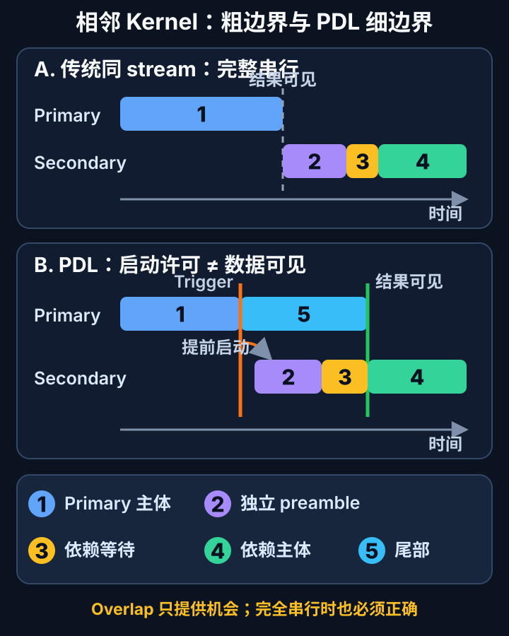

# CUDA Programmatic Dependent Launch：让有依赖的相邻 Kernel 安全重叠

在同一 CUDA stream 中，后提交的 kernel 默认要等前一个 kernel 完成。这个顺序通常是正确性所必需的：下游 kernel 会读取上游结果，过早读取就可能看到尚未写完的数据。

但“下游依赖上游结果”不等于“下游从第一条指令开始就需要结果”。许多 kernel 在真正消费输入前还有一段独立前导工作，例如清零局部状态、加载常量、计算地址，或预取不由上游产生的权重。**Programmatic Dependent Launch（PDL）**把“允许下游 grid 提前启动”与“允许下游读取上游结果”拆成两个事件，让这段 independent preamble 有机会与上游尾部重叠。

PDL 从 compute capability 9.0 设备开始提供重叠能力，适用于 Hopper、Blackwell 等架构。它不是取消依赖，也不保证并发；它提供的是一种保持内存正确性的、机会式的细粒度流水。

*图源与许可：本站自绘，原创站点内容；未复用第三方图像。机制依据 NVIDIA CUDA Programming Guide 的 [Programmatic Dependent Launch and Synchronization](https://docs.nvidia.com/cuda/cuda-programming-guide/04-special-topics/programmatic-dependent-launch.html) 与 NVIDIA CUTLASS 的 [Dependent kernel launches](https://github.com/NVIDIA/cutlass/blob/main/media/docs/cpp/dependent_kernel_launch.md) 整理。图示只表达事件顺序，不代表实际执行时间比例；PDL overlap 是机会式行为。*

## 1. 背景：同一 stream 的依赖边界通常画得太粗

传统执行把依赖表达成完整 kernel 边界：

~~~text
primary 全部完成并刷新结果
    -> secondary 启动
    -> secondary 前导工作
    -> secondary 消费 primary 输出
~~~

如果 secondary 的前导工作不读取 primary 输出，这个边界就比真实数据依赖更严格。可把 secondary 拆成三段：

1. **independent preamble**：不依赖 primary 输出；
2. **dependency synchronization**：等待 primary 完成并使全局内存写入可见；
3. **dependent body**：开始读取并处理 primary 输出。

普通的多 stream 并发不直接解决这个问题。若两个 kernel 完全独立，可以放入不同 stream 并用常规 event/依赖组织；PDL 针对的是**确有顺序依赖，但依赖点晚于 secondary 入口**的相邻 kernel。CUDA Graph 可以表达同一种程序化依赖，但 graph 本身也不会自动发现可前移的代码。

## 2. 机制：trigger 与 synchronize 组成双阶段协议

PDL 的关键不是一个“允许并发”开关，而是上、下游共同遵守的协议。

### 2.1 Primary：所有 block 到达 trigger

primary 在完成“secondary 启动前必须先做”的阶段后，由每个 thread block 执行：

~~~cpp
cudaTriggerProgrammaticLaunchCompletion();
~~~

当 primary 的所有 thread blocks 都已经启动并执行 trigger 后，驱动获得提前启动 secondary 的机会。trigger 之后，primary 仍可继续执行尾部计算和写回。

如果某个 primary block 没有显式执行 trigger，对应触发会在该 block 退出时隐式发生。这样不会让正确程序永远卡在 launch 条件上，但也会把 overlap 窗口推迟，甚至退化为传统串行。工程上仍应保证所有 block 的控制流都能清晰到达 trigger。

### 2.2 Host：用扩展 launch 标记 secondary

secondary 必须通过扩展 launch API 提交，并设置 <code>cudaLaunchAttributeProgrammaticStreamSerialization</code>：

~~~cpp
cudaLaunchAttribute attr{};
attr.id = cudaLaunchAttributeProgrammaticStreamSerialization;
attr.val.programmaticStreamSerializationAllowed = 1;

cudaLaunchConfig_t secondary_cfg{};
secondary_cfg.gridDim = dim3(grid_secondary);
secondary_cfg.blockDim = dim3(block_secondary);
secondary_cfg.dynamicSmemBytes = 0;
secondary_cfg.stream = stream;
secondary_cfg.attrs = &attr;
secondary_cfg.numAttrs = 1;

primary<<<grid_primary, block_primary, 0, stream>>>(
    input, primary_out, n);
CUDA_CHECK(cudaGetLastError());

CUDA_CHECK(cudaLaunchKernelEx(
    &secondary_cfg, secondary,
    weights, primary_out, result, n));
~~~

primary 与 secondary 仍在同一 stream 中。这个属性告诉驱动：secondary 已按 PDL 规则编写，允许在传统 stream serialization 完成前尝试启动。

### 2.3 Secondary：消费结果前同步 grid dependency

secondary 可以先做独立工作，但在第一次读取 primary 结果前必须调用：

~~~cpp
cudaGridDependencySynchronize();
~~~

该同步会一直等到 secondary 所依赖的全部 primary kernel 完成，并把结果刷新到全局内存。之后 dependent body 才能安全消费 <code>primary_out</code>。

最小 device-side 骨架如下：

~~~cpp
__global__ void primary(const half* input, half* output, int n) {
    // 阶段 A：完成 secondary 提前启动所需的工作。
    prepare_primary_state(input, n);

    // 每个 block 都必须经过这里。
    cudaTriggerProgrammaticLaunchCompletion();

    // 阶段 B：继续计算并写出最终结果，可与 secondary preamble 重叠。
    finish_and_store_primary(output, n);
}

__global__ void secondary(const half* weights,
                          const half* primary_out,
                          half* result,
                          int n) {
    // 只触碰独立数据，例如预取 weights、计算地址、准备 descriptor。
    prefetch_independent_weights(weights, n);

    // 从这一点开始建立 primary 完成与全局内存可见性边界。
    cudaGridDependencySynchronize();

    // 此后才能读取 primary_out。
    consume_primary_output(weights, primary_out, result, n);
}
~~~

必须区分四个事件：

- primary block 执行 trigger；
- 所有 primary blocks 均满足提前 launch 条件；
- secondary grid/block 实际被调度；
- primary 完成、写入可见，secondary 通过 dependency synchronize。

前两个事件不等于最后一个事件。trigger 不会让 primary 已写出的任意数据立即成为 secondary 可安全消费的数据；真正的数据消费边界仍是 <code>cudaGridDependencySynchronize()</code>。

## 3. 正确性边界：机会式 overlap 不能参与算法成立条件

NVIDIA 明确说明 PDL 并发是 opportunistic，不保证 primary 与 secondary 必然同时执行。因此，下面的设计是不安全的：

- primary 等待 secondary 写入某个标志；
- secondary 又要等 primary 释放资源或写入另一个标志；
- 程序假设 secondary 一定能占到 SM，从而解除 primary 的等待。

如果 primary 已占满设备、secondary 资源需求过高，或调度器选择不重叠，以上循环等待可能死锁。正确程序必须满足：

> 即使 secondary 完全不提前执行，primary 也能独立结束；即使 secondary 提前启动，它在同步点之前也不读取 primary 输出。

常见错误包括：

1. **过早读取输出**：preamble 中的地址计算可以独立，但实际 load 不能偷跑；
2. **遗漏 dependency synchronize**：launch 属性只允许提前启动，不提供结果可见性；
3. **trigger 控制流不一致**：少量慢 block 或分支绕过 trigger，会缩短甚至消灭窗口；
4. **资源反压**：secondary 的 registers、shared memory 或 cluster 配置挤压 primary 尾部进度；
5. **把 PDL 当作跨 stream 通用同步**：基本协议描述的是同一 stream 中的 primary/secondary 关系；
6. **把“API 已开启”当作“时间线已重叠”**：是否重叠必须由 profiler 证明。

代码还应检查设备 capability，并为 compute capability 9.0 以下设备保留普通 launch 路径。PDL 的 fallback 很自然：不设置 programmatic launch 属性时，同一 stream 继续按传统顺序执行。

## 4. 工程流程：从候选识别到可回退实现

一个稳妥的接入流程可以分成五步。

### 第一步：画真实数据依赖，而不是只看 kernel 边界

列出 secondary 入口到首次读取 primary 输出之间的所有指令，确认哪些操作只依赖常量、权重、descriptor 或独立缓冲区。只要 preamble 中混入一条对 primary 输出的 load，就必须移动同步点或重构代码。

### 第二步：把 primary 尾部与 trigger 位置参数化

trigger 太晚，可重叠尾部太短；trigger 太早，可能让大量 secondary blocks 竞争资源。对于迭代式 kernel，可测试在完成不同比例 tile 后触发，但每个候选都必须保持“所有 blocks 可达”和无跨 grid 死锁。

### 第三步：把 secondary 的独立区段与依赖区段物理分开

建议把 preamble、dependency synchronize 和 dependent body 写成清晰的三个阶段，避免编译期重构或后续维护把依赖 load 移到同步点之前。对复杂 pipeline，可用注释和 assertions 记录哪些 pointer 在 preamble 中允许访问。

### 第四步：同时保留 baseline

同一程序保留普通 launch 与 PDL launch 开关，确保参数、stream、输入和输出完全一致。这样才能进行正确性回归和性能 A/B，而不是把算法改动与 launch 改动混在一起。

### 第五步：检查所有 launch 路径

显式 launch、模板封装、库调用和 CUDA Graph capture 可能走不同路径。只有 secondary 的实际 launch 带有正确属性、device code 又执行同步协议，PDL 才完整成立。对异步错误，应在 launch 后检查返回值，并在测试路径中同步暴露延迟错误。

## 5. CUDA Graph：用 programmatic edge 表达同一语义

PDL 可以通过 stream capture 进入 CUDA Graph，也可以用 edge data 显式表达。显式构图时，连接两个 kernel nodes 的边使用：

~~~cpp
cudaGraphEdgeData edge{};
edge.type = cudaGraphDependencyTypeProgrammatic;
edge.from_port = cudaGraphKernelNodePortProgrammatic;
~~~

programmatic dependency edge 让下游 kernel 中的 <code>cudaGridDependencySynchronize()</code> 看见上游依赖。根据希望表达的触发语义，outgoing port 可以是 <code>cudaGraphKernelNodePortProgrammatic</code> 或 <code>cudaGraphKernelNodePortLaunchCompletion</code>。

对应关系需要保持一致：

- stream launch 的 <code>cudaLaunchAttributeProgrammaticStreamSerialization</code>，capture 后对应 programmatic dependency 与 programmatic port；
- programmatic event 若设置 <code>triggerAtBlockStart = 1</code>，对应 launch-completion port；
- 显式 graph edge 仍要求上、下游 kernel 遵守 trigger/synchronize 协议。

Graph 降低重复 host launch 开销，PDL 细化 device-side 依赖边界；两者解决的问题不同，可以叠加。验证时应打开 Nsight Systems 的 graph node tracing，不能只凭 graph launch 完成时间推断节点是否重叠。

## 6. CUTLASS 案例：把等待窗口变成 L2 权重预取

CUTLASS Example 63 展示了一个很贴近低延迟推理的场景：归一化或归约 kernel 之后紧接 GEMM。GEMM 的 activation 由前序 kernel 产生，必须等待；weights 却早已存在，不依赖前序输出。

该示例采用面向 Hopper 的 non-persistent、warp-specialized GEMM。在等待 activation 完成和刷新时，一部分 DMA warps 可以先把 operand A（weights）预取到缓存/后续数据通路中。官方示例还提供两个运行时参数：

- <code>overlap_ratio</code>：控制 primary 侧大约在加载多少 K tiles 后发出 dependent-grid launch 信号；默认值为 0.5；
- <code>prefetch_ratio</code>：控制预取多少比例的 K tiles；默认 -1.0 表示 best-effort 停止条件。

示例使用 TMA cache hints：weights A 采用 <code>EvictFirst</code>，activation B 采用 <code>EvictLast</code>；并提供 split DMA warps 的 schedule，使 A/B 的加载路径可以分离。这里的重点不是照搬默认参数。CUTLASS README 明确建议针对具体 GEMM，并依据完整 transformer layer 或连续多层的端到端时间自动调优；默认 <code>prefetch_ratio=-1.0</code> 在某些情况下甚至会让预取几乎无效。

该案例把 PDL 的适用条件说得很清楚：

- activation 是真实依赖，不能提前读；
- weights 是独立输入，可以提前搬运；
- GEMM 的前导阶段足够长，值得与前序尾部重叠；
- 参数选择受 shape、内存带宽、L2 行为与整个 kernel 链共同影响。

CUTLASS 文档与 Example 63 源码采用 BSD-3-Clause 许可；本文仅依据其公开说明分析机制，未复制项目图像或大段源码。

## 7. 性能与资源模型：能隐藏多少时间

可用一个上界模型筛选候选。设：

- <code>T_tail</code>：primary 从全部 blocks 满足 trigger 到完成的尾部时间；
- <code>T_pre</code>：secondary 在同步点前的独立工作时间；
- <code>T_resource</code>：在实际 SM、register、shared memory、带宽约束下可同时推进的时间；
- <code>C_pdl</code>：扩展 launch、额外控制与同步的新增成本。

理想可隐藏时间满足：

~~~text
T_hidden <= min(T_tail, T_pre, T_resource)
收益上界约为 max(0, T_hidden - C_pdl)
~~~

这不是预测器，而是排除低价值候选的检查。即使 <code>T_tail</code> 和 <code>T_pre</code> 都很长，两个 kernel 若各自占满 registers/shared memory 或 memory bandwidth，<code>T_resource</code> 仍可能接近零。

端到端时间还可粗略写成：

~~~text
T_chain_pdl
  ≈ T_primary + T_secondary
  - T_effective_overlap
  + C_pdl
  + C_interference
~~~

其中 <code>C_interference</code> 包含并发造成的 occupancy 下降、cache 污染、带宽争用、频率变化和 primary 尾部变慢。PDL 成功启动了 secondary，并不代表链路一定更快。

### 值得优先尝试

- 相邻 kernel 有真实 producer-consumer 依赖；
- secondary 有可观的独立 preamble；
- primary 尾部逐渐释放资源，或两者资源形态互补；
- launch latency 在短链路中占比可见；
- 权重、常量或 metadata 可在等待期间提前搬运；
- shape 相对稳定，允许按设备与 workload 调优。

### 通常不值得

- secondary 一进入就必须读取 primary 输出；
- 两个 kernel 都长期满占 SM 或饱和 HBM；
- preamble 比额外控制和同步成本还短；
- primary block 进度高度不均，最后几个 block 很晚才 trigger；
- 动态 shape 使最优触发/预取比例频繁变化；
- 维护 PDL 与 fallback 双路径的成本超过可测收益。

## 8. 如何验证：正确性、时间线与端到端 A/B

### 正确性

先让 PDL 路径与普通 launch 路径逐项比较输出。覆盖随机输入、边界 shape、非整 tile 尺寸、多 stream 隔离测试和长时间压力测试。对可能的越界、race 和同步错误，使用 Compute Sanitizer 的 memcheck/racecheck 等适用工具；它不能替代协议审查，但能更快暴露实现问题。

### Nsight Systems 时间线

时间线应回答：

- secondary grid 是否真的在 primary 完成前启动；
- independent preamble 是否与 primary tail 重叠；
- dependency synchronize 是否出现明显等待；
- host launch gap 是否被隐藏；
- 某些 shape 是否完全退化为串行。

如果只看到属性已设置，却没有 kernel overlap，先检查所有 primary blocks 是否及时 trigger，再看 occupancy 与资源竞争。没有 overlap 不是 correctness failure；它说明这一 workload 下没有获得性能机会。

### Nsight Compute 资源证据

对两条路径记录：

- achieved occupancy、active warps/blocks；
- registers/thread 与 shared memory/block；
- memory throughput、L2 hit rate 与 cache residency；
- barrier、dependency 与 memory stall；
- primary 尾部是否因 secondary 并发而变慢；
- CUTLASS 场景中 weights prefetch 是否减少 dependent body 的访存等待。

### 端到端测量

固定 GPU clocks/power policy、driver、CUDA Toolkit、stream、输入、warm-up 和重复次数。至少报告 median 与 P95/P99，并同时比较：

1. 普通同 stream launch；
2. 启用 PDL，但关闭额外 prefetch；
3. 启用 PDL 与 prefetch；
4. CUDA Graph 开/关（若生产路径使用 graph）。

不要只测孤立 GEMM。PDL 回收的是相邻 kernel 边界上的空隙，最终应以完整 layer、连续 kernel 链或实际请求延迟为准。

## 9. 局限

- 需要 compute capability 9.0+ 才能提供重叠能力；
- 并发是机会式行为，不能作为正确性、前进性或避免死锁的条件；
- trigger 表示可尝试提前启动，不等于 primary 结果已经可见；
- secondary 仍必须在消费依赖数据前显式同步；
- 同时驻留会竞争 SM、registers、shared memory、L2、HBM 与功耗预算；
- 不规则 block 进度会压缩实际重叠窗口；
- PDL 不替代普通 stream/event、完整 CUDA Graph 依赖或跨设备同步；
- profiler 中观察到重叠也不自动等于端到端加速；
- 库封装、模板与 graph capture 可能隐藏实际 launch 属性，升级 CUDA/CUTLASS 后需要回归；
- 双路径和参数调优会增加实现、测试与可维护性成本。

## 10. 实践检查表

### 协议与正确性

- [ ] 目标设备为 compute capability 9.0+，并保留普通 launch fallback。
- [ ] primary 的每个 block 都能到达 <code>cudaTriggerProgrammaticLaunchCompletion()</code>。
- [ ] secondary 使用扩展 launch API 与 programmatic stream serialization 属性。
- [ ] preamble 不读取或间接依赖 primary 输出。
- [ ] 第一次消费 primary 输出前调用 <code>cudaGridDependencySynchronize()</code>。
- [ ] 程序在完全不发生 overlap 时仍能结束且结果正确。
- [ ] 没有 primary/secondary 互相等待的 device-side 协议。
- [ ] 普通路径与 PDL 路径共享同一组数值回归测试。

### 性能与资源

- [ ] 已估算 <code>min(T_tail, T_pre, T_resource)</code>，候选窗口足够大。
- [ ] 用 Nsight Systems 证明 grid 和 preamble 确实重叠。
- [ ] 用 Nsight Compute 检查 occupancy、registers、shared memory 与 cache/带宽。
- [ ] 检查 primary 尾部是否被 secondary 资源竞争拖慢。
- [ ] 覆盖多种 shape、batch、序列长度与动态负载。
- [ ] 固定 clocks/power policy 并记录 GPU、driver、toolkit、编译参数。
- [ ] 同时报告普通 launch、PDL 与 PDL+prefetch 的端到端数据。
- [ ] CUTLASS 的 overlap/prefetch ratio 按 GEMM 与完整 layer 调优，不照搬默认值。

### Graph 与维护

- [ ] stream capture 与显式 graph edge 的 programmatic 语义一致。
- [ ] graph node tracing 已确认真实节点时间线。
- [ ] 所有 launch/API 错误均被检查。
- [ ] CUDA Toolkit、driver 或 CUTLASS 升级后重新做 correctness 与性能回归。
- [ ] 文档明确写出“PDL 不保证并发”。

## 小结

PDL 的本质是把粗粒度的“kernel 完成后才能启动”细化为两个边界：primary 用 trigger 表示 secondary 可以尝试启动，secondary 用 dependency synchronize 表示从此处才消费 primary 结果。正确性仍由完整依赖和全局内存可见性约束保证，提前执行只发生在独立 preamble 中。

对 Hopper/Blackwell 的低延迟推理，最直观的落地点是：activation 依赖前序 kernel，而 weights 独立可预取。此时 PDL 能把等待窗口转化为有用的数据搬运。但实际收益永远受 independent preamble、primary tail 与可用 GPU 资源三者的最小值限制。保留 baseline，用 Nsight Systems 证明 overlap，用 Nsight Compute 解释资源变化，再以完整 kernel 链的 A/B 结果决定是否保留，这才是可靠的工程闭环。

## 参考资料

- NVIDIA, **CUDA Programming Guide — Programmatic Dependent Launch and Synchronization**：<https://docs.nvidia.com/cuda/cuda-programming-guide/04-special-topics/programmatic-dependent-launch.html>
- NVIDIA, **CUDA Runtime API — Execution Control**：<https://docs.nvidia.com/cuda/cuda-runtime-api/group__CUDART__EXECUTION.html>
- NVIDIA CUTLASS, **Dependent kernel launches**（BSD-3-Clause）：<https://github.com/NVIDIA/cutlass/blob/main/media/docs/cpp/dependent_kernel_launch.md>
- NVIDIA CUTLASS, **Example 63: Hopper GEMM with L2 weight prefetch**（BSD-3-Clause）：<https://github.com/NVIDIA/cutlass/tree/main/examples/63_hopper_gemm_with_weight_prefetch>
- NVIDIA CUTLASS, **License**：<https://github.com/NVIDIA/cutlass/blob/main/LICENSE.txt>
