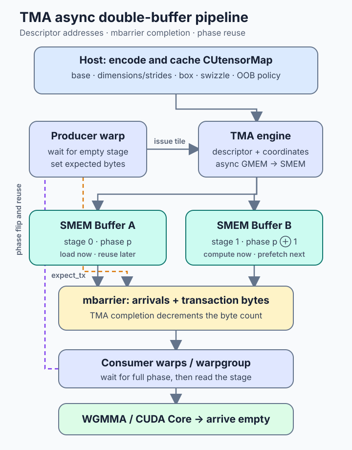
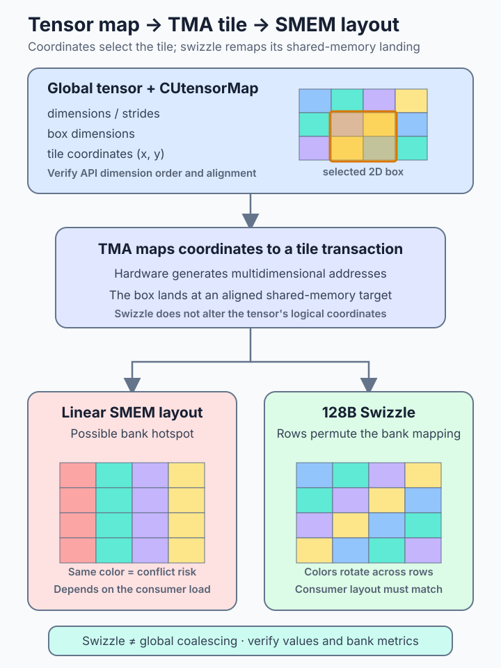

# CUDA TMA：用描述符、mbarrier 与 Swizzle 重构 Hopper 数据搬运

高性能 CUDA kernel 往往不是算术不够快，而是数据还没有按消费者需要的形状到达 shared memory。传统做法让许多线程各自计算地址，执行 global load，再把寄存器中的数据写入 shared memory；Ampere 的异步复制已经可以绕过中间寄存器，但搬运工作仍按线程组织。Hopper 的 Tensor Memory Accelerator（TMA）把问题再向前推进一步：由软件预先编码多维 tensor 描述符，kernel 中只需少量线程发起 tile 级异步事务，专用硬件负责地址生成、边界处理和搬运。

TMA 因此不是一个“把 memcpy 换成新指令”的局部优化。它改变了 kernel 的资源分工：producer warp 负责发起搬运，consumer warpgroup 专注计算；数据是否可消费由 `mbarrier` 的事务完成语义决定；shared-memory swizzle 与消费者访问布局共同决定 bank conflict；cluster multicast 则可以把 CTA 间的真实复用转化为更少的 HBM/L2 请求。

本文以 Hopper SM90 的 global-memory 到 shared-memory tiled load 为主线。示例中的 PTX/C++均为**协议伪代码**，用于呈现依赖关系，不可直接复制编译；具体指令签名、地址空间和模板接口应以所用 CUDA Toolkit、PTX ISA 与 CUTLASS 版本为准。

*图源与许可：本站原创，许可随本文使用；未复用、裁切或描摹第三方图片。机制依据 NVIDIA [CUDA Programming Guide：Asynchronous Data Copies](https://docs.nvidia.com/cuda/cuda-programming-guide/04-special-topics/async-copies.html)、[Hopper Tuning Guide：Tensor Memory Accelerator](https://docs.nvidia.com/cuda/hopper-tuning-guide/index.html#tensor-memory-accelerator) 与 [PTX ISA：`cp.async.bulk.tensor`](https://docs.nvidia.com/cuda/parallel-thread-execution/index.html#data-movement-and-conversion-instructions-cp-async-bulk-tensor) 整理。*

## 1. 背景：三代数据通路的资源分工

把一个 global-memory tile 搬进 shared memory，可以粗略分成三种路径：

| 路径 | 地址与搬运由谁承担 | 中间寄存器 | 完成同步 |
| --- | --- | --- | --- |
| `LDG → register → STS` | 多个线程逐元素计算地址并搬运 | 需要 | CTA barrier |
| Ampere `cp.async` / LDGSTS | 多个线程发起分段异步复制 | 通常不需要 | async-group wait + barrier |
| Hopper TMA | descriptor 描述 tensor，少量线程发起 tile 事务 | 不需要 | `mbarrier` transaction completion |

第一条路径的隐藏成本包括地址计算指令、搬运线程占用、寄存器生命周期和额外同步。第二条路径消除了显式中间寄存器，但每个参与线程仍要提供自己的复制片段。TMA 让单个线程代表 CTA 发起多维 tile 搬运，硬件读取 descriptor 后生成地址并处理合法的越界区域，因此更容易把搬运从计算 warp 中剥离出来。

这并不意味着只有一个线程“传输了全部字节”，也不意味着 Tensor Core 在执行复制。TMA 是独立的数据移动能力；Tensor Core/WGMMA 是矩阵计算能力；Blackwell 的 Tensor Memory（TMEM）又是另一种片上存储。三者名称相近，但资源与同步协议不同。

TMA 的核心收益不是单条指令延迟，而是减少每个 tile 的软件工作：

- 更少的地址生成和搬运指令；
- 更少用于 staging 的寄存器；
- producer/consumer warp specialization 更自然；
- 规则多维 tile 的边界处理可进入 descriptor 语义；
- 与 swizzle、cluster multicast 和异步流水线组合。

## 2. `CUtensorMap`：把地址计算前移到 descriptor

TMA tiled operation 不在指令中携带完整 shape 和 stride，而是读取 `CUtensorMap`。host 侧通常通过 Driver API 的 tensor-map encode 接口构造它，再把 descriptor 作为 kernel 参数传入。一个 tiled tensor map 至少描述：

- global-memory 基地址；
- tensor rank、每一维的 logical extent；
- global stride；
- 单次搬运的 box/tile dimensions；
- element stride；
- element type、interleave、swizzle 与边界填充方式。

这些字段共同定义“坐标如何变成地址”，而不是彼此独立的调优旋钮。数组维度顺序必须遵循 API 约定；不要把 C/C++ 源码中的行列顺序直接猜成 tensor-map 的维度顺序。基地址、stride、box shape 和 swizzle 还有明确的对齐及组合限制，应在 encode 返回值处立即报错，而不是等到 kernel 中排查未定义行为。

下面是 host 端的概念流程：

    // 协议伪代码：字段与错误检查必须按实际 Driver API 补全
    CUtensorMap map;
    encode_tiled(
        &map,
        element_type,
        rank,
        global_ptr,
        global_dims,
        global_strides,
        box_dims,
        element_strides,
        interleave,
        swizzle,
        l2_promotion,
        oob_fill);

    kernel<<<grid, block, dynamic_smem>>>(map, ...);

在 CUDA C++ kernel 中，descriptor 参数常声明为 `const __grid_constant__ CUtensorMap`，避免编译器为每个线程制造不必要的局部副本。descriptor 的创建成本通常在 host 控制路径，若 shape/stride 稳定，应缓存和复用；如果每个微小 tile 都重新编码，host 开销可能抵消 device 端收益。

越界填充能简化边缘 tile，但“能填充”不等于“免费”。最后一个 tile 只有少量有效元素时，仍可能传输或占用一个不经济的 box，并增加无效计算。边界占比高、shape 高频变化或 stride 极不规则时，显式 predication、普通 load/store 或线程级 `cp.async` 可能更合适。

## 3. 正确性协议：async proxy、`mbarrier` 与 phase

TMA load 是异步事务。发起指令返回，只说明请求已提交，并不说明 shared memory 中的数据可被消费者读取。正确协议必须同时表达两件事：

1. 参与线程已经到达同步点；
2. 与该 barrier 关联的预期事务字节已经完成。

`mbarrier` 的 transaction count 用于第二件事。producer 在发起 TMA 前把本次 tile 的字节数纳入 barrier 的 expected transaction bytes；TMA 完成后由硬件扣减。consumer 等待对应 phase 完成，才能读取目标 buffer。只有普通 `bar.sync`，或只有“线程 arrive”而没有事务字节记账，都不足以证明异步数据已经到达。

一个双缓冲循环可以抽象为：

    // 协议伪代码，不对应某一套可直接编译的 intrinsic
    initialize(full[0], full[1]);
    initialize(empty[0], empty[1]);

    for (tile = 0; tile < tile_count; ++tile) {
        stage = tile & 1;

        producer:
            wait_until_empty(empty[stage], empty_phase[stage]);
            expect_tx(full[stage], tile_bytes);
            issue_tma_load(map, coords(tile), smem[stage], full[stage]);

        consumers:
            wait_until_full(full[stage], full_phase[stage]);
            compute(smem[stage]);
            arrive_empty(empty[stage]);

        advance_phase_for_reused_stage(stage);
    }

phase 是复用 barrier 和 buffer 时区分“上一轮”与“下一轮”的关键。常见错误包括：

- producer 尚未确认 buffer 已空，就覆盖消费者仍在读取的数据；
- consumer 等错 phase，读取上一次 tile 或永久等待；
- expected bytes 与实际事务字节不一致，barrier 永不完成或过早完成；
- 某些控制流分支没有 arrive，导致参与者数量不匹配；
- 只测 happy path，最后一个边缘 tile 的字节记账与普通 tile 不一致。

### 3.1 async proxy 不是普通线程可见性的别名

PTX 把部分 TMA 操作放在 async proxy 中。若普通线程通过 generic proxy 写入 shared memory，而后续 async-proxy 操作需要观察这些写入，必须按 PTX ISA 的作用域与地址空间要求建立 proxy fence；典型机制是相应作用域的 `fence.proxy.async`。反向的数据消费则要由该指令定义的 completion mechanism 保证。

不要把 `__syncthreads()` 当作所有 proxy 间可见性的通用替代品。工程上应先画出 producer、consumer、内存位置和 proxy，再为每条跨域依赖选择文档明确支持的 fence/barrier。descriptor 若在 device 侧被修改，还涉及专门的 tensor-map proxy 可见性规则；稳定 descriptor 最简单的策略仍是 host 编码、只读传入、跨 tile 复用。

### 3.2 load 与 store 的完成机制并不对称

本文主线是 GMEM→SMEM TMA load，它通常用 `mbarrier` 跟踪到达 shared memory 的事务。SMEM→GMEM 的 bulk/tensor store 则使用 PTX 定义的 bulk async-group commit/wait 机制。不能把 load 示例中的 barrier 协议机械复制到 store 路径；发布可见结果之前，还要确认 store 的 wait 语义是否满足后续 host、kernel 或系统级消费者的要求。

## 4. Swizzle：改变 shared-memory bank 映射，而非 HBM 合并访问

*图源与许可：本站原创，许可随本文使用；未复用第三方图片。机制依据 NVIDIA [CUDA Driver API：Tensor Memory](https://docs.nvidia.com/cuda/archive/13.0.1/cuda-driver-api/group__CUDA__TENSOR__MEMORY.html)、[CUDA Programming Guide：Asynchronous Data Copies](https://docs.nvidia.com/cuda/cuda-programming-guide/04-special-topics/async-copies.html) 与 CUTLASS [CuTe TMA Tensors](https://docs.nvidia.com/cutlass/latest/media/docs/cpp/cute/0z_tma_tensors.html) 整理；图中 bank 颜色仅表达“访问分散”的布局直觉，不代表固定指令下的逐 lane bank 编号。*

TMA descriptor 可以声明 32B、64B 或 128B 等 swizzle 模式。其目标是改变 tile 落入 shared memory 后的地址排列，让消费者的一组并行访问更均匀地分布到 banks。它解决的是 **shared-memory bank mapping**，不是 global-memory coalescing，也不会自动改善任意消费者模式。

应把三个层次分开：

1. **global layout**：dimensions 和 strides 决定源 tensor 的地址；
2. **TMA transaction**：box shape、对齐与合法组合决定硬件怎样搬运 tile；
3. **shared layout**：swizzle 与 shared-memory 起始地址决定元素落点，消费者必须用匹配的 layout 读取。

如果 descriptor 使用 swizzle，而消费者仍按朴素 row-major 指针算术读取，结果可能不是“性能差一点”，而是逻辑坐标错误。CUTLASS/CuTe 的价值之一，就是让 TMA copy layout 与后续 WGMMA/线程 fragment layout 在类型和坐标变换层面衔接，而不是由开发者手工维护两套容易漂移的索引公式。

选择 swizzle 时，从消费者开始反推：

- 一个 warp/warpgroup 在同一条指令中读取哪些逻辑元素；
- 元素字节数与向量宽度是什么；
- tile 的 leading dimension 与 shared-memory pitch 是多少；
- WGMMA 或普通 CUDA core load 要求什么 layout；
- 所选 swizzle 对 box 内最内层字节范围和 shared-memory 对齐有什么限制。

实际验证不要只看 kernel 总时间。应同时检查 shared-memory bank conflict 指标、相关 load/store 指令吞吐和 consumer stall；如果 swizzle 降低 bank conflict，却迫使额外 layout conversion 或降低 occupancy，端到端仍可能变慢。

## 5. Warp specialization、multicast 与 cluster 复用

TMA 降低了发起搬运所需的线程参与度，因此适合 warp-specialized pipeline：一个 producer warp 维护 descriptor 坐标、barrier 与 stage；多个 consumer warps 或一个 warpgroup 执行 WGMMA/计算。producer 不是越少越好——如果它还承担复杂索引、epilogue 或多路 descriptor 调度，也可能成为供给瓶颈。

合理的职责边界通常是：

- **producer**：等待空 stage、设置 transaction bytes、发起 TMA、推进 tile 坐标；
- **consumer**：等待 full stage、执行计算、声明 stage 可复用；
- **共享协议**：固定参与者数量、phase 所有权和退出/drain 路径。

Hopper thread block cluster 还允许 TMA multicast：一个 CTA 发起的 global-memory tile 可以送到 cluster 内多个 CTA 的 shared memory。它适合多个 CTA 确实消费同一份数据的场景，例如 GEMM 中沿某一 grid 维复用 A 或 B tile。潜在收益是减少重复的 HBM/L2 请求，代价包括 cluster 同驻约束、distributed shared-memory/barrier 协议和更复杂的尾部处理。

multicast 的采用条件应写成流量问题。设 cluster 中有 `N` 个 CTA 复用一个大小为 `B` 的 tile；忽略缓存偶然命中时，独立加载请求约为 `N·B`，理想 multicast 的源读取接近 `B`。但若 CTA 实际读取不同 tile、数据本来稳定命中 L2，或 cluster 限制使活跃 CTA 数下降，理论节省不会转化为 kernel 加速。

## 6. 性能与资源模型：重叠之前先确认瓶颈

对稳定状态下的双缓冲 pipeline，每个 stage 的理想时间可近似为：

    T_stage ≈ max(T_TMA, T_compute)

完整 kernel 还包括：

    T_total ≈ T_descriptor_amortized
            + T_warmup
            + N_stage · max(T_TMA, T_compute)
            + T_drain
            + T_barrier_and_control

这揭示了几个边界：

- `T_compute` 太短，搬运延迟无法被覆盖；
- tile 太小，barrier、坐标更新和发起成本占比过高；
- tile 太大，shared memory 增长导致 active CTA 数下降；
- stage 数增加会提高 bytes in flight，但也增加 shared memory 和 barrier 状态；
- descriptor 频繁重建时，host/control 开销需要摊入端到端延迟；
- 边缘 tile 比例高时，填充与无效计算会扩大有效字节成本。

一个 CTA 的 staging 占用可粗略写成：

    SMEM_CTA ≈ stages · bytes_per_tile · operands + barrier_and_scratch

而设备上的有效并发由寄存器、shared memory、threads/CTA、cluster shape 和硬件上限共同取最小值。TMA 节省的寄存器可能提高 occupancy，但多 stage shared memory 又可能把它降回来，所以必须读取实际编译资源和 occupancy，而不能只凭源代码判断。

吞吐验证还要区分“请求字节”与“有效字节”：

    useful_bandwidth = useful_tensor_bytes / time
    traffic_efficiency = useful_tensor_bytes / observed_memory_bytes

若 multicast 或边界填充改变了 DRAM/L2 流量，只报告 GB/s 容易掩盖问题。应同时记录有效 tensor 字节、硬件观测流量和数值正确性。

## 7. 工程流程：从单 stage 正确性到 CuTe/CUTLASS

直接从 warp-specialized、swizzled、multicast 多 stage kernel 开始，任何错误都可能表现为随机数值偏差或 barrier hang。更稳妥的增量路线是：

### 第一步：单 stage、单 CTA、无 swizzle

- 固定一个规则 shape；
- host 端编码并检查 `CUtensorMap`；
- 只让一个线程发起 TMA；
- 用单个 `mbarrier` 等待完成；
- 与 CPU/reference kernel 做逐元素对比；
- 单独覆盖完整 tile 与边缘 tile。

### 第二步：双缓冲和 phase

- 增加 full/empty 状态；
- 明确每个 barrier 的参与者与 phase 所有者；
- 为 warm-up、steady state、drain 分别写控制流；
- 用很少的 tile 数测试 1、2、3 次 stage 复用，优先暴露奇偶 phase 错误。

### 第三步：匹配消费者的 swizzle

- 先写逻辑坐标到物理 shared-memory 地址的测试；
- 再启用目标消费者 load/WGMMA；
- 检查数值与 bank conflicts；
- 不要同时改变 tile shape、stage 数和 swizzle。

### 第四步：warp specialization

- 固定 producer/consumer 角色；
- 测量 producer 是否及时供给；
- 核对寄存器和 shared-memory 变化；
- 检查 consumer 等待 full、producer 等待 empty 的 stall 比例。

### 第五步：仅在存在 CTA 间复用时加入 multicast

- 先量化 `N·B → B` 的理论可省流量；
- 固定 cluster shape 和 multicast mask；
- 验证每个目标 CTA 的 barrier 与结果；
- 对比 cluster residency 损失、L2/DRAM 流量和总时间。

CuTe 的 `make_tma_copy`、TMA tensor 与 partitioning 抽象可以从 logical tensor/layout 推导 copy 对象，并把 descriptor 坐标与 thread/value layout 连接起来。CUTLASS Hopper warp-specialized GEMM 则展示了更完整的 mainloop、pipeline state、WGMMA 和 epilogue 组织。使用这些抽象不等于可以忽略底层协议：调试 hang、错误 layout 或 occupancy 回退时，仍需把抽象映射回 descriptor、barrier、phase 和资源占用。

## 8. Nsight Compute 验证清单

至少保留四个可对比版本：普通 load/store、线程级 `cp.async`、单 stage TMA、多 stage TMA。所有版本固定输入、输出、tile 语义、时钟策略与 warm-up，并执行足够多轮以报告中位数和分位数。

### 正确性

- [ ] 完整 tile、各维边缘 tile、最小 shape 与非整除 shape 均通过 reference；
- [ ] descriptor encode 返回值、alignment 和 stride 约束有显式检查；
- [ ] barrier expected bytes 与实际事务匹配；
- [ ] 1/2/3 个 tile 的 phase 复用均不 hang；
- [ ] swizzle 开关对应消费者 layout，而非只改变 descriptor；
- [ ] store 路径使用其文档规定的 commit/wait completion mechanism。

### 性能与资源

- [ ] copy 与 compute 时间线确实重叠，而非串行排队；
- [ ] consumer 等待 full 与 producer 等待 empty 的 stall 可解释；
- [ ] shared-memory bank conflicts 相比基线下降；
- [ ] registers/thread、shared memory/CTA、active CTAs 与 cluster residency 已记录；
- [ ] DRAM/L2 请求字节、吞吐和 hit rate 与预期一致；
- [ ] stage 数扫描至少覆盖 1、2、3，确认收益与 occupancy 拐点；
- [ ] multicast 同时比较 off/on 的流量、总时间和 cluster 占用；
- [ ] 端到端计时包含 descriptor 更新频率对应的 host 开销。

指标名称会随 Nsight Compute 和 GPU 架构版本变化，优先使用 Memory Workload Analysis、Scheduler Statistics、Warp State Statistics、Launch Statistics 与 Occupancy 等 section，再从报告中确认当前版本提供的具体 metric；不要把其他架构上的 metric 名称硬编码为自动化脚本的唯一依据。

## 9. 局限与采用决策

TMA 最适合规则、足够大、可复用 descriptor 的 tile，并且计算足以覆盖搬运延迟。以下场景应谨慎：

- 很小的复制，固定发起与 barrier 成本占主导；
- 地址高度不规则，难以表达为 tensor map；
- shape/stride 高频变化，descriptor 难以复用；
- 边缘区域占比高，box 中大量字节无效；
- shared memory 已限制 occupancy，增加 stage 得不偿失；
- 消费者布局与可用 swizzle 组合不匹配；
- 没有 CTA 间复用，却为了“使用新特性”引入 cluster/multicast。

可以用下面的顺序做采用判断：

1. 搬运能否表达成稳定的 1D–5D tensor tile，并满足 encode/alignment 约束？
2. tile 是否足够大，使地址生成、指令和寄存器节省具有意义？
3. 是否存在可与搬运重叠的计算？
4. staging shared memory 是否仍允许足够 residency？
5. 消费者布局能否与 swizzle/WGMMA 要求一致？
6. 若使用 multicast，是否有可量化的 CTA 间相同数据复用？
7. A/B profile 是否同时证明时间、流量、资源与数值结果改善？

若前几项答案是否定，小粒度 `cp.async` 或显式 load/store 往往更简单，也可能更快。TMA 的正确打开方式不是追求“指令更新”，而是重构整个 producer-consumer 数据通路，并用 completion protocol 和资源模型把正确性与性能同时闭环。

## 参考资料

1. NVIDIA, [CUDA Programming Guide — Asynchronous Data Copies](https://docs.nvidia.com/cuda/cuda-programming-guide/04-special-topics/async-copies.html).
2. NVIDIA, [Hopper Tuning Guide — Tensor Memory Accelerator](https://docs.nvidia.com/cuda/hopper-tuning-guide/index.html#tensor-memory-accelerator).
3. NVIDIA, [Parallel Thread Execution ISA — `cp.async.bulk.tensor`](https://docs.nvidia.com/cuda/parallel-thread-execution/index.html#data-movement-and-conversion-instructions-cp-async-bulk-tensor).
4. NVIDIA, [CUDA Driver API — Tensor Memory](https://docs.nvidia.com/cuda/archive/13.0.1/cuda-driver-api/group__CUDA__TENSOR__MEMORY.html).
5. NVIDIA CUTLASS, [CuTe TMA Tensors](https://docs.nvidia.com/cutlass/latest/media/docs/cpp/cute/0z_tma_tensors.html).
6. NVIDIA CUTLASS, [Hopper Warp-Specialized GEMM Example](https://github.com/NVIDIA/cutlass/tree/main/examples/48_hopper_warp_specialized_gemm).
7. Colfax Research, [CUTLASS Tutorial: Mastering the NVIDIA Tensor Memory Accelerator](https://research.colfax-intl.com/tutorial-hopper-tma/).
