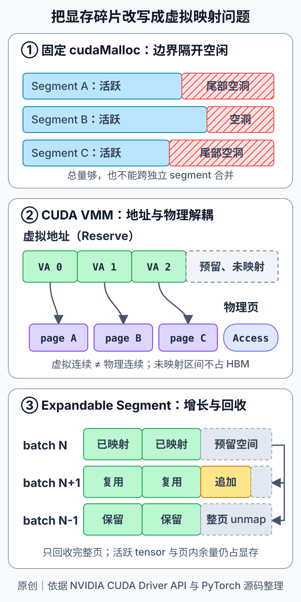

# CUDA VMM 与 PyTorch Expandable Segments：把显存碎片从物理分配改成虚拟映射问题

GPU OOM 并不总等于“所有显存都被有效 tensor 占满”。在动态 batch、可变序列长度、多组 CUDA Graph shape bucket 或在线推理服务中，前后两轮申请的大小往往只差一点，却可能让缓存分配器留下许多无法跨边界合并的尾部空洞。总空闲量看似足够，下一次大申请仍然找不到合适的连续块。

PyTorch 的 `expandable_segments` 针对的正是这类问题。它不是简单扩大缓存池，而是借助 CUDA Driver API 的 Virtual Memory Management（VMM），把四件原本绑定在一次 `cudaMalloc` 里的事情拆开：

1. 预留连续虚拟地址；
2. 创建物理显存 allocation；
3. 把物理页映射到虚拟区间；
4. 设置访问权限，并在需要时解映射与释放。

这样，allocator 可以让一个 segment 沿预留地址空间向尾部生长，把“再找一块连续物理大块”改写成“再映射若干物理页”。这能降低特定的 allocator 外部碎片，但不会消灭仍存活 tensor、第三方库占用或页内浪费。



*图源：本站原创示意图，依据 NVIDIA CUDA Driver API Virtual Memory Management 文档与 PyTorch `CUDACachingAllocator` 源码整理；未复用第三方图像。图中三部分依次表示独立 `cudaMalloc` segment 的尾部碎片、VMM 的地址/物理解耦，以及动态 batch 下按页增长和整页回收。*

## 1. 背景：显存总量足够，为什么仍会 OOM

先区分几组经常被混用的量：

- **allocated**：仍被活跃 tensor 使用、由 PyTorch 统计到的显存；
- **reserved**：PyTorch allocator 已向 CUDA 取得并管理的内存，其中既有活跃 block，也可能有可复用缓存；
- **inactive split blocks**：segment 被切分后暂时没有活跃对象、但受相邻存活 block 或尺寸限制而难以直接归还的部分；
- **device free**：驱动视角仍未被进程、库上下文或其他进程占用的物理显存；
- **non-PyTorch memory**：NCCL、cuBLAS/cuDNN workspace、自定义 CUDA 扩展或其他 allocator 使用、未完整反映在 PyTorch tensor 统计里的显存。

因此，不能把 `reserved - allocated` 全部叫作“碎片”，也不能只凭 `nvidia-smi` 的空闲量判断一次 PyTorch allocation 一定会成功。缓存块可能可以立即复用，也可能尺寸不匹配；驱动空闲内存也可能被其他上下文占用。

动态 batch 会把这个问题放大。设一次迭代在多个层上分别申请与 batch 大小相关的 buffer。batch 为 \(N\) 时，allocator 得到若干 segment，并把每个 segment 切成刚好够用的 block。下一轮变为 \(N+1\) 后，每层都需要稍大的 block，旧 segment 尾部剩余空间不够，只能再申请新的 segment。旧尾部形成很多 sliver；它们分散在不同 `cudaMalloc` 边界内，即使总和很大，也无法拼成一个新 block。

传统 CUDACachingAllocator 的层次可以简化为：

```text
CUDA allocation / segment
└── block A（活跃）
└── block B（空闲，可在本 segment 内 split / merge）
└── block C（活跃）
```

best-fit、split 和相邻空闲 block 合并都发生在 allocator 管理范围内，但合并不能穿过两个独立底层 allocation 的边界。`expandable_segments` 的核心价值，就是弱化“segment 必须在创建时确定物理容量”这个约束。

## 2. 机制：CUDA VMM 把地址与物理显存解耦

CUDA Driver API 的 VMM 接口提供了一条显式路径。

### 2.1 `cuMemAddressReserve`：先保留地址，不占满物理显存

`cuMemAddressReserve` 在进程的 GPU 虚拟地址空间中保留一段连续区间。此时得到的是地址范围，不代表同等大小的 HBM 已经被占用。预留区间可以远大于当前映射量，为后续尾部增长留下地址。

### 2.2 `cuMemCreate`：按设备与粒度创建物理 allocation

`cuMemCreate` 根据 allocation properties 创建物理显存句柄。实际大小必须满足 `cuMemGetAllocationGranularity` 返回的粒度约束。这里的“页”是 VMM 映射粒度，不应假定所有 GPU、驱动和内存类型都使用同一个固定数字。

### 2.3 `cuMemMap`：把物理页放进预留区间

`cuMemMap` 将物理 allocation handle 映射到先前保留的虚拟地址子区间。只要尾部仍有未映射的连续虚拟地址，新的物理 allocation 就能接在已有映射后面；物理页本身不要求在 HBM 中连续。

### 2.4 `cuMemSetAccess`：映射后还要授权

映射本身不等于设备可访问。`cuMemSetAccess` 为目标 device 设置读写权限。多 GPU peer access 也不能想当然地沿用传统 allocation 的处理方式，必须以当前 PyTorch 版本、驱动能力和实际通信路径为准。

回收时则反向执行：确认没有异步访问后，先 `cuMemUnmap` 解映射，再 `cuMemRelease` 释放物理句柄；整个虚拟区间不再需要时，才释放地址预留。地址生命周期与物理页生命周期因此可以不同。

## 3. PyTorch `ExpandableSegment` 如何生长

PyTorch 源码中的 `Note [Expandable Segments]` 给出的动机非常具体：当 allocation size 随 batch 轻微变化时，与其不断创建固定大小的 segment，不如预留足够大的地址空间，只为当前需要的范围映射物理显存。

可以把一次增长理解为：

```text
初始：
虚拟地址  [ 已映射 A ][ 已映射 B ][ 未映射................ ]

需求增加：
虚拟地址  [ 已映射 A ][ 已映射 B ][ 新映射 C ][ 未映射.... ]
物理显存      page set 1   page set 2   page set 3
```

已有 block 的虚拟地址不必因为尾部扩展而变化；新的物理页只映射到后续区间。这对需要稳定 device pointer 的执行路径很有价值，但要注意：**地址稳定是 CUDA Graph replay 的必要条件之一，不是兼容性保证**。graph capture 还受 stream、分配时序、库 workspace、版本限制等因素影响，必须用目标 workload 实测。

当 allocator 发现某些映射页已完全空闲时，可以解映射完整页，把物理显存还给系统，同时保留虚拟地址布局。这里的关键词是“完整页”：如果一个页内仍有活跃 block，页内剩余空间不能通过 unmap 归还。这也是 `expandable_segments` 只能缓解外部碎片、不能消灭所有内部碎片的原因。

此外，映射和解映射不是普通指针操作。allocator 必须尊重 CUDA 的异步执行语义，避免某个 stream 仍在使用页面时提前回收。实际同步、stream 归属、pool 组织和 peer access 处理都以所用 PyTorch 版本源码为准。

## 4. 性能与资源模型：省下的是什么，新增的成本是什么

设：

- \(C\)：设备可用物理显存容量；
- \(U\)：PyTorch allocator 之外的上下文和库占用；
- \(A\)：活跃 tensor/block 使用量；
- \(R\)：allocator 内可复用但尚未归还的缓存；
- \(W_g\)：由于 VMM 映射粒度产生、尚不能整页解映射的页内余量；
- \(V\)：已预留的虚拟地址空间；
- \(M\)：当前已经映射的物理显存。

概念上可写为：

\[
M \approx A + R + W_g
\]

\[
C \gtrsim U + M + \text{driver/context overhead}
\]

而 \(V\) 可能远大于 \(M\)。**虚拟地址预留很大，不等于同量 HBM 被占用。** 真正决定物理压力的是 mapped pages、其他库和上下文开销。

传统固定 segment 的浪费主要表现为多个 segment 尾部无法跨边界合并；VMM 方案将其改造成一个可扩展虚拟 segment 内的页映射问题。收益通常来自：

- 更少的新 segment 和尾部 sliver；
- 相近 shape 在同一地址区间内增长；
- 完整空闲页可以解映射；
- allocator 更容易复用相邻地址范围。

代价则包括：

- 首次创建、map、set access 和 unmap 的管理开销；
- 页粒度带来的 \(W_g\)；
- 预留虚拟地址空间与 bookkeeping；
- peer access、IPC、graph capture 和特定平台上的兼容性约束；
- 在 allocation pattern 不匹配时，收益可能很小。

所以评估时不能只报告“是否 OOM”。至少要同时记录峰值 allocated/reserved、inactive split、物理空闲、吞吐、P50/P95 step latency、首次迭代开销，以及 map/unmap 是否引入同步长尾。

## 5. 它适合解决什么

`expandable_segments` 更适合以下共同特征：申请大小相近但持续变化，生命周期大致一致，碎片主要来自多个固定 segment 的边界。

典型场景包括：

- 动态 batch 在 \(N\)、\(N+1\)、\(N-1\) 间波动；
- 推理服务的 sequence length 或并发数按 bucket 小幅变化；
- 训练中临时 workspace 大小随 shape 改变；
- 多套 CUDA Graph shape bucket 在不同顺序 warmup，造成 allocator 布局分散；
- 业务负载稳定，但偶发稍大请求会触发新 segment。

这类场景的共同证据通常是：`memory_snapshot()` 能看到多个 segment 的尾部空闲，`reserved` 明显高于活跃 allocation，且 OOM 前存在大量尺寸相近的申请历史。

## 6. 它不能解决什么

以下问题不应归因于 segment 外部碎片：

1. **活跃 tensor 真正占满显存。** autograd 引用链、把 loss/tensor 持续 append 到容器、未 detach 的缓存都不会被 VMM 修复。
2. **非 PyTorch 分配。** NCCL、cuBLAS、cuDNN、自定义扩展或另一个进程的占用，不会因为 PyTorch segment 可扩展而消失。
3. **单个请求本身超过物理容量。** VMM 只重排映射关系，不提供 HBM oversubscription。
4. **页内碎片。** 只要一个映射粒度内仍有活跃对象，剩余部分就不能整页 unmap。
5. **完全随机、跨度很大的 shape。** 如果每轮尺寸差异巨大且生命周期错位，单个 expandable segment 也可能留下难复用区间。
6. **平台或版本不支持。** 该选项长期带有实验性质；VMM、IPC、peer access 和 graph capture 的支持边界会随驱动与 PyTorch 版本变化。

尤其要避免用 `torch.cuda.empty_cache()` 作为“碎片已修复”的证明。它可以把完全空闲的缓存交还给 CUDA，但不会释放仍被 tensor 引用的内存，也不保证重排存活 block。

## 7. 工程流程：先诊断，再做 A/B 测试

### 第一步：建立同一 workload 的基线

固定模型、batch/sequence 分布、随机种子、warmup 次数、CUDA Graph 录制顺序和并发。记录：

```python
import torch

torch.cuda.reset_peak_memory_stats()
# run workload
torch.cuda.synchronize()

print("allocated_peak =", torch.cuda.max_memory_allocated())
print("reserved_peak  =", torch.cuda.max_memory_reserved())
print(torch.cuda.memory_summary(abbreviated=False))
```

同时保存 `torch.cuda.memory_snapshot()`，并用 `nvidia-smi` 或 DCGM 观察进程总占用，交叉判断 non-PyTorch memory。不要只截取一次 OOM 文本。

### 第二步：构造能复现 shape 波动的测试

比起只跑固定 batch，更有价值的是复现真实变化序列：

```text
N, N+1, N, N-1, N+1, ...
```

至少重复几十到几百轮，覆盖 warmup 后的稳态。对推理服务，还应保留请求到达顺序和 shape bucket 命中分布。

### 第三步：只改变 allocator 配置

在进程启动前设置：

```bash
PYTORCH_CUDA_ALLOC_CONF=expandable_segments:True python benchmark.py
```

配置必须在 CUDA allocator 初始化前生效。为了保证 A/B 可比，不要同时修改 batch、checkpoint、graph capture 或其他 allocator 参数。若项目使用不同 allocator backend，先确认当前 PyTorch 文档与运行日志中该选项是否走预期路径。

### 第四步：比较内存与性能，而不只比较 OOM

建议输出同一张表：

| 指标 | 基线 | expandable_segments | 判断 |
| --- | ---: | ---: | --- |
| OOM 次数 |  |  | 是否消除目标失败 |
| peak allocated |  |  | 活跃工作集是否相同 |
| peak reserved |  |  | allocator 物理映射压力 |
| inactive split bytes |  |  | 固定 segment 碎片是否下降 |
| tokens/s 或 samples/s |  |  | 稳态吞吐 |
| P50 / P95 step latency |  |  | map/unmap 是否制造长尾 |
| 首轮与 warmup 时间 |  |  | 初始化成本 |

如果只看到 `reserved` 变化，却没有 snapshot 中的布局证据和端到端收益，结论仍不完整。

### 第五步：做边界与回归测试

至少覆盖：

- 最小、常见、最大 shape；
- eager 与 CUDA Graph 路径；
- 单 GPU 与实际多 GPU/NCCL 路径；
- checkpoint save/load、multiprocessing 与 tensor IPC；
- 长时间运行后的内存水位；
- 目标 GPU 型号、驱动和生产 PyTorch 版本。

配置最好作为显式 feature flag 上线，保留回退路径，而不是直接当作所有任务的全局默认值。

## 8. 一个最小但可信的实验设计

可以用多个不同生命周期的 tensor 模拟层级 allocation，而不是只申请一个大 tensor：

1. 在每个“层”保留一个长期 block；
2. 按 batch \(N\) 申请短期 workspace；
3. 下一轮切到 \(N+1\)，让每层 workspace 略微增长；
4. 释放短期对象，但保留穿插其间的长期对象；
5. 重复 shape 序列，并定期保存 memory snapshot。

实验必须使用独立进程分别运行开关两组，因为 allocator 配置在进程级初始化。若测试脚本在同一进程中先跑基线再开选项，结果通常不可信。

观察重点不是“显存曲线是否更低”这一件事，而是：

- 新 segment 数量是否减少；
- 尾部 sliver 是否集中为可复用区间；
- mapped physical memory 是否随需求增长和回落；
- 延迟尖峰是否出现在首次映射或回收阶段；
- 最大 shape 下是否仍有足够的 non-PyTorch headroom。

## 9. 实践检查表

启用前：

- [ ] 已确认 OOM 不是存活 tensor 泄漏或单个请求过大；
- [ ] 已保存 `memory_summary`、`memory_stats` 和 `memory_snapshot`；
- [ ] 已区分 PyTorch allocated/reserved 与进程总显存；
- [ ] workload 确实包含相近但变化的 allocation shape；
- [ ] 已查阅目标 PyTorch 版本的 CUDA semantics 文档与 allocator 源码；
- [ ] 已确认目标 GPU、驱动和 allocator backend 支持该路径。

压测时：

- [ ] 基线与实验组使用独立进程，且只改变一个配置；
- [ ] 固定 shape 序列、warmup、图录制顺序和并发；
- [ ] 同时记录吞吐、P50/P95 延迟、峰值和碎片统计；
- [ ] 覆盖 eager、CUDA Graph、多 GPU 和长时间稳态；
- [ ] 检查 IPC、peer access、自定义扩展和第三方库兼容性。

上线前：

- [ ] 配置可回退；
- [ ] 监控 OOM、reserved/allocated 比值和延迟长尾；
- [ ] 为非 PyTorch 显存保留安全余量；
- [ ] 升级 PyTorch 或驱动后重新跑同一套基准；
- [ ] 没有把虚拟地址预留量误当成实际 HBM 占用。

## 小结

`expandable_segments` 的关键不是“更大的缓存”，而是改变 segment 的构造方式：先预留连续虚拟地址，再按需创建和映射物理显存。这样，动态 shape 原本散落在多个 `cudaMalloc` segment 尾部的空间，可以被组织进一个能够沿尾部增长、按完整页回收的虚拟区间。

它最擅长处理相近尺寸反复变化导致的 allocator 外部碎片；它不负责修复 tensor 生命周期错误、非 PyTorch 占用、单请求超容量或任意页内碎片。正确的使用方式是先用 snapshot 和统计确认碎片类型，再以独立进程做单变量 A/B 测试，把显存布局、吞吐和延迟放在同一个证据链里。

从更一般的 CUDA 系统设计看，VMM 的价值在于把“地址连续”与“物理连续”分开。很多动态运行时问题并不需要一开始就拿到一整块固定物理内存；它们需要的是稳定地址、可增长映射和可验证的回收边界。`expandable_segments` 正是这一思想在深度学习 allocator 中的一个具体实现。

## 参考资料

- NVIDIA, **CUDA Driver API — Virtual Memory Management**：地址预留、physical allocation、map、access 与 unmap API。<https://docs.nvidia.com/cuda/cuda-driver-api/cuda_driver_api/group__CUDA__VA.html>
- PyTorch, **CUDA semantics — Memory management / Optimizing memory usage**：allocator 配置、memory statistics 与 `expandable_segments` 说明。<https://docs.pytorch.org/docs/2.15/notes/cuda.html>
- PyTorch Dev Discussions, **When does fragmentation occur in the CUDA caching allocator?**：缓存分配器发生碎片的条件与分析。<https://docs.pytorch.org/devlogs/eager/2026-06-01-cuda-caching-allocator/>
- PyTorch source, **`c10/cuda/CUDACachingAllocator.cpp`**：`Note [Expandable Segments]`、VMM 映射和 allocator 实现。<https://github.com/pytorch/pytorch/blob/main/c10/cuda/CUDACachingAllocator.cpp>
- PyTorch Blog, **Understanding GPU Memory 1: Visualizing All Allocations over Time**：`memory_snapshot` 与显存时间线分析。<https://pytorch.org/blog/understanding-gpu-memory-1/>
