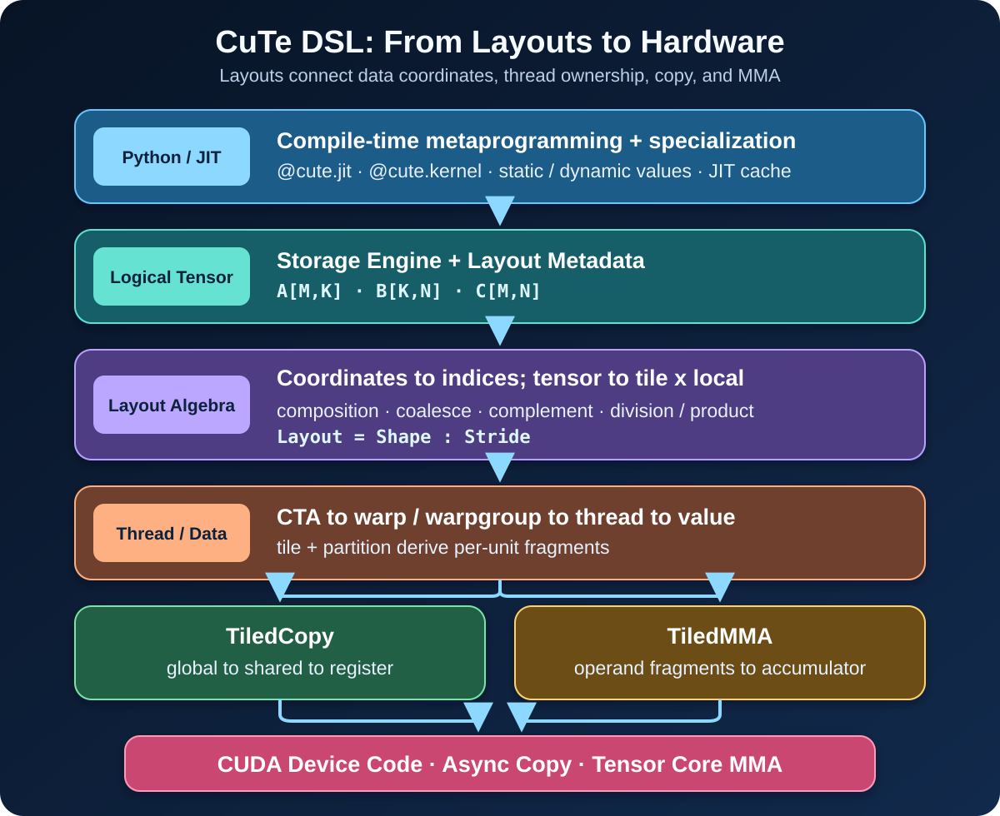
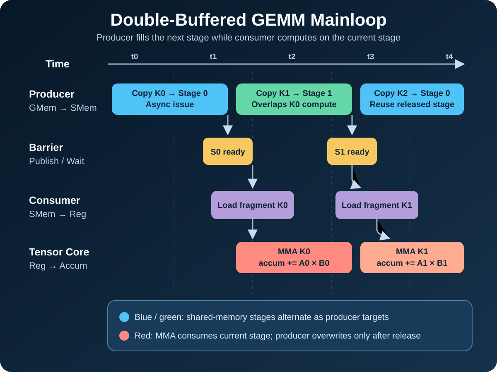

# CuTe DSL：用布局代数把 Python 写成硬件级 CUDA Kernel

高性能 GEMM、attention 或量化 kernel 的难点，通常不在于用 Python 还是 C++ 写入口，而在于能否把逻辑 tensor 正确映射到 global memory、shared memory 和寄存器，再把工作分配给 CTA、warp、线程以及 Tensor Core 指令。一个看似简单的二维下标，落到现代 GPU 上会同时受到合并访存、shared-memory bank、指令 fragment、异步 copy、barrier 和 occupancy 的约束。

CuTe DSL 是 CUTLASS 4.x 中面向 Python 的底层 kernel DSL。它并不是让 GPU 解释执行 Python，而是让 Python 承担编译期元编程，使用 CuTe 的 tensor、layout、copy、MMA 与 pipeline 抽象构造程序，再由编译链生成 GPU device code。它最重要的能力也不是语法更短，而是把**数据布局、线程布局和硬件原语放进同一套可组合模型**。

*图 1：CuTe DSL 从 Python/JIT、逻辑 tensor、layout algebra、线程/数据分区到 TiledCopy/TiledMMA 与硬件指令的映射。图源：本站原创示意图；概念依据 NVIDIA [CUTLASS Python Overview](https://docs.nvidia.com/cutlass/latest/media/docs/pythonDSL/overview.html)、[CuTe Layouts](https://docs.nvidia.com/cutlass/latest/media/docs/cpp/cute/01_layout.html) 与 Cris Cecka 的 [CuTe Layout Representation and Algebra](https://arxiv.org/html/2603.02298) 整理，未复用第三方图像。*

## 1. 背景：真正困难的是映射，不是语言

以 CTA 计算一个 GEMM output tile 为例，至少要回答以下问题：

1. CTA 处理多大的 `(M, N, K)` tile；
2. A、B 从 global memory 搬入 shared memory 时，每个线程负责哪些向量；
3. shared-memory layout 是否满足对齐、合并访问和 bank 分布要求；
4. 每个 warp 或 warpgroup 处理哪个 MMA tile；
5. Tensor Core 指令要求的 register fragment 如何从 shared tensor 得到；
6. copy、barrier 与 MMA 如何组成多 stage 流水线；
7. 尾块、动态 shape 与 epilogue 如何处理。

CUTLASS C++ 已经能精确表达这些关系，但深层模板、编译错误和实例化时间提高了开发门槛。CuTe DSL 保留类似的硬件控制面，同时用 Python 做参数组合、专化和代码生成。它适合的不是“完全不懂 GPU 也能自动获得峰值性能”，而是希望保留硬件级控制、又需要更快迭代的 kernel 工程。

## 2. 执行边界：哪些发生在 Python，哪些发生在 GPU

CuTe DSL 程序需要区分 host-side JIT 函数与 device kernel。概念上：

- `@cute.jit` 描述 JIT 编译与 host 侧组织边界；
- `@cute.kernel` 描述实际运行在 GPU 上的 kernel；
- Python 对象、静态整数和编译期分支可驱动专化；
- runtime tensor、指针和动态 shape 则成为生成代码的输入。

典型路径可以概括为：

~~~text
Python 调用
  → 依据静态参数选择/生成 CuTe DSL 程序
  → DSL IR 与 CUDA 工具链编译
  → 缓存已编译变体
  → launch 生成的 GPU kernel
~~~

因此，kernel 热路径里没有 CPython 解释器。Python 的作用更接近模板元编程和编译器前端。第一次遇到新的静态参数组合时可能产生 JIT 编译开销；重复调用相同签名可利用缓存。若把每个 runtime shape 都提升为静态值，虽然能得到更强专化，也可能造成编译变体数量和缓存体积快速增长。

工程上应明确一条“专化边界”：只把真正影响 tile、atom、流水线 stage 或代码路径的参数设为静态；批量大小、矩阵边界等可以由同一 kernel 安全处理的维度尽量保留为动态值。基准测试则要把首次编译、warm-up 与 steady-state 执行时间分开报告。

## 3. Layout：从坐标到线性索引的函数

CuTe layout 可以直观地写成：

~~~text
Layout = Shape : Stride
index(coord) = coord · stride
~~~

例如，shape 为 `(M, N)` 的二维 tensor：

- row-major 可表示为 `(M, N):(N, 1)`；
- column-major 可表示为 `(M, N):(1, M)`。

关键在于 shape 与 stride 都可以是层次化 tuple，而不只是一对扁平整数。一个 layout 可以同时表达“8 个 warp，每个 warp 32 个线程”，也可以表达“每个线程持有 2×4 个 fragment 元素”。这种层次结构让坐标保持语义，而不必尽早压平为难以维护的位运算和手写下标。

CuTe tensor 可以理解为**存储引擎加 layout 元数据**。指针说明数据在哪里，layout 说明逻辑坐标如何映射到地址。相同 storage 可以用不同 layout 观察；同一个逻辑 shape 也能通过不同 stride 映射到完全不同的物理访问顺序。layout 本身不移动数据，真正的数据搬运由 copy 操作完成。

## 4. 布局代数为何能替代下标魔法

CuTe 提供的布局运算不是装饰性 API，而是推导线程和数据映射的核心工具：

- **composition**：把一个坐标映射接到另一个映射之后，用于把逻辑 tile 解释成目标存储布局；
- **coalesce**：在保持映射含义的前提下合并可合并模式，简化层次结构；
- **complement**：构造与已有 layout 互补的坐标空间，常用于补全 tile 内未表达的维度；
- **logical division/product**：把整体空间按 tile 分解或组合，建立“tile 坐标 × tile 内坐标”的层次；
- **tile/partition**：从 CTA tensor 推导每个 warp、线程或 value fragment 的局部视图。

假设 CTA tile 是 `(128, 128)`，线程组织为 8 个 warp，每个 warp 再由 32 个 lane 构成。传统代码常把 warp id、lane id、向量宽度和矩阵 leading dimension 混进一串除法、取模与位运算。使用 layout 后，可以先声明线程布局和 value 布局，再通过 partition 得到每个线程的 tensor view。算法循环只处理局部 fragment，复杂映射由 layout 组合表达。

这带来两个直接收益。第一，映射可以在小 shape 上枚举和验证，不必等到完整 GEMM 才发现线程重叠或漏算。第二，替换 CTA tile、warp arrangement 或 MMA atom 时，映射关系仍由组合规则推导，减少散落在 kernel 各处的常量。

但“映射合法”不等于“映射高效”。layout algebra 能保证坐标关系可表达，却不会自动保证：

- global load 连续且满足向量对齐；
- shared-memory 访问没有严重 bank conflict；
- fragment 与目标 MMA 指令完全匹配；
- 寄存器用量允许足够 occupancy；
- 尾块 predication 没有引入大量无效工作。

这些仍要通过静态检查、SASS/PTX 检查和 profiler 证据验证。

## 5. Atom、TiledCopy 与 TiledMMA：把硬件约束接入模型

layout 说明“谁拥有哪个元素”，atom 则说明“一次基本硬件操作如何发生”。

**Copy atom** 封装最小 copy 操作及其线程/value 映射。把 copy atom 按更大的线程布局平铺后，得到 TiledCopy；它可以描述普通向量 load/store，也可以连接到特定架构的异步搬运机制。

**MMA atom** 描述一条或一组矩阵乘加指令要求的 operand 与 accumulator 布局。TiledMMA 把该 atom 扩展到 warp 或 warpgroup 层级，进一步决定 CTA tile 如何分给各执行单元。

于是 GEMM 数据路径可以用统一对象串起来：

~~~text
global tensor
  -- TiledCopy --> shared-memory tile
  -- partition --> register fragments A/B
  -- TiledMMA  --> accumulator fragment
  -- epilogue  --> output tensor
~~~

不同架构的差异不会消失，而是被显式放在 atom 和 pipeline policy 中。Ampere 常以 warp MMA 和 `cp.async` 为核心；Hopper 可使用 warpgroup MMA 与 TMA；Blackwell 又引入 tcgen05 与 Tensor Memory。CuTe DSL 的价值在于上层 tile/partition 思路可延续，但实际 atom、同步协议、资源空间与支持矩阵仍必须针对目标架构选择。

## 6. 用双缓冲 GEMM mainloop 串起完整流程

一个可维护的 GEMM 实现，通常从以下对象逐层收敛：

| 层级 | 需要确定的内容 | 主要约束 |
| --- | --- | --- |
| problem | `M × N × K`、dtype、leading dimension | 业务 shape 与数值精度 |
| CTA tile | `BM × BN × BK` | SMEM、并行度、尾块比例 |
| thread hierarchy | warp/warpgroup arrangement | atom 形状与架构规则 |
| copy | global→shared、shared→register | 合并访问、对齐、bank conflict |
| MMA | operand/accumulator fragment | Tensor Core 指令契约 |
| pipeline | stage 数、barrier、producer/consumer | overlap 与资源占用 |
| epilogue | scale、bias、activation、store | 带宽、寄存器与融合收益 |

下面的伪代码强调结构，而不是绑定某个快速变化的 API 拼写：

~~~python
@cute.kernel
def gemm_kernel(A, B, C, problem_shape, tiled_copy, tiled_mma):
    cta_coord = get_cta_coord()
    gA, gB, gC = make_cta_tiles(A, B, C, cta_coord)

    thr_copy = tiled_copy.get_slice(thread_id())
    thr_mma  = tiled_mma.get_slice(thread_id())

    sA, sB = allocate_staged_shared_tiles(stage_count=2)
    rA, rB, accum = make_register_fragments(thr_mma)

    issue_async_copy(gA[0], gB[0], sA[0], sB[0])
    for k_tile in range(num_k_tiles):
        wait_until_ready(stage=k_tile % 2)
        load_fragments(sA[k_tile % 2], sB[k_tile % 2], rA, rB)
        issue_next_copy_if_any(stage=(k_tile + 1) % 2)
        tiled_mma(accum, rA, rB)
        release_consumed_stage(stage=k_tile % 2)

    epilogue_store(accum, gC)
~~~

*图 2：双缓冲 GEMM mainloop 中 global→shared copy、barrier、shared→register fragment 与 MMA 的重叠关系。图源：本站原创示意图；概念依据 NVIDIA [DSL Programming Model](https://docs.nvidia.com/cutlass/latest/media/docs/pythonDSL/cute_dsl.html) 与 [CuTe DSL examples](https://github.com/NVIDIA/cutlass/tree/main/examples/python/CuTeDSL) 整理，未复用第三方图像。*

双缓冲的关键不是简单地开两块 shared memory，而是建立严格的 producer-consumer 协议：

1. producer 只能覆盖已经被 consumer 释放的 stage；
2. consumer 只能读取已完成 copy 并被 barrier 发布的 stage；
3. 当前 stage 做 MMA 时，下一 stage 的 copy 才能形成有效 overlap；
4. 尾部必须 drain 尚未消费的 stage，边界 tile 还要正确处理 predication。

stage 数增加可能隐藏更长延迟，但会占用更多 shared memory，并可能降低每个 SM 可驻留的 CTA 数。最优 stage 数取决于 copy 延迟、K 循环长度、MMA 吞吐和资源预算，不能仅凭“更多 overlap”判断。

## 7. 性能与资源模型：零成本抽象不等于零调优

对一个 tiled GEMM，可先用近似模型定位上限：

~~~text
FLOPs = 2 × M × N × K
Arithmetic intensity ≈ FLOPs / bytes_from_HBM
T_total ≈ max(T_compute, T_memory) + T_pipeline_bubble + T_epilogue
~~~

若 tile 能让 A、B 在 shared memory 和寄存器中充分复用，HBM 算术强度会上升，主瓶颈可能转到 Tensor Core 发射、shared-memory 带宽或寄存器依赖。此时要重点检查：

- global transaction 是否连续，对齐与向量宽度是否成立；
- shared load/store 的 bank conflict 指标；
- Tensor Core 指令数量与 active cycle 占比；
- register per thread、shared memory per CTA 与实际 occupancy；
- barrier wait、long scoreboard 与 pipeline 空泡；
- predicated-off 线程和尾块浪费；
- epilogue 是否重新成为带宽瓶颈。

资源约束可以写成：

~~~text
resident_CTA_per_SM ≤ min(
  register_file / registers_per_CTA,
  shared_memory / shared_memory_per_CTA,
  thread_limit / threads_per_CTA,
  architectural_CTA_limit
)
~~~

高 occupancy 并非目的本身。若更多寄存器换来了更少的 spill 和更高的数据复用，较低 occupancy 也可能更快；反之，过大的 tile 或过深 pipeline 可能只增加资源压力而没有隐藏更多延迟。

JIT 还引入一项 host 侧资源账。假设静态参数集合分别有 `n_tile`、`n_dtype`、`n_stage`、`n_arch` 个取值，理论变体数可达到它们的乘积。生产系统应记录 cache hit rate、编译耗时和缓存体积，避免在延迟敏感路径上意外编译新变体。

## 8. 调试与验证：先映射，后数值，最后性能

最有效的验证顺序不是直接运行大矩阵，而是把问题分层：

### 8.1 验证 layout 与 partition

在很小的静态 shape 上枚举逻辑坐标，确认：

- 每个目标元素恰好被需要的线程覆盖；
- 没有线程间意外重叠或空洞；
- 地址范围不越界；
- contiguous 维度与向量宽度符合预期；
- 线程/value 层次与 copy/MMA atom 契约一致。

### 8.2 验证数值正确性

使用高精度 reference，对以下输入分别测试：

- tile 的整数倍 shape；
- `M/N/K` 刚好跨过 tile 边界的 shape；
- 很小 shape、零维边界允许时的退化 shape；
- 随机非方阵、不同 leading dimension；
- 包含极大值、极小值、NaN/Inf 的诊断输入。

误差阈值应与 dtype、累加精度和 reduction 顺序匹配，不能把 FP16/BF16 的结果按 FP64 误差要求比较，也不能只验证一组全 1 输入。

### 8.3 验证生成代码与性能

记录 GPU、SM 架构、driver、CUDA Toolkit、CUTLASS commit、编译选项与 clock 状态。然后：

1. 检查 PTX/SASS 是否生成目标 MMA 与异步 copy 指令；
2. 用 Nsight Compute 观察内存 transaction、bank conflict、Tensor Core、stall 和 occupancy；
3. 与 CUTLASS C++ reference 或供应商库在相同 dtype/shape/epilogue 下比较；
4. 同时报告冷启动、warm steady-state 和端到端 wall-clock；
5. 多次运行并给出分位数，不用单次最好值代表稳定性能。

## 9. CuTe DSL、CUTLASS C++、Triton 与 CUDA C++ 怎么选

| 方案 | 抽象重心 | 更适合 | 主要代价 |
| --- | --- | --- | --- |
| CuTe DSL | layout、atom、tile、pipeline | 需要 Python 元编程与精确硬件原语控制 | API/架构知识要求高，仍需手工调优 |
| CUTLASS C++ | 模板化 collective/operator | 复用成熟 operator、已有 C++ 集成 | 模板复杂，编译与错误诊断成本高 |
| Triton | blocked program、编译器推导 | 快速开发规则张量 kernel | 对特定底层 atom/流水线的直接控制较少 |
| CUDA C++ | 线程、内存与指令的直接控制 | 非张量算法、自定义控制流、最直接工具链集成 | 手写映射与架构维护工作量最大 |

它们不是严格替代关系。同一系统完全可以用供应商库处理标准 GEMM，用 Triton 快速实现融合算子，用 CuTe DSL 开发需要架构专用 atom 的核心热点，再用 CUDA C++ 处理不规则控制流。选型依据应是团队能否验证和维护目标层级，而不是语言偏好。

## 10. 局限与常见误区

- **Python 语法不等于动态解释执行。** 静态/动态值边界决定生成代码与编译变体。
- **layout algebra 不会自动优化访问。** 正确映射仍可能不合并、冲突严重或占用过多寄存器。
- **示例支持不等于所有组合可生产使用。** dtype、atom、架构和 epilogue 的支持矩阵要以实际版本为准。
- **跨架构不是替换一个 target 字符串。** Ampere、Hopper、Blackwell 的 copy、MMA、同步与资源空间不同。
- **JIT 缓存不是无限免费。** 过度 shape 专化会增加冷启动延迟、磁盘缓存和部署复杂度。
- **峰值 microbenchmark 不等于应用收益。** fusion、layout 转换、调用频率和上下游同步会改变端到端结果。
- **DSL API 仍在演进。** 生产代码应固定 CUTLASS 版本或 commit，并维护可复现测试。

## 11. 实践检查表

- [ ] 已画清 logical tensor、CTA tile、warp/warpgroup、thread 与 value fragment 的层级。
- [ ] 静态参数只包含影响代码生成的 tile、atom、stage、dtype 或架构选择。
- [ ] global→shared 与 shared→register 的线程/value layout 已在小 shape 上枚举验证。
- [ ] 向量访问满足地址对齐，尾块 predication 不会越界。
- [ ] shared-memory layout 已检查 bank conflict 与架构特定 swizzle 约束。
- [ ] TiledMMA fragment 与目标硬件 atom 的 operand/accumulator 契约一致。
- [ ] pipeline 的 acquire、commit、wait、release 顺序覆盖 warm-up、steady-state 与 drain。
- [ ] register、shared memory、threads/CTA 和 resident CTA 预算已量化。
- [ ] correctness 覆盖整数倍、边界、随机和非方阵 shape，并与可靠 reference 比较。
- [ ] 冷编译、warm cache、kernel time 与端到端 wall-clock 分开统计。
- [ ] Nsight Compute 与 PTX/SASS 证明预期 copy/MMA 指令和 overlap 确实出现。
- [ ] 已固定 GPU 架构、CUDA、CUTLASS commit 与编译参数，结果可复现。

## 参考资料

1. NVIDIA, [CUTLASS Python Overview](https://docs.nvidia.com/cutlass/latest/media/docs/pythonDSL/overview.html).
2. NVIDIA, [DSL Programming Model](https://docs.nvidia.com/cutlass/latest/media/docs/pythonDSL/cute_dsl.html).
3. NVIDIA, [CuTe DSL Introduction](https://docs.nvidia.com/cutlass/latest/media/docs/pythonDSL/cute_dsl_general/dsl_introduction.html).
4. NVIDIA, [CuTe Layouts](https://docs.nvidia.com/cutlass/latest/media/docs/cpp/cute/01_layout.html).
5. Cris Cecka, [CuTe Layout Representation and Algebra](https://arxiv.org/html/2603.02298), arXiv:2603.02298.
6. NVIDIA, [CUTLASS repository](https://github.com/NVIDIA/cutlass).
7. NVIDIA CUTLASS, [CuTe DSL examples](https://github.com/NVIDIA/cutlass/tree/main/examples/python/CuTeDSL).
8. NVIDIA, [CUTLASS License](https://github.com/NVIDIA/cutlass/blob/main/LICENSE.txt). CUTLASS 主体采用 BSD-3-Clause；仓库内 `python/CuTeDSL` 等材料另有 NVIDIA EULA 条款，具体以对应版本仓库文件为准。
