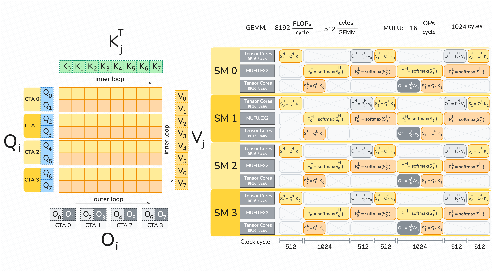
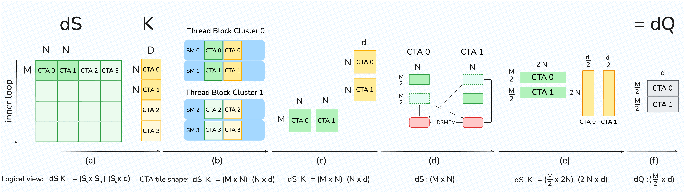

# FlashAttention-4：当 Tensor Core 变快后，Attention 为什么要重写流水线

FlashAttention 的核心一直不只是“写一个更快的 GEMM”，而是避免把 N×N 的 attention score 矩阵完整落到 HBM，并让 QKᵀ、online softmax 与 PV 在片上流水化。到了 NVIDIA Blackwell，这个问题又发生了一次结构性变化：B200 的 BF16/FP16 Tensor Core 峰值约为 H100 的两倍，但 shared memory 带宽、指数函数单元和普通 ALU 并没有同比扩展。

于是，上一代最值得优化的矩阵乘，在新硬件上可能先跑完；剩下的 softmax、SMEM 搬运、跨 CTA reduction 和同步反而暴露在关键路径上。[FlashAttention-4](https://arxiv.org/abs/2603.05451) 的关键并非某一条 Blackwell 指令，而是承认这种**非对称硬件扩展**，然后联合修改算法、tile、资源分配与软件流水线。

本文聚焦 B200 上 BF16/FP16 训练型 attention 的 forward/backward kernel。推理阶段的 paged attention、KV-cache 管理、稀疏 attention 和低比特量化有不同的数据流，不应直接套用这里的结论。

## 1. 背景：为什么 FlashAttention-3 不能机械搬到 Blackwell

FlashAttention-3 面向 Hopper，已经采用 warp specialization 和 ping-pong schedule，把 TMA 数据搬运、WGMMA 与 softmax 分给不同 warpgroups。Blackwell 进一步改变了三个前提：

1. **矩阵乘变得更快。** 论文按 B200 的 148 个 SM、1.85 GHz 和 2.25 PFLOP/s 峰值换算，每个 SM 的 BF16 MMA 吞吐为 8192 FLOP/clock，是 Hopper 的两倍。
2. **MUFU 与 SMEM 没有同步翻倍。** B200/GB200 每个 SM 的指数吞吐仍约为 16 op/clock，论文微基准采用的 SMEM read throughput 为 128 B/clock/SM。
3. **累加器位置和 MMA 粒度变了。** Blackwell 的第五代 Tensor Core 通过 tcgen05/UMMA 执行更大的 128×N tile，并把结果异步写入每个 SM 256 KB 的 TMEM；Hopper 则把 WGMMA accumulator 写回寄存器。

第三点不只是“多了一层存储”。当 accumulator 不再立即占据普通寄存器，MMA issuer 可以更早继续发射，softmax consumer、correction warpgroup 和 TMA producer 也能以新的依赖关系并行。但代价是程序必须显式管理 TMEM 的分配、生命周期、barrier 和跨阶段复用。

## 2. 先做资源账：瓶颈不等于 TFLOPS 最低

设一个 forward tile 在 query 与 key 序列维度上为 M×N，head dimension 为 d。每轮包含 QKᵀ 和 PV 两次矩阵乘，论文给出的简化周期模型是：

- MMA：T_mma = 4MNd / 8192；
- 指数：T_exp = MN / 16；
- SMEM：需要分别计算 Q/K 和 V 被 MMA tile 重复读取的流量，不能只看一次逻辑读。

当 M=N=d=128 时，论文估算 MMA、SMEM、指数分别约为 1024、768、1024 cycles；当 M=256、N=d=128 时，分别约为 2048、1536、2048 cycles。大 tile 增加了单 CTA 的工作量和数据复用机会，但 softmax 并没有因此消失，寄存器、TMEM 和 occupancy 压力也同步上升。

这个模型应当被理解为设计方向，而不是精确 runtime 预测。真实 kernel 还受 L2/HBM、寄存器带宽、barrier latency、bank conflict、tail tile、causal mask 和 CTA residency 影响。正确的问题不是“Tensor Core 利用率是否到顶”，而是：

- 哪类执行资源占据最长关键路径；
- 其他阶段能否被这条路径隐藏；
- 为提高 overlap 增加的寄存器、SMEM 或 TMEM 是否降低了并发度；
- 不同 sequence length、head dimension 与 mask 是否改变了上述答案。

## 3. Forward 机制：全异步 MMA、TMEM 与双 Q tile

*图 1：FlashAttention-4 forward pipeline，完整复用原论文 Figure 1，未裁切、未加注。上标 H/L 分别表示两个 128-token Q tile；图中展示 QK、softmax、PV、correction 与数据搬运的交错。来源：Ted Zadouri、Markus Hoehnerbach、Jay Shah、Timmy Liu、Vijay Thakkar、Tri Dao，[FlashAttention-4 Figure 1](https://arxiv.org/html/2603.05451v1#S3.F1)，[原始图片](https://arxiv.org/html/2603.05451v1/Figures/FA4_FWD_p3.png)。许可：[CC BY-NC-SA 4.0](https://creativecommons.org/licenses/by-nc-sa/4.0/)。移动端可点击图片查看原尺寸。*

Forward 仍然沿用 online softmax 的块式更新，但执行组织围绕 Blackwell 重写：

1. 一个 CTA 同时推进 high/low 两个 Q tile。一个 tile 做 Tensor Core 工作时，另一个 tile 做 softmax，形成类似 FA-3 的 ping-pong。
2. QKᵀ 的 score accumulator 异步进入 TMEM。softmax warpgroup 等待对应 barrier 后，把一行 128 个元素读入寄存器，执行 row max、指数、row sum 和低精度转换。
3. 概率块 P 通过 TMEM 交给 PV MMA，而不是依赖 Hopper 式寄存器 accumulator 布局。
4. 历史输出 O 的重缩放被拆给独立 correction warpgroup，从 softmax 与当前 MMA 的关键重叠区移出。
5. 一个 warpgroup 驱动 Tensor Core 与 TMA，两个 128-thread warpgroups 分别处理两组 softmax；每个线程负责完整一行，避免为 row max 做跨 warp shuffle。

全异步不等于无同步。生产者在覆写 SMEM stage 前必须确认消费者完成读取；softmax 读取 TMEM 前必须等待 QK 完成；PV 使用 P 前必须看到转换后的数据；TMEM 释放前则要证明所有异步使用者已经退出。mbarrier 的 phase、arrival count 和 TMEM 生命周期因此属于正确性条件，而不只是性能细节。

更大的 tile 也会迅速吃掉寄存器。论文指出 BF16 路径中，每个 softmax thread 可能需要 128 个寄存器保存输入，并需要至多 64 个寄存器保存输出，另有临时值与统计量。实现把 P 的写出拆成“前三个 quarter + 最后一个 quarter”，正是为了降低瞬时寄存器压力并避免 spill。

## 4. Softmax：指数函数成为显性短板

### 4.1 用 FMA 分担 MUFU 的 exp2

B200 的 MUFU 每个 SM 每周期只能完成约 16 个指数操作，而 BF16 MMA 吞吐达到 8192 FLOP/clock/SM。FlashAttention-4 因此没有把所有 exp2 都压在 MUFU 上，而是让一部分元素走软件路径：

1. 用 Cody–Waite range reduction 把 2^x 拆为整数部分 2^floor(x) 和区间 [0,1) 上的分数部分；
2. 整数部分通过 IEEE 754 exponent bits 构造；
3. 分数部分使用 Sollya 生成的多项式，并以 Horner 形式在 FMA 单元求值；
4. 将两部分重新组合。

这相当于用原本相对空闲的 FMA/整数流水线为 MUFU 分流。论文实际只让每行约 10%–25% 的元素走软件近似，其余仍使用硬件 MUFU.EX2；比例按 tile 的 MMA/exp 资源比实测调优。若全部软件化，额外系数、临时值、寄存器带宽和延迟可能触发 spill，收益会反转。

近似也不是“免费精度”。论文在 [0,1) 上抽样 400 万个输入：三阶多项式的 FP32 最大相对误差约 8.8×10^-5，但转成 BF16 后，约 3.9×10^-3 的量化误差占主导，99% 输入与硬件结果相差不超过 1 BF16 ULP。这只说明论文测试的 BF16 attention 数据路径具有合适误差预算；对 FP32 输出、特殊分布或更严格容差，仍应重新做端到端误差验证。

### 4.2 条件重缩放：不是每次 row max 变化都立刻改 O

标准 online softmax 在发现新 row max m_j 时，要把旧 accumulator O_(j-1) 乘以 exp(m_(j-1)-m_j)。这是一整行向量乘。FlashAttention-4 维护真实统计量，但只有当 max 增量超过阈值 τ 时才立即重缩放；论文典型设置为 log2(256)=8。增量较小时继续以旧参考点累计，最后再用真实最大值和 normalizer 统一归一化。

严格地说，这不是“仅在 max 改变时缩放”，而是允许有界 slack 的延迟校正。实现还要避免 warp divergence：当一个 warp 中任一线程需要重缩放时，整个 warp 执行该路径。阈值、累加范围、mask 后极值与最终归一化都必须纳入数值测试。

## 5. Backward 机制：2-CTA MMA、DSMEM 与 reduction 轴重排

Backward 每轮需要五次 MMA：重算 S，以及 dP、dV、dQ、dK。论文对 M=N=d=128 的 1-CTA 模型估算，MMA 约 2560 cycles，而总 SMEM 流量约 3328 cycles，后者高约 30%。即使 TMEM 可以保存更多中间 accumulator，仍有八个 BF16 GEMM operand 需要从 SMEM 喂给 Tensor Core。

*图 2：FlashAttention-4 的 2-CTA backward dQ 数据交换，完整复用原论文 Figure 3，未裁切、未加注。CTA pair 通过 DSMEM 交换各自一半 dS，使每个 CTA 获得完整 2N reduction 所需的数据，再形成自己的 dQ 行块。来源：Ted Zadouri、Markus Hoehnerbach、Jay Shah、Timmy Liu、Vijay Thakkar、Tri Dao，[FlashAttention-4 Figure 3](https://arxiv.org/html/2603.05451v1#S3.F3)，[原始图片](https://arxiv.org/html/2603.05451v1/Figures/2cta_figure.png)。许可：[CC BY-NC-SA 4.0](https://creativecommons.org/licenses/by-nc-sa/4.0/)。移动端可点击图片查看原尺寸。*

Blackwell 的 2-CTA MMA 允许同一 cluster 中的一对 CTA 协作执行 MMA。以 M=256、N=K=128 为例：

- A tile 和 accumulator 沿 M 在两个 CTA 间切分；
- B tile 沿 N 切分，每个 CTA 只在自己的 SMEM 中 staging 一半；
- 硬件消费两侧数据并访问配对 CTA 的 TMEM。

这大致减半了多个 GEMM 的 B operand SMEM traffic，但 dQ 有一个额外矛盾：FlashAttention backward 的外层按 KV tile 并行，dQ 则要沿 KV 序列做 reduction；普通 2-CTA MMA 切的是输出 M 轴，并不会自动重排 reduction 轴。

FA-4 的解决方法是让 CTA pair 通过 DSMEM 交换各自一半 dS。交换后，每个 CTA 拥有 M/2 行和完整的 2N reduction，执行 (M/2, 2N) × (2N, d) 的 dQ MMA。S、dP、dV、dK 使用 M=256 的 2-CTA tile，而 dQ 使用 M=128、reduction=256 的形状。流水线把当前 tile 的 dP/dS 与上一 tile 的 dQ MMA 交错，以隐藏 DSMEM latency。

重排还带来第二项收益：每个 CTA 最终只写自己的一半 dQ 行块，因此相较 1-CTA 方案，全局 atomic reduction 数量减半。代价同样明确：

- 两个 CTA 必须固定配对并同时驻留；
- peer CTA 在 MMA in-flight 时不能退出；
- 涉及 TMEM/UMMA 的路径必须保持一致的 2-CTA 模式；
- cluster residency、DSMEM 同步、配对尾块和资源占用都会限制调度自由度。

默认 atomic accumulation 的浮点加法顺序不固定，因此 backward 不是确定性的。论文另提供 semaphore 串行化公共 gradient tile 的 deterministic 模式，并通过 batch/head swizzle、causal 情况下的 KV 逆序与 shortest-processing-time-first 顺序减轻等待。确定性换来 memory fence 与锁等待，论文报告其最佳结果可达到 1-CTA 非确定性 backward 速度的约 75%，不应理解为零成本。

## 6. 为什么选择 CuTe DSL

FlashAttention-4 完全使用嵌入 Python 的 CuTe DSL 实现：Python 元编程描述 layout、tile、copy、MMA 与调度，编译器降到 PTX，再由 ptxas 生成 SASS；必要时仍可插入自定义 PTX。这条路线同时追求两件事：

- 保留对 tcgen05、TMA、TMEM、cluster、barrier 与 register allocation 的底层控制；
- 避免在复杂 C++ template 实例化上消耗大量开发迭代时间。

论文对“单个 kernel”的比较中，FA-3 C++ template 的 forward/backward 编译约为 55 s/45 s，FA-4 CuTe DSL 为 2.5 s/1.4 s，对应约 22×/32×。这不是任意项目都能获得的通用加速比：缓存状态、模板规模、编译选项、目标架构与变体数量都会改变结果。

源码阅读可以从 [flash_attn/cute](https://github.com/Dao-AILab/flash-attention/tree/main/flash_attn/cute) 开始，按以下顺序建立映射：

1. 找 forward/backward 的 tile 与 dtype dispatch；
2. 对照 layout 和 copy atom，确认 GMEM→SMEM→TMEM/RMEM 的数据路径；
3. 标出 producer、MMA、softmax、correction warpgroups 和每个 barrier；
4. 跟踪 scheduler 对 causal、varlen、batch/head swizzle 的分支；
5. 最后再看 benchmark 与 correctness test，确认论文形状如何落到代码参数。

## 7. 工程实现流程

把类似优化迁移到新 GPU 时，可以采用下面的顺序。

### 第一步：建立组件级基线

固定 GPU clocks 与功耗模式，分别测 MMA、MUFU、SMEM、TMA、TMEM load/store 和 cluster DSMEM。记录理论值、微基准值与 Nsight Compute 指标，避免用产品页峰值代替可用吞吐。

### 第二步：画出依赖图与资源生命周期

对每个 tile 标出 GMEM load、SMEM stage、QK、softmax、P conversion、PV、correction 和 store。给每个 mbarrier 写明 producer、consumer、phase 与预期 arrival；给每段 TMEM 标明 allocate、最后一次异步使用和 deallocate。

### 第三步：先正确，再逐项打开 overlap

从单 stage、单 CTA、硬件 exp2 和无近似版本开始，与 FP32 reference 比较。随后依次加入双 Q tile、异步 TMEM、correction warpgroup、部分软件 exp2、条件重缩放和 2-CTA backward。每一步同时检查误差与 race，而不是最后一次性定位。

### 第四步：做 shape sweep

至少覆盖 head dimension 64/128/192，sequence length 1K–32K，causal/non-causal，固定长度/varlen，以及能制造 tail tile 的非整倍数形状。对 GQA/MQA 还要单独检查 dK/dV reduction 与 atomic 行为。

### 第五步：与当前库公平比较

统一 dtype、mask、dropout、layout、总 token 数、warm-up、JIT/cache 状态和计时边界；记录 CUDA、driver、CuTe DSL、cuDNN、Triton 与框架版本。只比较 kernel 时间时，不要把结论外推为模型端到端训练加速。

## 8. 怎样读论文性能结果

论文在 B200、BF16/FP16 上测试 sequence length 1K–32K，并令 batch size 随长度变化以保持总 token 数为 32K；覆盖 head dimension 64、128，以及 DeepSeek V3 风格的 Q=192/KV=128，包含 causal 与 non-causal。

在该设置中，论文报告：

- 峰值达到 1613 TFLOP/s，约为 B200 理论 BF16 峰值的 71%；
- forward 相对 cuDNN 9.13 为 1.1×–1.3×，相对其 Triton baseline 为 2.1×–2.7×；
- 中长序列，尤其 4K 以上，优势更稳定；
- 论文摘要将总体最好结果概括为相对 cuDNN 9.13 最高 1.3×、相对 Triton 最高 2.7×。

这些数字有三条边界。第一，TFLOP/s 按 attention 逻辑 FLOPs 计算，causal 情况按约一半有效元素折算，它不是芯片上所有指令的物理操作计数。第二，这是 kernel benchmark，不包含 QKV projection、通信、optimizer、数据加载和框架调度。第三，论文明确指出更新的 cuDNN 已吸收其中多项技术并达到相近性能；附录同时列出 cuDNN 9.19.1.2，因此旧版本对比不能当作永久排名。

更可迁移的性能模型是：

> tile 时间 ≈ max(MMA 路径、softmax/MUFU 路径、SMEM/TMEM 数据路径) + 无法隐藏的同步、尾块与调度开销。

优化某一路径只有在它位于 max 项，或能改善 overlap 时才会变成端到端收益。若模型训练还被通信、MLP 或 optimizer 支配，即使 attention kernel 快 30%，step time 也不会等比例下降。

## 9. 局限与适用边界

- **架构专用性强。** tcgen05、TMEM 和 2-CTA MMA 是 Blackwell 特性，Hopper/Ampere 不能直接执行同一 kernel。
- **精度结论有 dtype 边界。** 软件 exp2 的三阶误差在 BF16 rounding 下被掩盖，不代表 FP32 或所有输入分布都安全。
- **资源交换复杂。** 大 tile 和多 warpgroup 增加寄存器与 TMEM 压力；2-CTA 又约束 cluster residency，低占用可能抵消单 tile 收益。
- **形状敏感。** 短序列、小 batch、特殊 head dimension、稀疏 mask、dropout、varlen 与 tail tile 可能改变瓶颈。
- **确定性有成本。** semaphore 和 device-wide fence 会串行化 reduction，性能取决于 CTA 顺序与负载均衡。
- **库对比会过期。** cuDNN、Triton、编译器和驱动持续吸收新调度；任何结论都必须附版本。
- **kernel 不是完整训练。** 还需测量 projection、通信、activation memory、编译/JIT、框架 dispatch 和模型收敛。

## 10. 实践检查表

### 正确性与数值

- [ ] 与高精度 reference 比较 forward、dQ、dK、dV，并覆盖极端 score 与全 mask 行。
- [ ] 分别验证硬件 exp2、软件 exp2 和混合比例；记录 max/mean error 与 ULP 分布。
- [ ] 条件重缩放是否在最终 normalization 中使用了正确的累计统计量？
- [ ] causal、varlen、GQA/MQA 和非整 tile 边界是否都经过 race 检查？
- [ ] 确定性模式是否在多次运行中 bitwise 一致，并覆盖 dQ/dK/dV 的所有跨 CTA reduction？

### 同步与资源

- [ ] 每个 mbarrier 的 arrival count、phase 翻转和 producer/consumer 是否一一对应？
- [ ] TMEM 是否在最后一个异步 MMA 和 consumer 完成后才释放或复用？
- [ ] 2-CTA peer 是否固定配对、同时存活，并在 DSMEM exchange 前后正确同步？
- [ ] register spill、local memory、SMEM bank conflict 与 cluster occupancy 是否在目标 shape 上可接受？

### 性能

- [ ] 基准是否包含 warm-up，并把首次 JIT 与稳定态时间分开报告？
- [ ] 是否扫描 sequence length、head dimension、mask、batch 和 tile，而不是只报最佳点？
- [ ] Nsight Compute 是否证明被优化的资源原本确实位于关键路径？
- [ ] baseline 是否使用相同 dtype、layout、功能开关、计时范围和当前版本？
- [ ] kernel 收益是否在真实模型 step time、显存占用和收敛质量上重新验证？

## 11. 结论

FlashAttention-4 最值得复用的方法论，是每到一代新 GPU 都重新做资源账。当 Tensor Core 的扩展速度超过 MUFU、SMEM 和标量流水线时，继续只围绕 MMA 调 tile 已经不够；算法必须主动把指数分流到 FMA，把可延迟的 rescale 移出关键路径，把 accumulator 放进 TMEM，并用 CTA pair 重排数据与 reduction。

这也是高性能 kernel 的长期规律：硬件峰值只说明某个部件能多快，真正的吞吐取决于整条流水线中最慢、最难隐藏且最受资源约束的阶段。

## 参考资料

1. Ted Zadouri et al., [FlashAttention-4: Algorithm and Kernel Pipelining Co-Design for Asymmetric Hardware Scaling](https://arxiv.org/abs/2603.05451), 2026。
2. [FlashAttention-4 HTML full text](https://arxiv.org/html/2603.05451v1)。
3. [FlashAttention-4, MLSys 2026 conference paper](https://proceedings.mlsys.org/paper_files/paper/2026/file/ae8b0b5838ba510daff1198474e7b984-Paper-Conference.pdf)。
4. Dao-AILab, [FlashAttention CuTe implementation](https://github.com/Dao-AILab/flash-attention/tree/main/flash_attn/cute)。
5. NVIDIA, [PTX ISA: tcgen05 family instructions](https://docs.nvidia.com/cuda/parallel-thread-execution/#tcgen05-family-instructions)。
6. NVIDIA, [CuTe DSL Introduction](https://docs.nvidia.com/cutlass/latest/media/docs/pythonDSL/cute_dsl_general/dsl_introduction.html)。
7. Jay Shah et al., [FlashAttention-3: Fast and Accurate Attention with Asynchrony and Low-precision](https://arxiv.org/abs/2407.08608)。
8. Creative Commons, [CC BY-NC-SA 4.0](https://creativecommons.org/licenses/by-nc-sa/4.0/)。
