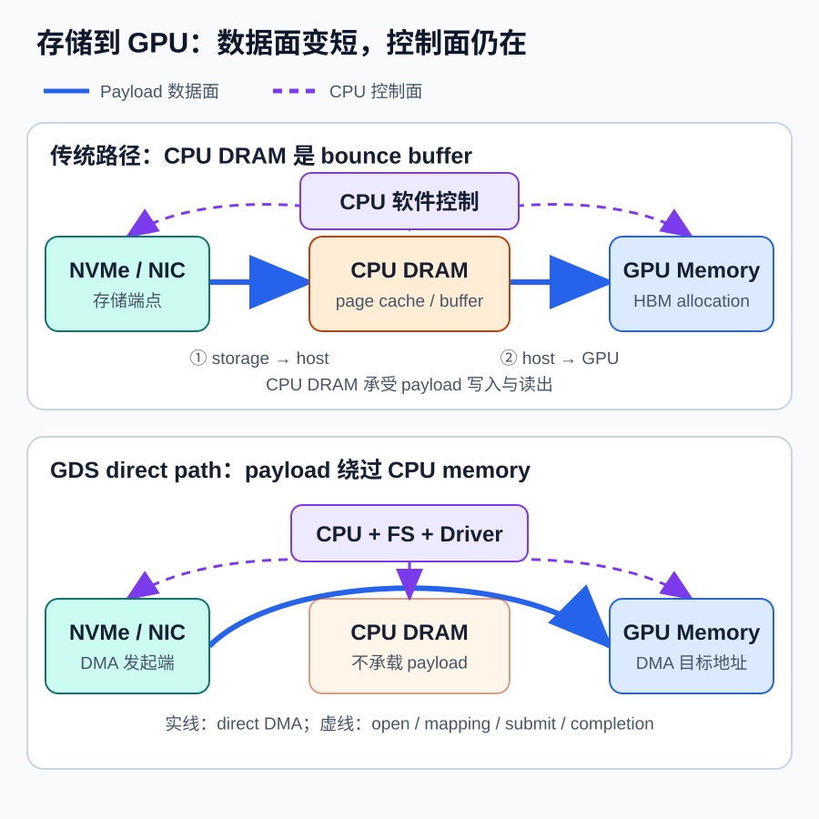
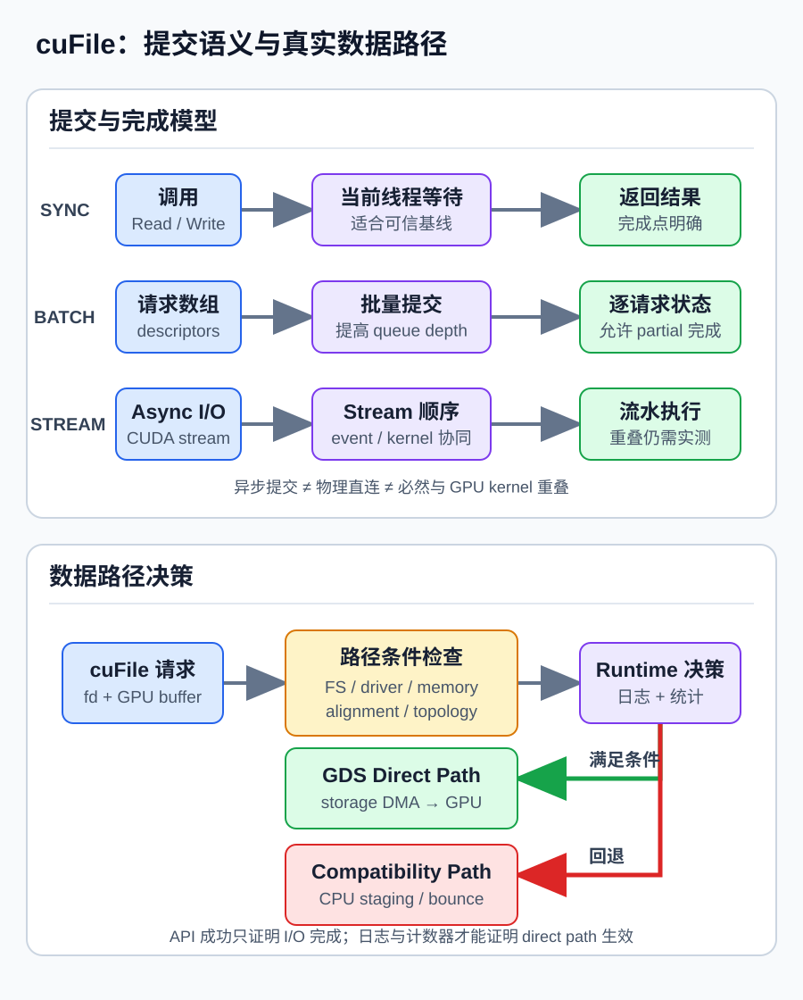

# GPUDirect Storage 与 cuFile：让 GPU 绕过 CPU Bounce Buffer 直连存储

GPU 算力增长很快，但数据进入和离开显存的路径并没有自动变短。传统文件 I/O 往往先把数据读入 CPU 内存，再通过 cudaMemcpy 搬到 GPU；写 checkpoint 时则反向经历同样的 staging。对大规模训练、GPU 数据分析、图计算和科学计算来说，这条路径不只增加一次拷贝，还会占用 CPU DRAM 带宽、CPU 核心和额外的同步窗口。

GPUDirect Storage（GDS）提供了另一条数据路径：在硬件、文件系统和驱动均支持时，NVMe、NIC 或存储控制器可以通过 DMA 直接读写 GPU memory。NVIDIA 的 cuFile API 把文件描述符、GPU buffer、提交方式与兼容回退封装成可编程接口。

但“调用了 cuFile”并不等于“数据一定绕过了 CPU”。文件系统、O_DIRECT 条件、buffer 类型与对齐、PCIe 拓扑、驱动配置都可能改变实际路径。本文的重点不是把 GDS 描述成一个更快的 read()，而是建立一套可观测、可对照、可复现的 GPU I/O 工程方法。

*图 1：传统路径与 GDS 数据路径。蓝色实线表示数据面，灰色虚线表示控制面。图由本文原创，技术依据为 NVIDIA [GPUDirect Storage Overview Guide](https://docs.nvidia.com/gpudirect-storage/overview-guide/index.html) 与 [Design Guide](https://docs.nvidia.com/gpudirect-storage/design-guide/index.html)，未复制 NVIDIA 原图；许可：CC BY 4.0。*

## 1. 背景：GPU 很快，为什么数据仍卡在 CPU 内存

最常见的 GPU 文件读取流程可以抽象为两段：

~~~text
storage --pread/read--> host buffer --cudaMemcpy--> GPU memory
~~~

第一段由存储设备把数据送到 host memory；第二段由 GPU DMA engine 或拷贝引擎从 host memory 读取，再写入 HBM。若经过 page cache、用户态 pageable buffer 或额外格式转换，中间还可能发生更多复制。即使使用 pinned host buffer 消除了 pageable-to-pinned 的隐式 staging，CPU DRAM 仍至少承受一次写入和一次读出。

当 GPU 才是数据的 first touch 或 last touch 时，CPU 内存只是中转站，常见场景包括：

- GPU 数据分析直接扫描二进制列块；
- 训练数据已离线打包，GPU 端完成解码或变换；
- 科学计算读取大型场、矩阵与轨迹；
- checkpoint tensor 本来就在显存；
- 多盘聚合吞吐逼近 CPU socket 的内存或 I/O 上限。

此时 host staging 会产生搬运延迟、CPU DRAM 流量和软件调度开销。GDS 要优化的正是这段数据面。

## 2. 机制：GDS 到底绕过了什么

GDS 的核心不是“完全不需要 CPU”，而是让大块 payload 不必经过 CPU memory。支持条件满足时，存储侧 DMA 可以面向 GPU virtual address 建立映射，数据沿 PCIe fabric 直接进入或离开 GPU memory。

CPU 仍参与控制面，包括：

- 打开文件、处理 metadata 和权限；
- 由文件系统解析 offset 到存储块的映射；
- 注册文件 handle 与 GPU buffer；
- 建立 pinning、DMA mapping 和 I/O submission；
- 处理完成状态、错误、回退与清理。

因此，更准确的说法是：**GDS 绕过 CPU bounce buffer，而不是消灭 CPU control plane。**

本地 NVMe、NVMe-oF、支持的网络文件系统和并行文件系统在物理实现上不同，但应用层可以使用相似抽象：文件 offset、GPU virtual address、传输长度和 completion。真正的数据路径则由文件系统插件、驱动、NIC/NVMe 与 PCIe 拓扑共同决定。

## 3. cuFile 的最小编程模型

一个同步读取的最小流程通常包含以下步骤：

~~~text
cuFileDriverOpen()
fd = open(path, O_RDONLY | O_DIRECT)
cuFileHandleRegister(handle, fd)
cudaMalloc(device_buffer, bytes)
cuFileBufRegister(device_buffer, bytes)   # 可选的性能优化
cuFileRead(handle, device_buffer, size, file_offset, buffer_offset)
validate_data()
cuFileBufDeregister(device_buffer)
cuFileHandleDeregister(handle)
close(fd)
cuFileDriverClose()
~~~

这段伪代码强调调用关系，而不是可跨平台直接复制的配置。实际代码还需要检查每一步返回值、CUDA context、文件系统支持、驱动版本和关闭顺序。

cuFileRead/cuFileWrite 中最容易混淆的是三个地址量：

1. **file offset**：文件中的起始位置；
2. **device pointer base**：GPU allocation 的基地址；
3. **device pointer offset**：相对 GPU buffer 基地址的偏移。

传输 size、file offset、buffer offset 与 buffer 地址可能受到设备、文件系统和 O_DIRECT 的对齐要求约束。不要把某个系统上的 4 KiB 经验值写死为全局定律；应以当前 GDS 版本、文件系统和块设备要求为准，并用专门的尾部缓冲处理非对齐文件尾。

cuFileBufRegister 通常用于提前 pin/map GPU buffer，避免反复 I/O 时重复建立映射。它是重要的性能优化，但并不意味着所有受支持调用都必须显式注册。若 buffer 生命周期很短，注册成本可能抵消收益；若同一组 buffer 被反复复用，注册通常更合理。

## 4. 同步、Batch 与 Stream API 分别解决什么问题

### 4.1 同步 API：先建立可信基线

同步 cuFileRead/cuFileWrite 返回时，本次操作已有明确结果。它最适合验证 direct path、建立单盘单 GPU 基线、检查数据正确性，以及处理粗粒度传输。语义简单，但单线程逐个提交很难填满高性能 NVMe 或并行文件系统。

### 4.2 Batch API：摊薄大量请求的固定成本

Batch API 将多个 I/O descriptor 组成批次提交，再通过 completion/status 接口回收结果。它适合大量独立块、分片数据集和多文件读取。收益来自减少用户态往返与提高 queue depth，而不是改变每个字节的物理链路。

使用 Batch API 时必须为每个请求保存独立状态，处理 partial completion、错误和重试；“批次提交成功”不等于批内每个 I/O 都成功完成。

### 4.3 Stream API：把 I/O 纳入 CUDA 依赖图

Stream API 允许 I/O 与 CUDA stream 中前后的 kernel、event 和其他操作建立顺序关系。例如两个 stream 分别执行“读分片—预处理—计算”，形成双缓冲流水线。

但要区分三个概念：

- **异步提交**：host 调用很快返回；
- **异步执行**：I/O 在后台推进；
- **硬件重叠**：I/O 与 kernel 实际同时使用不同或可共享资源。

前两项成立，不代表第三项必然成立。存储、PCIe、GPU memory system 和 kernel 都可能争用带宽，最终仍要看 timeline 与端到端吞吐。

*图 2：同步、Batch、Stream 三种执行语义，以及 direct/compatibility path 的决策点。图由本文原创，技术依据为 NVIDIA [cuFile API Reference](https://docs.nvidia.com/gpudirect-storage/api-reference-guide/index.html) 与 [O_DIRECT Requirements Guide](https://docs.nvidia.com/gpudirect-storage/o-direct-guide/index.html)，未复制 NVIDIA 原图；许可：CC BY 4.0。*

## 5. Direct path 为什么会变成 compatibility path

cuFile 的 compatibility mode 很有价值：当 direct path 不可用时，应用仍可借助 CPU staging 完成 I/O。但它也带来诊断风险——API 返回成功，性能却与预期完全不同。

常见触发因素包括：

- 文件系统、mount option 或协议不在当前支持矩阵内；
- NVIDIA 驱动、nvidia-fs、DMA-BUF 或相关组件未正确配置；
- 文件没有满足所需的 direct-I/O 条件；
- offset、size 或 buffer 不满足路径要求；
- memory type 不受支持，或 GPU buffer 无法建立所需映射；
- 拓扑或平台策略不允许预期的 peer/direct 访问；
- 配置允许 compatibility mode，在 direct path 失败后自动回退。

验收不能只检查返回值。至少需要核对当前支持矩阵、文件系统与 mount、GDS/cufile 配置和统计、诊断工具结果、CPU utilization、CPU DRAM traffic、NVMe/PCIe 吞吐，并对 direct 与 compatibility 两条路径做受控 A/B。

compatibility path 不是错误；它是可移植性边界。真正的问题是应用不知道自己正在走哪条路径。

## 6. PCIe 拓扑决定“直连”是否真的短

“直接到 GPU memory”只描述端点，不保证中间路径最短。NVMe、NIC 与目标 GPU 可能挂在同一 PCIe switch、同一 root complex、不同 root complex，甚至跨 NUMA socket。跨 socket 或共享上行链路会增加 hop、争用与 tail latency。

多 GPU、多盘、多 NIC 系统不能把设备随机配对。工程上应读取 nvidia-smi topo -m、PCIe tree、NUMA affinity 和存储设备位置，再建立显式映射：

~~~text
shard 0 -> local NVMe 0 -> nearest GPU 0
shard 1 -> local NVMe 1 -> nearest GPU 1
network flow -> local NIC -> topology-near GPU
submission thread -> corresponding NUMA node
~~~

如果存储离 GPU 很远，direct path 仍可能减少 CPU DRAM traffic，但未必达到本地 NVMe 的峰值。拓扑是性能模型的一部分，不是部署完成后的附加检查。

## 7. 性能与资源模型：粒度、对齐、并发度

对一次大小为 S 的读取，传统非流水路径可以粗略写成：

~~~text
T_host-stage ≈ S / B_storage + S / B_H2D + L_io + L_copy
T_GDS        ≈ S / min(B_storage, B_PCIe-path, B_GPU-endpoint) + L_submit
~~~

这不是精确公式：page cache、并行请求、DMA engine、文件系统和流水执行都会改变各项。但它揭示了两点：GDS 消除的是 host staging 项，不会让慢存储凭空变快；瓶颈会转移到存储、PCIe 路径或 GPU 端点中的最小带宽。

传统路径的 CPU DRAM 至少要为 payload 承受约 S 的写入和 S 的读出，page cache 或额外 memcpy 还会继续放大。GDS direct path 可以显著降低这部分流量，但 HBM、PCIe 与存储队列仍然消耗真实资源。

请求粒度和并发度通常决定能否接近带宽上限：

- 请求太小，submission 与 completion 的固定成本占主导；
- 请求较大，更容易摊薄开销，但单请求 latency 和 buffer 占用上升；
- queue depth 太低，NVMe/网络链路不饱和；
- queue depth 太高，会增加 tail latency、拥塞和显存占用；
- 若每个 in-flight buffer 为 S，并发度为 Q，仅数据 buffer 就约占 Q × S。

测试时不要只报告峰值 GB/s。至少同时观察端到端 samples/s 或 checkpoint pause、CPU utilization、CPU DRAM bandwidth、NVMe/NIC 吞吐、PCIe 利用率、P50/P95/P99 latency、GPU memory 占用，以及 direct/compatibility path 比例。

## 8. 局限：GDS 适合什么，不适合什么

GDS 最适合 GPU 是数据 first/last touch、大块连续且可并发的 streaming I/O、CPU 不需要逐字节解析 payload、host copy 已是瓶颈，并且应用能够复用 buffer 和控制对齐的场景。

以下情况收益可能有限：

- CPU 必须完成解压、解析、校验或复杂变换；
- 大量 metadata 操作或细粒度随机 I/O；
- 热数据已经稳定命中 page cache；
- 存储本身远慢于 PCIe 和 host copy；
- 数据集很小，注册与初始化成本占主导；
- direct path 支持不完整，生产环境频繁回退；
- GPU kernel 已把 HBM/PCIe 资源占满，I/O 无法有效重叠。

压缩数据尤其需要端到端判断。如果解码只能在 CPU 上完成，直接把压缩块送到 GPU 可能只是移动瓶颈；如果有 GPU 端解码器，GDS 与 GPU decompression 才可能组成完整 direct pipeline。

## 9. 从单盘基线到端到端应用的工程流程

### 第一步：功能与支持检查

固定 GPU、驱动、CUDA/GDS、文件系统和 kernel 版本；检查设备、mount option、O_DIRECT 与支持矩阵；用校验和验证读写正确性；显式测试非对齐尾部、短读和错误路径；记录 compatibility mode 是否开启。

### 第二步：建立四组微基准

在同一文件、设备和缓存条件下比较：

1. POSIX read 到 host buffer；
2. POSIX read + H2D copy；
3. cuFile direct path；
4. cuFile compatibility path。

逐步扫描 block size、queue depth 和 buffer registration。每轮只改变一个变量，并记录吞吐、CPU、DRAM、PCIe 与 tail latency。

### 第三步：拓扑扩展

先做单盘/单 GPU，再增加 queue depth，然后扩展到多盘，最后扩展到多 GPU。每一步都验证设备亲和性、NUMA pinning 和共享链路是否成为新瓶颈。

### 第四步：放回应用时间线

把读取、GPU 预处理、kernel、通信和写回放到一条 timeline。确认 I/O 优化缩短的是 critical path，而不是只让脱离应用的 microbenchmark 更快。若使用 Stream API，还要检查 kernel 与 I/O 并发是否导致 HBM 或 PCIe 争用。

### 第五步：生产化

监控 direct/fallback 路径；对版本升级执行回归基准；为不支持的节点保留正确 fallback；对短读、磁盘满、设备重置和 partial completion 做故障注入；把正确性、P99 latency 与端到端吞吐都设为发布门槛。

## 10. 实践检查表

| 检查项 | 通过标准 |
| --- | --- |
| 软件栈 | GPU 驱动、CUDA/GDS、文件系统插件与 kernel 组合在支持矩阵内 |
| Direct I/O | fd、mount、offset、size、buffer 地址与尾部处理满足当前平台要求 |
| 数据路径 | 日志/统计能区分 direct 与 compatibility，不能只看 API 成功 |
| 正确性 | 读写内容、partial completion、错误与重试路径均有校验 |
| Buffer 生命周期 | 注册成本被复用摊薄，清理顺序明确，无悬空映射 |
| 拓扑 | NVMe/NIC、GPU、NUMA thread 的亲和关系已记录并固定 |
| 并发度 | block size 与 queue depth 扫描过，吞吐和 P99 均可接受 |
| 资源占用 | CPU DRAM、PCIe、HBM、GPU memory 和 CPU core 使用量有数据 |
| 端到端收益 | samples/s、step time 或 checkpoint pause 稳定改善 |
| 回退策略 | fallback 可观测、性能边界已知，升级后有回归测试 |

## 结论

GPUDirect Storage 的真正价值，是把存储到 GPU 的大块数据面从 CPU memory staging 中解耦。cuFile 提供同步、Batch 与 Stream 三种编程方式，让应用能够在正确性、吞吐和依赖管理之间选择。

但 GDS 不是一个孤立 API。文件系统与 O_DIRECT 决定路径能否建立，compatibility mode 决定失败时如何回退，PCIe/NUMA 拓扑决定“直连”有多短，请求粒度与并发度决定设备能否被填满，应用时间线决定微基准收益能否变成端到端收益。

最稳妥的工程原则是：**先证明路径，再优化路径，最后证明关键路径真的缩短。**

## 参考资料

1. NVIDIA. *GPUDirect Storage Overview Guide*. <https://docs.nvidia.com/gpudirect-storage/overview-guide/index.html>
2. NVIDIA. *GPUDirect Storage Design Guide*. <https://docs.nvidia.com/gpudirect-storage/design-guide/index.html>
3. NVIDIA. *GDS cuFile API Reference Guide*. <https://docs.nvidia.com/gpudirect-storage/api-reference-guide/index.html>
4. NVIDIA. *GPUDirect Storage O_DIRECT Requirements Guide*. <https://docs.nvidia.com/gpudirect-storage/o-direct-guide/index.html>
5. NVIDIA Technical Blog. *GPUDirect Storage: A Direct Path Between Storage and GPU Memory*. <https://developer.nvidia.com/blog/gpudirect-storage/>
6. NVIDIA. *GPUDirect Storage Documentation Hub*. <https://docs.nvidia.com/gpudirect-storage/>
