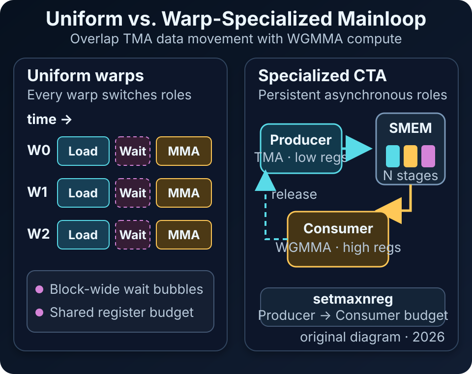
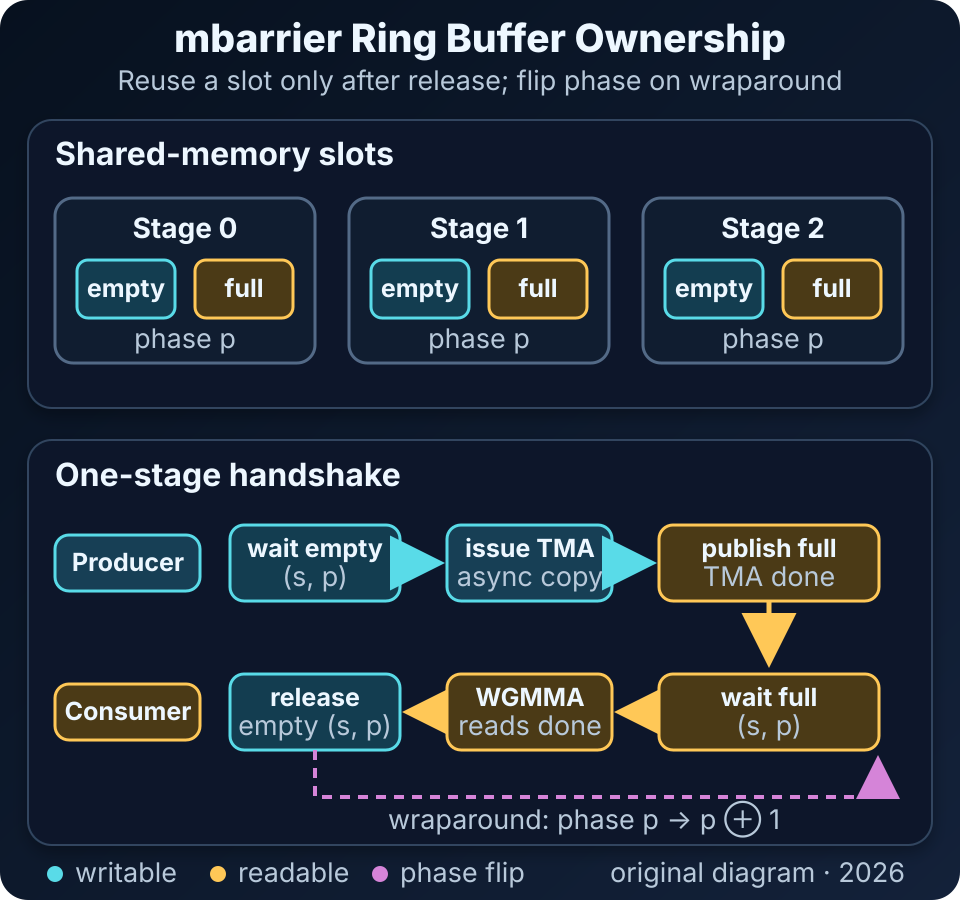

# Hopper Warp Specialization：用 TMA、mbarrier 与寄存器再分配拆开搬运和计算

传统 CUDA kernel 往往让一个 thread block 内的 warp 执行相同 mainloop：搬入一个 tile、同步、计算，再进入下一轮。这个结构直观，但当 kernel 同时包含地址生成、global-to-shared copy、Tensor Core 运算、归约和 epilogue 时，同一批 warp 必须在不同硬件流水线之间反复切换，软件流水线也越来越难保持稳定发射。

Hopper 上的 warp specialization 改变的是任务组织方式：少量 producer warp 常驻负责数据搬运，consumer warp group 常驻负责 WGMMA 计算；双方通过 shared-memory 环形缓冲区和 `mbarrier` 交换所有权，再把 producer 不需要的寄存器预算转给持有 accumulator 的 consumer。它不是多写一个 warp-id 分支就能自动提速，而是把 thread block 设计成长期运行的异步生产者—消费者系统。

*图 1：本站原创。依据 NVIDIA [Hopper Tuning Guide](https://docs.nvidia.com/cuda/hopper-tuning-guide/index.html#tensor-memory-accelerator)、[CUTLASS Efficient GEMM](https://docs.nvidia.com/cutlass/latest/media/docs/cpp/efficient_gemm.html#warp-specialization) 与 PyTorch 的 [Warp Specialization](https://pytorch.org/blog/warp-specialization/) 说明绘制，未复用第三方图像。*

## 1. 背景：统一 warp 为什么开始成为限制

在 uniform-warp mainloop 中，每个 warp 通常都经历相似阶段：

~~~text
地址计算 → global load → shared store → block 同步 → MMA → 下一 tile
~~~

即使使用多 stage buffering，同一个 warp 仍要同时承担搬运和计算指令。复杂 kernel 里会出现三类干扰：

1. load、Tensor Core 与标量/归约指令争夺 warp scheduler 的发射机会；
2. producer 需要的地址与临时寄存器挤占 accumulator 的寄存器预算；
3. block-wide 同步把本可独立推进的 stage 绑到同一个节拍。

Warp specialization 把这些工作分给不同 warp group，让 TMA copy engine、Tensor Core 和普通 CUDA core 更持续地并行工作。它不会提高芯片峰值 FLOPS；目标是减少不同硬件流水线之间的空泡，并把等待从全 block 停顿缩小为某个 buffer stage 的所有权等待。

## 2. Hopper 提供的四块积木

### 2.1 TMA：把搬运从“大批线程指令”变成异步事务

Tensor Memory Accelerator（TMA）根据 tensor map 描述符完成 global memory 与 shared memory 之间的多维搬运。一个线程即可发起大粒度 transfer，地址生成和边界处理由专用硬件承担。与每个线程分别计算地址并执行 load/store 相比，producer warp 的指令数和寄存器压力都更低。

TMA 仍受 global-memory 合并、对齐、tile shape、shared-memory layout 与 swizzle 约束；它只改变搬运的发起和执行方式，不会消除带宽上限。

### 2.2 WGMMA：让 consumer 持续推进 Tensor Core

Hopper 的 warp-group matrix multiply-accumulate（WGMMA）由四个连续 warp 协作发起异步矩阵运算。consumer 可以提交一组 WGMMA，在适当位置等待完成，并在寄存器中保留 accumulator。若输入 stage 能及时到达，Tensor Core 发射就不必被下一 tile 的 global load 指令打断。

### 2.3 `mbarrier`：为异步事务定义完成条件

`mbarrier` 支持把 arrive 与 wait 分开，并以 phase 区分同一 barrier 对象的连续轮次。TMA transaction 的完成也可以计入 barrier 条件，因此“producer 已发起 copy”和“数据已经可被 consumer 读取”不是同一事件。与 `__syncthreads()` 不同，参与者只需等待自己依赖的 stage，无须每轮把整个 block 拉到同一同步点。

### 2.4 Warp-group 寄存器再分配

producer 只需维护 descriptor、stage index 和少量控制状态，consumer 却要保存大量 accumulator。PTX `setmaxnreg` 允许 warp group 放弃或申请寄存器额度，使低需求 producer 的预算可用于高需求 consumer。增加与减少必须按协议配对，而且整个 CTA 仍受 SM register file 总容量约束；重新分配不是凭空增加寄存器。

## 3. 最小 producer-consumer 状态机

设 shared memory 有 `N` 个 stage。每个 stage 配一组“可写/已满”状态，mainloop 的核心协议可以写成：

~~~text
Producer(stage s):
  wait_empty(s, phase)
  issue_tma_copy(tile, s)
  commit_full(s, phase)       # 完成条件包含 TMA transaction

Consumer(stage s):
  wait_full(s, phase)
  issue_wgmma(s)
  wait_before_overwrite(s)
  release_empty(s, phase)
~~~

stage index 通常按环形递增：`s = iteration % N`。当同一物理 slot 被下一轮复用时，phase bit 翻转，用于区分“上一圈的完成”与“这一圈的新事务”。因此正确性不只取决于 barrier 地址，还取决于 stage、phase、expected arrival count 和 transaction byte count 是否一致。

*图 2：本站原创。依据 CUDA Programming Guide 的 [Asynchronous Barriers](https://docs.nvidia.com/cuda/cuda-programming-guide/04-special-topics/async-barriers.html) 与 PTX ISA 的 [`mbarrier` 语义](https://docs.nvidia.com/cuda/parallel-thread-execution/index.html#parallel-synchronization-and-communication-instructions-mbarrier) 绘制，未复用第三方图像。*

初始化尤其容易出错。barrier 的 expected count 必须与实际 arrive 协议一致；只有参与协议的线程才能在相同控制流假设下 arrive。尾部 tile 也必须走完 publish、consume 和 release，不能因为输入越界就跳过某次 arrive，否则另一角色可能永久等待。

## 4. `mbarrier` 不是加强版 `__syncthreads()`

两者的设计目标不同：

| 机制 | 同步范围 | 状态 | 适合场景 |
| --- | --- | --- | --- |
| `__syncthreads()` | 整个 thread block | 单次 rendezvous | 所有线程都要看到同一阶段完成 |
| `mbarrier` | 显式参与者与事务 | arrival count、transaction、phase | 异步 copy 与分阶段 producer-consumer |

常见错误包括：

- expected arrival count 与实际执行路径不一致；
- producer 在 consumer release 之前复用同一 slot；
- 等待了旧 phase，误把上一圈完成当成本轮完成；
- 发散分支让部分线程跳过 arrive，造成死锁或 barrier 更新次数膨胀；
- TMA 尚未真正完成就发布 full 状态；
- WGMMA 仍引用 shared tile 时提前 release，导致下一轮覆盖输入。

调试时应先把 stage 数降到最小、关闭额外融合，并用 `compute-sanitizer --tool racecheck` 和 `--tool synccheck` 覆盖整数倍与非整数倍 tile 的 shape。barrier bug 常表现为偶发错误或特定尾块挂死，仅测试规整大矩阵不足以发现它。

## 5. 寄存器、shared memory 与 occupancy 的资源账

假设 producer 使用 `R_p` 个 registers/thread、consumer 使用 `R_c`，线程数分别为 `T_p` 与 `T_c`，CTA 的近似寄存器需求为：

~~~text
R_CTA ≈ align(R_p × T_p + R_c × T_c, allocation_granularity)
SMEM_CTA ≈ N_stage × bytes_per_tile + barrier_state + epilogue_workspace
~~~

驻留 CTA 数受多个资源上限共同限制：

~~~text
resident_CTA/SM ≤ min(
  register_file / R_CTA,
  shared_memory / SMEM_CTA,
  thread_limit / threads_CTA,
  architectural_CTA_limit
)
~~~

更深的 pipeline 可隐藏更长 copy 延迟，却线性增加 tile buffer；更大的 consumer register budget 可减少 spill，却可能把 active CTA 从 2 降到 1；额外 producer warp 也不是免费线程。低 occupancy 不必然低性能，但必须确认单个 CTA 已有足够独立 WGMMA 与 TMA 工作覆盖延迟，并且没有因 spill、barrier stall 或尾部不均衡失去收益。

一个简单的时间模型是：

~~~text
T_tile ≈ max(T_TMA, T_WGMMA + T_consumer_aux) + T_exposed_sync
T_kernel ≈ warmup + tiles × T_tile + drain + epilogue
~~~

若 `T_TMA` 与计算没有足够重叠区间，或者 `T_consumer_aux`（如 softmax、归约、类型转换）成为串行长尾，增加 stage 数不会按比例降低时间。

## 6. CUTLASS 中的 basic、cooperative 与 ping-pong

CUTLASS 3.x 的 Hopper GEMM kernel schedule 把角色分工封装进 collective mainloop。三类思路可概括为：

- **basic warp-specialized：** 一个 producer warp group 为一个 consumer warp group 准备 tile，结构和资源模型最容易理解；
- **cooperative：** 多个 consumer warp group 协作处理更大的 output tile，提高并行计算规模，但同步和 accumulator 分区更复杂；
- **ping-pong：** consumer groups 在不同 tile 或 mainloop/epilogue 阶段交错推进，让一个 group 的非 Tensor Core 工作尽量被另一个 group 的 WGMMA 覆盖。

`tile shape × cluster shape × stage count × kernel schedule` 必须联动选择。更大的 tile 提高数据复用，却增加 SMEM、寄存器和尾块浪费；cooperative 或 ping-pong 也只有在问题规模足以填满 GPU、每个角色有稳定工作时才有意义。生产代码应以目标 dtype、shape 分布和 epilogue 做 autotune，而不是把某个示例配置视为通用最优值。

## 7. FlashAttention-3：specialization 只是第一层重叠

FlashAttention-3 在 H100 上利用 producer-consumer 组织重叠 TMA 与 GEMM，并进一步采用 ping-pong 调度交错 GEMM 与 softmax。这里有三层不同贡献：

1. TMA/WGMMA 与 warp specialization 映射硬件流水线；
2. attention 算法重排减少 materialization 和 HBM 流量；
3. FP8 路径还涉及数值表示与精度控制。

论文报告在 H100 上达到最高约 740 TFLOPS 的 FP16 前向性能，并在其测试配置中显著提高利用率。该结果说明异步调度有潜力，不代表任意 attention shape 或融合 kernel 都会获得同样加速。短 sequence、较小 head dimension、稀疏尾块或额外 mask/epilogue 都可能改变瓶颈。

## 8. Triton 自动 warp specialization 做了什么

编译器自动化的目标不是简单插入 `if warp_id == ...`，而是完成一组相互依赖的变换：识别可并行任务、划分 producer/consumer、把通信值放入 shared memory、建立 cyclic buffer、拆分代码区域，并把依赖 lowering 为 barrier 协议。

PyTorch/Triton 公开案例在特定 Flash Attention 与 FP8 GEMM 配置中展示约 10%–15% 的收益。自动化降低了直接手写 PTX/CuTe pipeline 的门槛，但 buffer 数、consumer group 数、tile shape 与问题分布仍决定资源占用和实际收益。生成代码也必须检查：目标 WGMMA/TMA 是否命中、是否出现意外 spill、barrier stall 是否下降，以及新配置是否牺牲了小 shape。

## 9. 何时不该使用 warp specialization

以下情况通常应先保留简单实现：

- kernel 很短，warmup/drain 和额外 warp 的固定成本占比高；
- load 与 compute 没有可重叠区间，或只有一两个 K tile；
- tile 太小，TMA 粒度和 WGMMA 组织成本高于收益；
- shared memory 或寄存器已经限制驻留 CTA，新增 stage 进一步降低并行度；
- 尾部 tile 比例高，角色长期负载不均衡；
- 瓶颈是 epilogue、跨 CTA 通信或 HBM 总带宽，而不是 mainloop 发射空泡；
- 目标平台缺少 Hopper 同等级别的 TMA/WGMMA/寄存器再分配能力。

最可靠的方法是保留 uniform baseline，并逐步引入 producer-consumer、增加 stage、再做 register redistribution 与高级 schedule。每一步只改变一个维度，才能判断收益来自哪里。

## 10. 工程流程

1. **冻结基线：** 固定 dtype、shape 集、epilogue、编译参数和时钟，记录吞吐与 kernel 资源；
2. **验证可重叠性：** 用 profiler 确认 load latency 与 Tensor Core 工作存在足够重叠窗口；
3. **实现最小协议：** 单 producer、单 consumer group、最少 stage，先覆盖所有边界；
4. **检查生成代码：** 确认目标 TMA/WGMMA 指令、寄存器数量和 spill；
5. **逐级调参：** 扫描 tile、stage、consumer groups 与 register budget；
6. **加入 epilogue：** 重新测量整体 pipeline，避免 mainloop 变快但尾部暴露；
7. **做分布评测：** 同时报告常见 shape、极小 shape、非整除 shape 与长尾分位数；
8. **固定版本：** 记录 GPU、driver、CUDA、CUTLASS/Triton commit 和编译选项。

## 11. 实践检查表

| 类别 | 检查项 | 通过标准 |
| --- | --- | --- |
| Barrier | expected count、phase、transaction bytes | 每个 stage 的 acquire/publish/release 成对 |
| 边界 | 非整除 K、极小矩阵、空尾块 | 无挂死、越界或旧 phase 误命中 |
| 数值 | 随机输入、极值、reference 误差 | 符合 dtype 与累加顺序预期 |
| 工具 | racecheck、synccheck | 无 race、barrier 或同步诊断 |
| 指令 | SASS/PTX 中的 TMA/WGMMA | 热路径确实命中目标指令 |
| 寄存器 | producer/consumer 用量、spill | 再分配后无不可接受 local-memory 流量 |
| SMEM | stage 数、swizzle、bank conflict | 容量可驻留，冲突指标可解释 |
| Pipeline | barrier stall、long scoreboard、Tensor Core active | 空泡较 baseline 下降 |
| 端到端 | warmup、drain、epilogue、尾块 | 常见 shape 的稳定分位数更优 |
| 可复现 | 硬件、软件版本、配置 | benchmark 可重复并可回退 baseline |

## 小结

Hopper warp specialization 的核心不是“让不同 warp 做不同事”这句话本身，而是四个机制共同成立：TMA 让轻量 producer 推进异步搬运，WGMMA 让 consumer 持续驱动 Tensor Core，`mbarrier` phase 协议保护环形缓冲区所有权，warp-group register allocation 把有限寄存器预算倾向 accumulator。

它值得使用的前提，是 profiler 证明 load、compute 与辅助工作确实可以重叠，同时 SMEM、寄存器和额外 warp 的成本仍在预算内。把它当成可测量的硬件流水线映射，并从最小状态机逐步扩展，比直接照搬复杂 schedule 更容易获得正确且可维护的性能收益。

## 参考资料

1. NVIDIA. **Hopper Tuning Guide — Tensor Memory Accelerator**. <https://docs.nvidia.com/cuda/hopper-tuning-guide/index.html#tensor-memory-accelerator>
2. NVIDIA. **CUDA Programming Guide — Asynchronous Barriers**. <https://docs.nvidia.com/cuda/cuda-programming-guide/04-special-topics/async-barriers.html>
3. NVIDIA. **Parallel Thread Execution ISA — mbarrier**. <https://docs.nvidia.com/cuda/parallel-thread-execution/index.html#parallel-synchronization-and-communication-instructions-mbarrier>
4. NVIDIA. **Parallel Thread Execution ISA — setmaxnreg**. <https://docs.nvidia.com/cuda/parallel-thread-execution/index.html#miscellaneous-instructions-setmaxnreg>
5. NVIDIA CUTLASS. **Efficient GEMM in CUDA — Warp Specialization**. <https://docs.nvidia.com/cutlass/latest/media/docs/cpp/efficient_gemm.html#warp-specialization>
6. Jay Shah et al. **FlashAttention-3: Fast and Accurate Attention with Asynchrony and Low-precision**. arXiv:2407.08608. <https://arxiv.org/abs/2407.08608>
7. PyTorch. **Enabling advanced GPU features in PyTorch — Warp Specialization**. <https://pytorch.org/blog/warp-specialization/>
8. Tri Dao. **FlashAttention-3: Fast and Accurate Attention with Asynchrony and Low-precision**. <https://tridao.me/blog/2024/flash3/>
