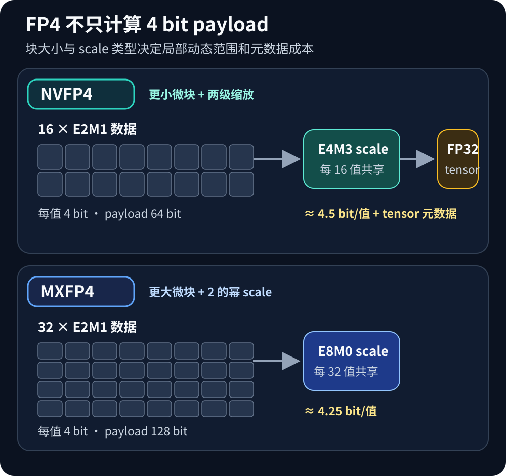
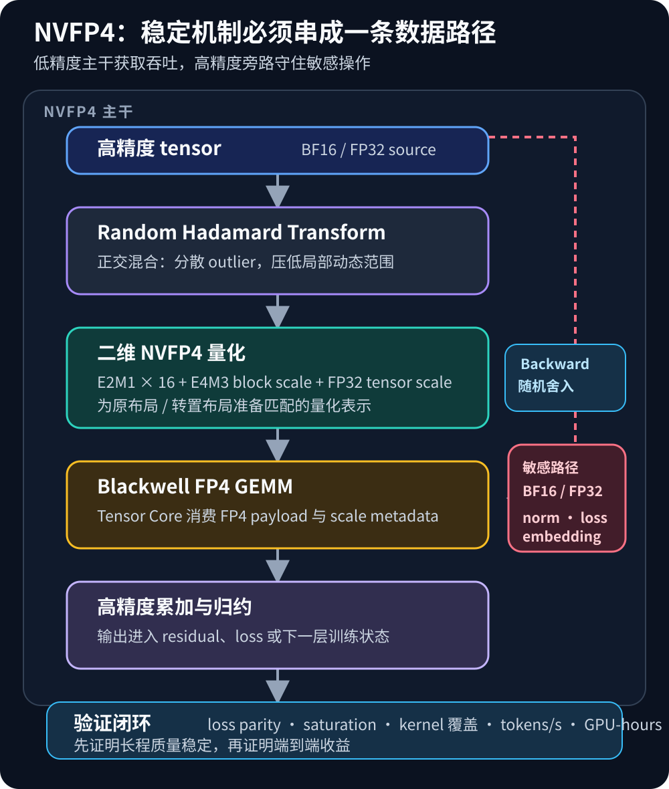

# NVFP4 大模型预训练：4-bit 格式、数值稳定性与 Blackwell 实现

4-bit 推理已经很常见，但 4-bit **预训练**是另一类问题。推理可以离线校准权重；预训练时，权重、激活和梯度的分布每一步都在变化，持续的饱和、下溢或有偏舍入会沿数万亿 token 的优化轨迹累积。

NVFP4 的意义因此不只是“把 GEMM 输入从 8 bit 再减半”。它把 E2M1 数据、16 元素微块、E4M3 块级 scale 和 FP32 tensor scale 组合成两级缩放格式，并配合 Random Hadamard Transform（RHT）、二维量化、stochastic rounding 与选择性高精度路径。Blackwell Tensor Core 提供原生 FP4 计算能力，但能否稳定收敛、能否缩短 time-to-train，仍取决于整个训练配方。

## 1. 为什么 4-bit 预训练更难

E2M1 只有 1 个符号位、2 个指数位和 1 个尾数位，可用格点非常稀疏。共享 scale 若被少量 outlier 拉大，大多数普通值会挤在零点附近；scale 太小，极值又会饱和。训练还会放大四类风险：

1. 不同 step、层和 micro-batch 的 activation/gradient 范围持续漂移；
2. 梯度量化误差改变权重，权重又改变下一步量化分布；
3. 确定性最近邻舍入可能反复把同类小梯度舍为零；
4. 同一张量在 forward、DGRAD 和 WGRAD 中沿不同 reduction axis 被消费，单方向量化未必同时适用。

所以 NVFP4 训练仍是 mixed precision：FP4 用于吞吐占主导的矩阵乘输入，高精度用于累加、归约、优化器状态、master weights 或敏感层。**FP4 GEMM 输入不等于所有训练状态都是 4 bit。**

## 2. 数据格式：两级缩放怎样补偿 E2M1

NVFP4 将连续 16 个 E2M1 值组成微块，每块共享一个 E4M3 scale；块级 scale 再由 tensor 级 FP32 scale 归一化。概念上可写成：

    q_i     = Q_E2M1(x_i / (S_tensor · s_block))
    x_hat_i = q_i · s_block · S_tensor

实际 scale 计算、饱和规则和布局应以使用的 Transformer Engine 版本为准。16 元素块限制局部动态范围；带尾数的 E4M3 scale 比 2 的幂次缩放更细；FP32 tensor scale 又扩大块级 scale 可覆盖的全局范围。

*图 1：本站原创。依据论文 [Pretraining Large Language Models with NVFP4](https://arxiv.org/html/2509.25149v2) Section 2 与 [Transformer Engine NVFP4 文档](https://docs.nvidia.com/deeplearning/transformer-engine/features/low_precision_training/nvfp4/nvfp4.html) 整理；不复用论文或官方博客图片。*

| 格式 | 数据 | 块大小 | 块级 scale | 不计全局元数据的最低存储 |
| --- | --- | ---: | --- | ---: |
| NVFP4 | E2M1，4 bit | 16 | E4M3，8 bit | 4.5 bit/元素 |
| MXFP4 | E2M1，4 bit | 32 | E8M0，8 bit | 4.25 bit/元素 |

“4 bit”只描述 payload，不包含 scale、对齐填充、双轴副本和运行时缓存。NVFP4 用略高元数据成本换取更小量化组和更精细 scale，目标是提高训练保真度，而不只是压缩率。

## 3. RHT：先重塑分布，再量化

若一个 16 元素块里有一个值远大于其余元素，scale 会优先容纳它，剩余值只能使用很少的 E2M1 格点。RHT 先做正交混合，把集中在少数坐标上的能量分散，再进行块量化。对满足 H Hᵀ = I 的变换：

    A · W = (A · H) · (Hᵀ · W)

精确算术下线性层结果不变；量化路径中的坐标级动态范围通常更温和。随机符号可避免固定结构与模型分布发生不利对齐。

RHT 也有 transform kernel、额外读写和 shape 约束。工程上要检查非 2 的幂尺寸如何分组，变换能否与量化/转置融合，前反向是否使用匹配变换，以及量化误差、saturation 和最终 loss 是否确实改善。

## 4. 二维量化：适配前向与反向布局

线性层 Y=XW 在训练中至少触发：

    FPROP: Y  = X  · W
    DGRAD: dX = dY · Wᵀ
    WGRAD: dW = Xᵀ · dY

原布局适合 FPROP 时，转置布局未必适合 DGRAD/WGRAD；直接转置已量化 payload 也不会得到沿新轴统计的正确 block scale。二维量化因此为两个消费方向准备布局匹配的量化表示和 scale metadata。

实现时应把 packed E2M1、每 16 元素的 E4M3 scale、FP32 tensor scale、原/转置 stride、padding、对齐和缓存生命周期视为同一个数据结构。这样会增加存储，却避免前反向使用统计含义不一致的副本。显存预算不能只把 BF16 元素大小除以四。

## 5. Stochastic rounding：降低长期梯度偏差

确定性最近邻舍入可能反复把低于半个量化间隔的小梯度变为零。随机舍入按相邻可表示值的距离分配概率，使：

    E[Q_stochastic(x)] ≈ x

它不消除方差，却能降低长程优化中的系统性漂移。代价是随机数生成、kernel 状态和复现复杂度。生产实验要记录全局与 rank-local seed、各并行 rank 的随机流划分、checkpoint 中的 RNG 状态，以及框架、CUDA、Transformer Engine 和 fused kernel 版本。

## 6. 选择性高精度仍然必要

| 层级 | 初始策略 | 理由 |
| --- | --- | --- |
| Transformer 主干 GEMM | NVFP4 输入、高精度累加 | 占 FLOPs 主体 |
| norm / softmax / residual / loss | BF16 或 FP32 | reduction 与指数运算敏感 |
| embedding / LM head | 先保留 BF16 | 词表投影可能放大误差 |
| master weights / optimizer states | BF16/FP32 | 保持更新分辨率 |
| collective reduction | 明确 payload/accumulator 精度 | 避免跨 rank 溢出与偏差 |

具体边界取决于模型与库版本，不应照搬固定白名单。高精度 fallback 会降低理论加速上限，却通常是从“能跑几百步”走向稳定预训练的必要条件。

## 7. 从 Transformer Engine 落地

Transformer Engine 为 recipe、autocast、线性层替换和量化 metadata 提供统一入口。NVFP4 的高性能路径依赖 Blackwell 原生 FP4 Tensor Core；API 和 shape 支持会随版本变化，部署应固定版本并核对官方文档与 release notes。

*图 2：本站原创。依据论文 Sections 4–5、[Transformer Engine NVFP4 文档](https://docs.nvidia.com/deeplearning/transformer-engine/features/low_precision_training/nvfp4/nvfp4.html) 与 [NVIDIA 技术博客](https://developer.nvidia.com/blog/nvfp4-trains-with-precision-of-16-bit-and-speed-and-efficiency-of-4-bit/) 整理。*

推荐逐级放大：

1. 冻结 BF16 reference：数据顺序、超参、并行策略、checkpoint 和评测一致；
2. 先替换 attention/MLP 主干 GEMM，敏感操作保留高精度；
3. 做短程 parity，比较逐 step loss、gradient norm、更新范数和关键层误差；
4. 分别 ablate RHT、二维量化、随机舍入和 fallback；
5. 逐步扩大 hidden size、sequence length、micro-batch 和 token horizon；
6. 加入 TP/PP/DP，检查 metadata、collective dtype 和 restart；
7. 用多 seed、跨学习率长程验证，排除迟发散。

每次实验都应记录 GPU、driver、CUDA、框架、Transformer Engine、NCCL 版本和实际 kernel。否则配置可能被接受，却在不支持的 shape 上隐式回退高精度。

## 8. 性能与资源模型

一次 step 可粗略拆成：

    T_step = T_FP4_GEMM + T_RHT + T_quant/dequant
           + T_scale/layout + T_high_precision
           + T_communication + T_exposed_tail

收益来自更高 Tensor Core 吞吐、更低 GEMM 输入带宽和更紧凑的部分缓存/通信表示；成本来自 RHT、双轴量化、scale 读写、随机数、高精度层、非 GEMM 算子和同步。

对 N 个值的一个 NVFP4 副本，理想 payload 约 N/2 字节，block scale 约 N/16 字节，另加 tensor scale、padding 和 metadata；若缓存两个量化方向，相关部分可能接近翻倍。峰值显存还受 activation checkpoint、workspace、allocator 碎片和通信 buffer 影响。

应同时报告端到端 tokens/s、step time、MFU、FP4 kernel 覆盖率、HBM 流量、峰值显存、collective tail、功耗，以及达到同一 validation loss 所需 GPU-hours。**峰值 FP4 FLOPS 不等于训练吞吐按比例提升；达到目标质量的总成本才是最终指标。**

## 9. 论文结果怎样读

《Pretraining Large Language Models with NVFP4》报告了 12B hybrid Mamba-Transformer 在 10T tokens 上的训练，NVFP4 loss 与下游精度接近 FP8 baseline。这把 4-bit 训练证据推进到长 token horizon，也说明多种稳定机制需要协同。

但它是可行性证据，不是通用性能承诺。该架构的分布不等于纯 Transformer、MoE 或视觉模型；12B 配方不能直接外推到 70B、超长上下文或不同 optimizer；数值对齐也不保证任意集群获得相同吞吐。目标模型、shape 与并行拓扑仍须独立 benchmark。

## 10. 局限与风险

- **硬件绑定：** 原生高性能路径依赖 Blackwell，旧 GPU 无法仅靠软件获得同等收益。
- **recipe 成熟度：** shape 覆盖、checkpoint 与分布式集成受版本影响。
- **调试复杂：** RHT、双轴布局、随机舍入和 fallback 同时存在，错误未必立即表现为 NaN。
- **资源收益非线性：** scale 和双副本吞掉部分存储收益，非 GEMM 与通信限制 Amdahl 上限。
- **复现更难：** stochastic rounding、并行随机流和 fused kernel 会放大 run-to-run 差异。

## 11. 实践检查表

| 阶段 | 必查项 | 通过标准 |
| --- | --- | --- |
| 基线 | BF16/FP8 reference、数据、超参 | 多 seed 正常波动已知 |
| 格式 | E2M1、16 元素块、两级 scale、padding | 布局与库版本一致 |
| 误差 | 层输出、梯度、更新范数、saturation | 无持续扩大的关键层误差 |
| 稳定机制 | RHT、2D quant、随机舍入 ablation | 收益与开销可解释 |
| 长程训练 | loss gap、NaN/Inf、gradient norm | token horizon 足够暴露迟发散 |
| 性能 | kernel 覆盖、tokens/s、HBM、功耗 | FP4 真实命中且端到端更快 |
| 分布式 | collective dtype、scale 生命周期 | 无隐藏 cast、同步或 metadata 错位 |
| 恢复 | checkpoint/restart 与 RNG | 重启后 loss 连续 |
| 成本 | 目标质量的 GPU-hours 与能耗 | 优于高精度基线 |

## 小结

NVFP4 预训练不是 dtype 替换，而是格式、算法和硬件协同设计。16 元素微块与两级 scale 改善 E2M1 的局部表示；RHT 分散 outlier；二维量化适配前反向；随机舍入降低长期梯度偏差；高精度路径守住敏感操作。

Blackwell 提供把这套配方做快的硬件前提，但判断顺序不应颠倒：先用长程实验证明质量与稳定性，再用端到端 profile 证明 time-to-train 和资源成本下降。

## 参考资料

1. NVIDIA et al. **Pretraining Large Language Models with NVFP4**. arXiv:2509.25149v2. <https://arxiv.org/html/2509.25149v2>
2. arXiv. **Pretraining Large Language Models with NVFP4 — abstract and version record**. <https://arxiv.org/abs/2509.25149>
3. NVIDIA Transformer Engine Documentation. **NVFP4 low-precision training**. <https://docs.nvidia.com/deeplearning/transformer-engine/features/low_precision_training/nvfp4/nvfp4.html>
4. NVIDIA Technical Blog. **NVFP4 Trains with Precision of 16-Bit and Speed and Efficiency of 4-Bit**. <https://developer.nvidia.com/blog/nvfp4-trains-with-precision-of-16-bit-and-speed-and-efficiency-of-4-bit/>
5. NVIDIA. **Transformer Engine**（代码仓库为 Apache-2.0 许可）. <https://github.com/NVIDIA/TransformerEngine>
6. NVIDIA Transformer Engine PR #2177. **NVFP4 training support**. <https://github.com/NVIDIA/TransformerEngine/pull/2177>
