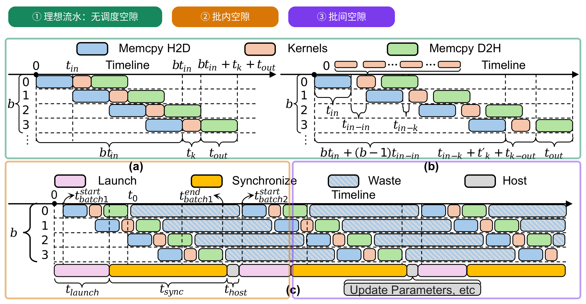
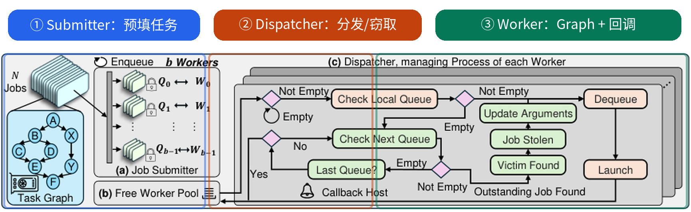
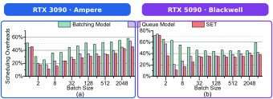

# SET：用 Stream-Event 触发调度填平 CUDA Graph 的 Kernel Gap

CUDA Graph 能把一串 operation 预先实例化，并用一次 replay 代替多次主机 launch。对固定 DAG 和短 kernel，这通常能明显降低 CPU 提交成本。但 Graph 解决的是“怎样更便宜地提交一组依赖”，并不会自动决定：

- 下一份动态输入何时写入、参数何时更新；
- 哪个 stream 和哪组 device buffer 可以安全复用；
- 某个任务先完成后，能否立刻补入新任务；
- 批次之间是否仍有全局 barrier；
- 多个 worker 争用共享队列时，锁与轮询是否反而成为瓶颈。

SET（Stream-Event-Triggered Scheduling）是一篇 Euro-Par 2026 论文提出的 **CUDA runtime framework 原型**。它不修改 kernel，也不是 NVIDIA CUDA 内建调度器；它把每个 job 封装成可复用的 CUDA Graph executable，再用有界 worker、per-worker queue、空闲 worker pool、stream 尾部完成通知和必要时的 work stealing，让主机侧调度由“完成事件”推进，而不是等待整个 batch 或反复查询所有 stream。

> **图源与许可：** Zhengxiong Li、Tsung-Wei Huang、Umit Ogras，*SET: Stream-Event-Triggered Scheduling for Efficient CUDA Graph Pipelines*，Figure 2（[原图](https://arxiv.org/html/2606.05495v1/bottleneck.png)，[论文 HTML](https://arxiv.org/html/2606.05495v1)）。论文页面标注 [CC BY 4.0](https://creativecommons.org/licenses/by/4.0/)；本站保留完整三联图，仅添加彩色边框与中文标签。

## 1. 背景：Graph replay 之后为什么还有白缝

把一个任务抽象成 H2D → kernels → D2H，一次 replay 的设备工作并不等于端到端时间。粗略地说：

~~~text
T_measured = T_ideal + t_intra + t_inter
~~~

其中：

- T_ideal 是 copy engine 与 compute engine 在依赖允许时连续工作所需的时间；
- t_intra 是同一批任务内部，parameter update、host submission、stream 空闲等造成的 operation 间隙；
- t_inter 是批尾等待、同步、buffer 回收和下一批准备造成的批间间隙。

单 graph replay 可以减少每个 operation 的 launch 次数，却仍需要更新动态 memcpy/kernel node 参数，并且只有一个执行 slot。静态 batching 能把固定开销摊到更多任务上，但常在 batch 边界同步；早完成的 worker 不能越过 barrier 接新任务，还会为更大的 batch 预留更多 buffer。共享 global queue 能动态派工，但短 kernel 场景下，轮询、锁竞争和逐 worker 查询可能与 kernel 本身处于同一数量级。

这个问题在新 GPU 上会更显眼。设 kernel 时间因架构升级缩短为原来的 1/S，而主机调度成本变化很小，则：

~~~text
overhead_fraction =
    T_host / (T_host + T_kernel / S)
~~~

随着 S 增大，未被优化的 T_host 占比上升。CUDA Graph 降低了其中一部分，但参数准备、资源所有权和完成检测仍要由 runtime 处理。

## 2. 四种常见执行模型的边界

理解 SET 前，先把几种基线分开：

| 模型 | 优点 | 主要空隙或代价 |
| --- | --- | --- |
| 同步逐项提交 | 控制简单、显存占用小 | 每个 H2D/kernel/D2H 都付主机提交与同步成本 |
| 单 CUDA Graph | replay 开销较低 | 单 worker；动态参数更新与 replay 仍在 host |
| 静态 batching | 摊薄 launch 成本、增加并发 | 批间 barrier、尾部等待、延迟与显存压力 |
| 共享 global queue | 动态负载均衡 | 全局锁、轮询、共享状态竞争与 O(b) 查询 |

这里的 b 是 worker 或 batch 规模。论文把 SET 的正常路径描述为 O(1) 的共享资源操作，含义是：完成通知直接把 worker 放回空闲池，不再每轮查询所有 stream；它不代表整个调度器在所有情况下严格 O(1)。当本地队列为空时，work stealing 仍要搜索其他队列；偷到任务后还要重绑定 graph 参数。

## 3. 机制：Job-as-Graph 与有界 Worker

SET 的基本执行单元是 worker。第 i 个 worker 可写成：

~~~text
W_i = {
  stream S_i,
  pre-instantiated graph executable G_i,
  device buffers M_i,
  host-side prepared-job queue Q_i
}
~~~

三个绑定关系决定了正确性。

### 3.1 Stream、Graph Exec 和 Buffer 绑定

每个 worker 有独立 stream、预实例化 graph executable 和 device buffer。Graph 构造时，可变的 memcpy 地址、kernel 参数等先放 placeholder；任务进入队列前再更新成实际值。

独立 buffer 不是单纯的性能优化，而是 memory safety 边界。一个 worker 仍在执行时，host 不能覆盖其 input、temporary 或 output slot。并发 worker 数因此也是最大 in-flight 任务数的一部分，必须有明确上限和 backpressure。

### 3.2 队列中存“已准备的任务”

SET 为每个 worker 建立线程安全的 host-side queue。队列项不是只有 task index，而是已完成大部分 graph 参数准备的 job wrapper。这样 dispatcher 取到任务后，正常路径可以直接 launch，避免把 node update 留到 worker 已空闲之后。

代价是 submitter 必须提前工作，而且 prepared queue 的深度会增加 host memory、graph update 和待处理输入的生命周期。队列不能无限增长。

### 3.3 偷任务必须重绑定地址

若空闲 worker W_free 的本地队列为空，dispatcher 可以从其他 worker 的队列偷任务。但被偷 job 原先按 victim worker 的 G_i/M_i 准备，不能直接在 thief stream 上提交。论文原型在 launch 前进行 JIT update，把：

1. 输入地址；
2. 临时 buffer；
3. 输出地址；

全部改绑到 W_free 的资源。漏掉任何一个可变地址，都可能形成跨 stream 读写竞争或静默数据破坏。

## 4. 事件链：Submitter、Dispatcher 与完成回池

> **图源与许可：** Li、Huang、Ogras，SET 论文 Figure 3（[原图](https://arxiv.org/html/2606.05495v1/overview.png)，[论文 HTML](https://arxiv.org/html/2606.05495v1)），[CC BY 4.0](https://creativecommons.org/licenses/by/4.0/)。本站保留完整执行流，放大原图并添加三组彩色框与中文标签；未裁切 submitter、dispatcher、worker、callback 或 work-stealing 路径。

SET 把 host 侧工作拆成两个线程：

- **Submitter**：发现 Q_i 有空位后，准备新 job、更新 graph 参数并入队；
- **Dispatcher**：从 free-worker pool 取得 W_free，优先取 Q_free 的队首；本地无任务时再 work steal，然后 launch。

一次简化状态流如下：

~~~text
input ready
   ↓
submitter: update graph parameters → enqueue prepared job
   ↓
dispatcher: pop free worker → local queue / steal → launch graph
   ↓
stream ordered completion notification
   ↓
finished_count++ → worker returned to free pool
~~~

关键变化是完成路径。每次 graph launch 后，dispatcher 在该 stream 尾部追加一个轻量 host function/callback。只有前面的 graph operations 完成后，通知才会执行；它原子更新完成计数，并把 worker index 放回 free pool。dispatcher 因而消费“已完成的 worker”，不需要持续 cudaStreamQuery 所有 stream。

工程实现要遵守 CUDA host function/callback 的限制：回调内不要调用 CUDA API，也不要阻塞、分配大对象或执行复杂业务。回调应只写入线程安全的完成队列/计数器并尽快返回，后续参数更新、错误处理和新 launch 由普通 host thread 完成。CUDA event、stream-ordered host function 和 host dispatcher 是三个不同概念：回调由 host 线程执行，不是在 GPU 上执行。

## 5. 工程流程：从时间线到可维护原型

SET 适合借鉴，但不应直接从“多开几个 stream”开始。更稳妥的落地顺序如下。

### 第一步：用时间线证明 gap 存在

用 Nsight Systems 记录稳定阶段，至少标出：

- graph node update 与 cudaGraphLaunch 的 CPU 时间；
- H2D、kernel、D2H 的设备时间线；
- 同一 batch 内的空隙与 batch 边界空隙；
- stream synchronization、event wait 和 host wait；
- copy/compute overlap 与 GPU active 区间。

若单个 kernel 已长时间饱和 GPU，或 gap 相对 kernel 时间可忽略，SET 式 runtime 很可能不是首要优化。

### 第二步：建立单 Graph replay 基线

先把一个 job 构造成稳定 DAG，验证 graph capture 或显式 graph API 能覆盖依赖。测量：

~~~text
T_update, T_launch, T_device, T_end_to_end
~~~

参数变化只使用允许更新的 node 属性；第三方库 capture 支持不完整时，要保留普通 stream 路径。

### 第三步：引入独立 slot，而不是先做偷取

建立少量 worker，每个 worker 固定：

~~~text
stream[i] ↔ graphExec[i] ↔ buffers[i]
~~~

先用简单 free list 做无 work stealing 的版本，验证每个 slot 的状态机：

~~~text
FREE → PREPARED → RUNNING → COMPLETED → FREE
~~~

任何错误、取消或 shutdown 路径都必须最终释放或隔离 slot，不能永久丢失 worker。

### 第四步：把参数准备前移

为每个 worker 增加有界 prepared queue。submitter 只在队列有容量时生产，满队列时施加 backpressure。记录 graph node update 的时间，确认前移后 dispatcher 的关键路径确实缩短。

### 第五步：用完成通知代替轮询

在 stream 尾部追加最小 host function，把 worker 放回 free pool。压力测试回调晚到、重复通知、launch 失败、程序退出和队列关闭，保证计数与所有权一致。

### 第六步：最后才加 work stealing

只在本地队列不均衡明显时加入偷取；为 stolen job 建立集中式的 rebind 函数和地址清单。对每类 graph node 做单元测试，确认 input、temporary、output 与 metadata 均绑定到 thief worker。

## 6. 性能与资源模型：吞吐不是单调增加

可把一个任务的可见成本写成：

~~~text
T_job ≈ T_graph_update
      + T_dispatch
      + T_queue
      + T_graph_launch
      + T_device
      + T_completion
      + T_contention
~~~

SET 主要尝试降低 T_dispatch、T_queue 和设备工作之间的空隙，并用更多 in-flight job 隐藏固定开销；它不会降低 kernel 本身的算术量。worker 数增加后，资源成本近似为：

~~~text
M_total ≈ M_static
        + N_worker × (M_input + M_temp + M_output + M_graph)
        + M_prepared_jobs
~~~

并发度先增加 overlap，随后会遇到 SM、copy engine、L2、TLB、HBM、PCIe/NVLink、host lock 和功耗限制。吞吐常呈倒 U 形，而调度开销占比可能呈 U 形。因此需要同时扫描 worker 数、queue depth 与 workload 粒度，不能只把 batch size 拉到最大。

> **图源与许可：** Li、Huang、Ogras，SET 论文 Figure 6（[原始 SVG](https://arxiv.org/html/2606.05495v1/overhead_ratio.svg)，[论文 HTML](https://arxiv.org/html/2606.05495v1)），[CC BY 4.0](https://creativecommons.org/licenses/by/4.0/)。本站保留 RTX 3090 与 RTX 5090 两个完整 panel、坐标轴和图例，仅增加架构标签与外框。数值只代表论文中的硬件、CUDA 12.8、workload 与 baseline 配置。

### 6.1 怎样读论文结果

论文在两台 Ubuntu 22.04 主机上测试 RTX 3090（Ampere）和 RTX 5090（Blackwell），CUDA 12.8，覆盖 Sobel、GEMM、BP、KNN、Hotspot、SSSP 六类 compute- 与 memory-bound workload。作者报告：

- 相对其先进 host-side/CUDA Graph baselines，SET 的 speedup 为 **1.15–1.44×**；
- 调度开销降低 **18–54%**；
- 聚合两张 GPU 后，相对 synchronous、graph、batching、queue 模型的平均 speedup 分别为 2.18×、2.10×、1.17×、1.39×。

这些数值不能脱离 baseline 直接外推。论文中的 KNN kernel 平均可短至约 10 μs，而有数据竞争时全局队列 mutex 的获取/释放约为 3–5 μs；此时共享队列管理已经与 kernel 同量级，per-worker queue 的价值很高。Hotspot 则使用最高约 90% DRAM bandwidth 和 50% L2 traffic；继续增加并发会加剧数据竞争，说明“更多 worker”并不自动更快。

论文 Figure 6 也显示，batch size 很小时，固定调度成本占比高；增加 batch 后 GPU 利用率提升、占比下降；继续增大时，batch barrier、共享状态与内存竞争又让开销上升。应关注完整曲线与最优区间，而不是只摘一个最大 speedup。

### 6.2 建议记录的指标

至少同时记录：

| 维度 | 指标 |
| --- | --- |
| 端到端 | throughput、p50/p99 latency、每任务完成时间 |
| GPU | GPU active、SM active、copy/compute overlap、DRAM/L2 traffic |
| Graph | node update、instantiate、launch 时间与失败率 |
| Runtime | queue wait、lock wait、steal rate、rebind time、callback-to-dispatch latency |
| 资源 | in-flight jobs、每 worker 显存、host queue 内存、功耗与频率 |

若吞吐提升但 p99 明显恶化，应检查 prepared queue 是否过深；若 steal rate 很高但收益很小，应检查 rebind 成本和任务分配策略；若 GPU active 已高而 DRAM 接近饱和，继续加 worker 通常只会放大 contention。

## 7. 局限与适用边界

SET 式设计较适合：

- 每个 job 的 DAG 稳定，但输入地址、shape 范围或 kernel 参数动态；
- 单任务较短，host gap 占比可见；
- 能为多个 in-flight job 准备独立 buffer；
- H2D、compute、D2H 有可重叠空间；
- 任务时长有抖动，静态 batch 容易被最慢任务拖住。

以下情况收益有限或维护成本偏高：

- 单个长 kernel 已饱和 SM/HBM，主机调度不是瓶颈；
- 每个 worker 的临时内存很大，独立 slot 无法容纳；
- 第三方库无法稳定 capture，或 graph node 不能按需求更新；
- 任务极短到 host callback、线程唤醒本身都过重；
- 应用优先优化单请求尾延迟，而不是稳态吞吐；
- 地址重绑定和取消语义复杂，难以证明 buffer 所有权；
- 多进程/MIG/MPS 环境下还有其他调度层，单进程 runtime 的观察不完整。

另外，论文是研究原型。它展示了特定 workload、GPU 和软件栈上的结果，没有证明所有生产环境中的公平性、NUMA 行为、异常恢复、长期运行碎片或多租户 QoS。落地时应保留简单 baseline 与 feature flag。

## 8. 实践检查表

### 正确性

- [ ] 每个 worker 的 stream、graph exec 与 buffer 映射唯一且可追踪。
- [ ] 活跃 slot 禁止 host 覆写；in-flight 数量有硬上限。
- [ ] graph node 的所有可变地址和 scalar 参数均进入更新清单。
- [ ] stolen job 完整重绑定 input、temporary、output 和 metadata。
- [ ] callback/host function 不调用 CUDA API、不阻塞、不执行重任务。
- [ ] launch 失败、异步错误、取消和 shutdown 都能回收或隔离 worker。
- [ ] 完成计数、free pool 与实际运行任务数始终满足不变量。
- [ ] 用 Compute Sanitizer 与压力测试覆盖竞态、越界和错误退出。

### 性能与资源

- [ ] Nsight Systems 已证明存在可优化的 intra/inter-batch gap。
- [ ] 单 graph replay 是已测量 baseline，不以同步逐项提交充当唯一对照。
- [ ] 扫描 worker 数、prepared queue depth 和 steal 策略。
- [ ] 同时报告 throughput、p50/p99，而不是只报告峰值吞吐。
- [ ] 记录 graph update/launch、queue/lock、callback-to-dispatch 时间。
- [ ] 显存模型包含每 worker 独立 input/temp/output 与 graph 对象。
- [ ] 检查 DRAM/L2/copy engine/SM/功耗竞争是否抵消并发收益。
- [ ] 结果注明 GPU、driver、CUDA、workload、batch size 和 baseline。

### 可维护性

- [ ] 正常路径先实现无 stealing 版本，stealing 可独立关闭。
- [ ] 参数 rebind 集中在单一模块，不散落在 dispatcher 分支。
- [ ] 队列有 backpressure，退出时能停止生产并排空或取消任务。
- [ ] callback 生命周期晚于所有可能触发它的 stream work。
- [ ] 保留普通 stream 或单 Graph fallback，便于回归和故障切换。

## 小结

CUDA Graph 把“提交一张 DAG”变便宜，却不会替应用解决动态参数、buffer 所有权、worker 空闲检测和 batch barrier。SET 的价值在于给这些 host-side 问题一个明确结构：以 stream、graph executable 和独立 buffer 组成有界 worker；submitter 提前准备任务；dispatcher 消费完成事件；本地队列提供快路径，必要时再 work steal。

这套设计最值得借鉴的不是某个固定 batch size，而是优化顺序：先从时间线量化 gap，再建立单 Graph 基线；随后增加独立 slot、前移参数更新、用完成通知替代轮询；最后在确有负载不均衡时加入 stealing。每一步都同时验证正确性、尾延迟、显存和共享资源竞争，才能把“更多并发”变成端到端收益。

## 参考资料

- Zhengxiong Li, Tsung-Wei Huang, Umit Ogras. **SET: Stream-Event-Triggered Scheduling for Efficient CUDA Graph Pipelines**. Euro-Par 2026 / arXiv:2606.05495. <https://arxiv.org/abs/2606.05495>
- 同论文 HTML 全文与原始 figures（页面标注 CC BY 4.0）：<https://arxiv.org/html/2606.05495v1>
- NVIDIA. **CUDA Programming Guide — CUDA Graphs**. <https://docs.nvidia.com/cuda/cuda-c-programming-guide/index.html>
- NVIDIA. **CUDA Runtime API — Stream Management**. <https://docs.nvidia.com/cuda/cuda-runtime-api/cuda_runtime_api/group__CUDART__STREAM.html>
- NVIDIA. **CUDA Runtime API — Event Management**. <https://docs.nvidia.com/cuda/cuda-runtime-api/cuda_runtime_api/group__CUDART__EVENT.html>
- NVIDIA. **CUDA Runtime API — Execution Control**. <https://docs.nvidia.com/cuda/cuda-runtime-api/cuda_runtime_api/group__CUDART__EXECUTION.html>
