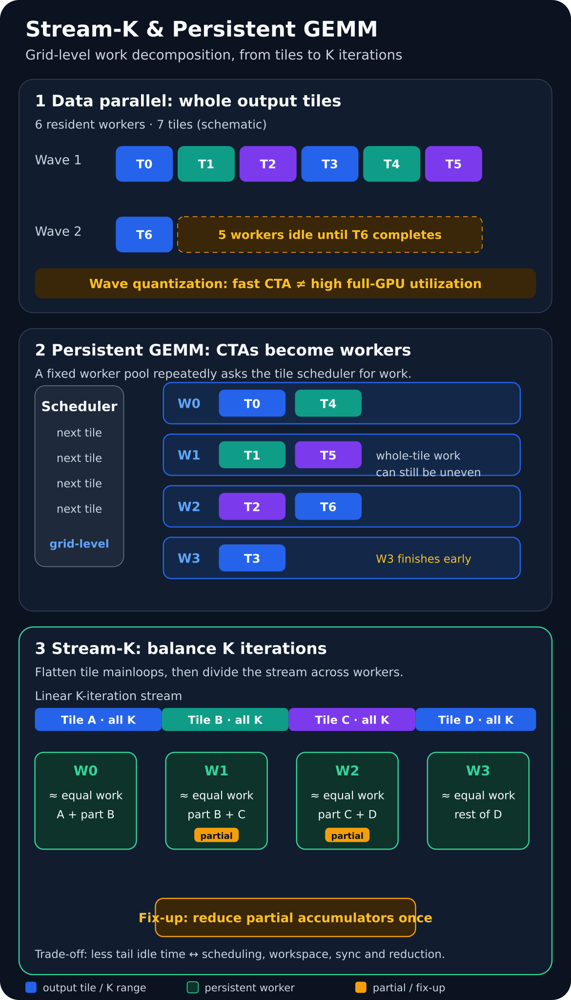

# Stream-K 与持久化 GEMM：从 Wave Quantization 到工作中心调度

一个 GEMM kernel 可以在 CTA 内把 Tensor Core、异步拷贝和双缓冲流水线调得很好，却仍然没有把整张 GPU 吃满。原因往往不在 microkernel，而在更高一层：输出 tile 如何分给有限数量的 SM，以及最后一波 CTA 还剩多少并行工作。

传统 data-parallel GEMM 让一个 CTA 独占一个输出 tile，并沿完整 K 维完成累加。它简单、局部性好、通常不需要跨 CTA 归约；但输出 tile 数不能整除并发 worker 数时，会出现 **wave quantization**。持久化 GEMM 把 CTA 变成常驻 worker，Stream-K 又把所有 tile 的 K-loop 迭代视为一条可切分的工作流，以 partial-tile 归约为代价换取更均匀的全芯片工作量。

本文讨论的重点不是某条 MMA 指令，而是 **grid 级调度**：它与 TMA、warp specialization 等 CTA 内优化可以组合，但解决的是不同层次的问题。

*图 1：传统 data-parallel、persistent 与 Stream-K 调度的概念对比。本站根据 Stream-K 论文、CUTLASS 3.x 文档和 Colfax Research 教程的公开算法描述原创绘制，未复用第三方图件。许可：本站原创图，可随本文引用并保留来源说明。概念来源：[Stream-K 论文](https://arxiv.org/abs/2301.03598)、[CUTLASS 3.x GEMM API](https://docs.nvidia.com/cutlass/latest/media/docs/cpp/gemm_api_3x.html)、[Colfax 教程](https://research.colfax-intl.com/cutlass-tutorial-persistent-kernels-and-stream-k/)。*

## 1. 背景：CTA 很快，不等于整卡很快

设 GEMM 为

\[
C_{M\times N}=A_{M\times K}B_{K\times N},
\]

输出 tile 形状为 \(M_t\times N_t\)。忽略 batch 和边界特例时，输出 tile 数为

\[
T=\left\lceil\frac{M}{M_t}\right\rceil
  \left\lceil\frac{N}{N_t}\right\rceil.
\]

若一次最多有 \(W\) 个有效 resident workers 同时推进这些 tile，传统一 CTA 一 tile 调度需要

\[
Q=\left\lceil\frac{T}{W}\right\rceil
\]

个 wave。最后一波利用率近似为

\[
U_{\text{tail}}=\frac{T-(Q-1)W}{W}.
\]

例如 \(W=114\)、\(T=115\) 时，需要两波：第一波 114 个 CTA，第二波只有 1 个。即使每个 CTA 内部都很高效，第二波的大多数 SM 仍然空闲。相反，如果 \(T\gg W\)，尾波损失会被前面许多满波摊薄。

这里的 \(W\) 不应机械等同于 SM 数。真实值还受每 CTA 的寄存器、shared memory、线程数、cluster 形状以及其他并发 workload 影响。工程上应由 occupancy 分析和实测得到有效并发 worker 数。

## 2. 三种工作分解机制

### 2.1 Data-parallel：一个 CTA 完整拥有一个输出 tile

传统方案把网格坐标直接映射到 \((m\_tile,n\_tile)\)。每个 CTA 领取一个输出 tile，遍历这个 tile 的全部 K iterations，在寄存器或专用 accumulator 中完成累加，最后执行一次 epilogue 并写回。

它没有跨 CTA 的同一输出 tile 合并，控制路径最短，也是规则大 GEMM 的首选基线。缺点是工作粒度固定为“完整输出 tile”，无法填补量化形成的小尾波。

### 2.2 Persistent GEMM：CTA 从一次性 block 变成 worker

持久化 kernel 通常只启动与目标驻留规模相近的 CTA。每个 CTA 完成当前 tile 后，不退出，而是向 tile scheduler 请求下一份工作：

~~~text
worker_id = resident CTA id
while scheduler.has_work():
    work_tile = scheduler.next(worker_id)
    run_mainloop(work_tile)
    run_epilogue(work_tile)
~~~

这样做的价值不只是减少 block 启动。调度器可以控制 tile 遍历顺序、复用常驻资源，并使 grid 大小不再与输出 tile 数一一绑定。它也引入了 scheduler 状态和公平性、常驻 CTA 的资源占用、跨 tile 循环，以及尾声与同步的正确性。

仅仅“持久化”不会自动消除 wave quantization。如果 scheduler 仍以完整 output tile 为最小单位，115 个近似等长的 tile 分给 114 个 worker，仍会有一个 worker 多算一整块。要进一步均衡，必须把工作粒度切得更细。

### 2.3 Stream-K：按 K-loop 迭代切分总工作流

若每个输出 tile 需要 \(L=\lceil K/K_t\rceil\) 个 mainloop 迭代，Stream-K 把总工作看成

\[
I_{\text{total}}=T\cdot L
\]

个线性的 K iterations，再近似均匀地切给 \(W\) 个 worker。每个 worker 的目标工作量约为

\[
I_w\approx\left\lceil\frac{I_{\text{total}}}{W}\right\rceil.
\]

worker 的区间可能从某个 tile 的中间开始，也可能跨过 tile 边界。这正是均衡的来源，也产生了 **partial tile**：多个 worker 分别计算同一输出 tile 的一段 K 区间，最终必须做 fix-up/reduction，才能得到完整累加结果并执行一次语义正确的 epilogue。

因此 Stream-K 的交换关系很明确：

- 收益：worker 获得更接近的 K-iteration 数，减少尾波和长尾；
- 成本：partial accumulator 暂存、同步、归约、额外读写与更复杂的调度状态；
- 风险：当单个 tile 很短或输出 tile 已经很多时，fix-up 成本可能超过均衡收益。

## 3. Stream-K 与 Split-K 不应混为一谈

两者都会沿 K 切分，但目标和工作分配方式不同。

| 方案 | 主要目的 | 切分方式 | 常见代价 |
|---|---|---|---|
| Data-parallel | 最低调度与归约开销 | 每个 CTA 完整计算一个输出 tile | 尾波量化 |
| Split-K | 为并行度不足的选定 tile 增加并行 CTA | 每个 tile 预先切成固定数量 K partitions | workspace/原子归约，切分因子需调参 |
| Stream-K | 让全局 worker 工作量更均衡 | 所有 tile 的 K iterations 展平后按 worker 分区 | 边界 partial tile 的 fix-up 与调度状态 |

Split-K 更像“每个 tile 切几份”；Stream-K 更像“把整个 GEMM 的工作中心排成队列，再按 worker 数切段”。实际实现可能采用相似的归约原语，但选择逻辑不应只看“是否切 K”。

## 4. 为什么混合调度通常比全量 Stream-K 更实用

完整的 data-parallel wave 已经能让所有 worker 忙碌，而且没有 partial-tile 归约。将这些满波也改为 Stream-K，常常只增加复杂度。因此更实用的策略是：

1. 先用 data-parallel 处理若干完整 waves；
2. 将不足一波或量化严重的尾部交给 Stream-K；
3. 只为跨 worker 边界的 tile 执行 fix-up；
4. 让 scheduler 在运行时 shape、tile shape 与硬件规模之间选择 DP、hybrid 或 Stream-K。

选择至少依赖 \(M,N,K\)、threadblock/cluster tile shape、有效 resident worker 数、每 tile 的 K iterations、partial accumulator 大小、workspace 带宽、epilogue 语义以及同卡并发干扰。它不是跨 GPU 通用的一条固定阈值。

## 5. 映射到 CUTLASS 的工程流程

CUTLASS 3.x 将 GEMM 分为较清晰的层次：device/kernel 入口、collective mainloop、collective epilogue，以及决定 work tile 如何分配的 tile scheduler。Stream-K 属于最后一层。它可以与 TMA、warp specialization、不同 MMA atom 组合，因为后者主要解决 CTA 内数据搬运与计算流水线。

### 第一步：建立无调度混淆的基线

固定 dtype、layout、tile shape、cluster shape、epilogue 和编译选项，先测 data-parallel kernel。记录实际 occupancy、寄存器和 shared-memory 用量，并据此确定有效 worker 数。

### 第二步：暴露运行时问题形状

不要只测方阵。至少加入：

- tile 数为 \(W+1\)、\(2W+1\) 的量化边界；
- small-M/large-K 或 small-N/large-K；
- 只有少量 output tiles、但每 tile K-loop 很长的形状；
- 有充分多 waves 的大矩阵，作为“Stream-K 不应明显占优”的控制组。

### 第三步：配置 scheduler 并保留验证

CUTLASS 的具体类型名和模板参数会随架构与版本变化，应以当前版本源码为准。官方 Blackwell Stream-K 示例 examples/74_blackwell_gemm_streamk/blackwell_gemm_streamk.cu 展示了 scheduler 参数、运行时 problem shape、reference check 与 profiler 入口。移植时应保留数值验证，尤其检查非整 tile 边界、不同 K 分区数和带融合 epilogue 的情况。

### 第四步：把选择逻辑放在 dispatch 层

不要让单一调度策略覆盖所有 shape：

~~~text
if many_full_waves && low_quantization_loss:
    launch(data_parallel)
else if full_waves_exist && tail_is_expensive:
    launch(hybrid_stream_k)
else:
    benchmark_or_launch(stream_k_or_split_k)
~~~

阈值应来自目标 GPU、目标 dtype 和真实 shape 分布上的 benchmark，而不是跨代复制。

## 6. 性能与资源模型：先估上界，再看 profiler

把每个完整 output tile 的计算时间近似记为 \(t_{tile}\)。传统调度的理想化时间为

\[
t_{DP}\approx\left\lceil\frac{T}{W}\right\rceil t_{tile}.
\]

若 Stream-K 能将 K iterations 完全均衡，计算部分近似为

\[
t_{SK,compute}\approx\frac{T}{W}t_{tile},
\]

但总时间还要加上

\[
t_{SK}\approx t_{SK,compute}
+t_{schedule}+t_{partial\_store}+t_{sync}+t_{reduce}.
\]

这组模型的用途是判断“是否值得测”，而不是预测绝对性能。若 DP 的量化损失只占几个百分点，Stream-K 的额外项很容易吞掉收益；若 115 个 tile 落在 114 个 worker 上，理论可消除的尾波则很大，值得进入实测。

资源方面要同时观察：

- **寄存器与 shared memory**：决定实际 resident workers；
- **workspace**：partial accumulator 的容量、对齐和生命周期；
- **额外内存流量**：partial 写出与归约读回可能使 kernel 更带宽敏感；
- **同步与原子操作**：关注长尾而不只是平均吞吐；
- **L2 locality**：persistent 遍历顺序可能改善或破坏复用；
- **epilogue 语义**：最终写回者必须看到完整累加值，避免重复执行非线性操作。

推荐同时报告 kernel time、TFLOP/s、SM Active、Tensor Core 利用率、DRAM/L2 吞吐、workspace 大小和 P50/P95 延迟。只看 TFLOP/s 很难判断收益来自计算均衡还是测量噪声。

## 7. Cluster Launch Control 解决的是相邻问题

静态 persistent scheduler 默认目标 worker 都能大致同时运行。若 GPU 与其他 kernel 共置，一部分 block/cluster 尚未启动，静态工作映射仍可能失衡。

Blackwell 的 Cluster Launch Control（CLC）允许活跃 cluster 取消尚未开始的 cluster，并取得被取消工作的坐标，以支持更动态的 persistent work stealing。它关注的是“运行时哪些 worker 真正可用、未启动的 tile 由谁接手”。Stream-K 关注的是“GEMM 的 K-loop 工作如何切得更均匀”。两者可以组合，但不能等同。

## 8. 局限与容易踩坑的地方

1. **不是所有 GEMM 都受 wave quantization 主导。** 规则大矩阵有很多满波时，data-parallel 往往更简单、更快。
2. **归约并非免费。** K 很短、accumulator 很大或 workspace 带宽紧张时，Stream-K 可能退化。
3. **数值顺序会变化。** 浮点加法不满足结合律；分区归约可能与单 CTA 累加产生可接受但不同的舍入结果，测试应使用与 dtype/规模匹配的容差。
4. **融合 epilogue 增加正确性难度。** activation、clamp、量化、随机操作不能对 partial accumulator 任意重复执行。
5. **静态 SM 数不是实际并发度。** 资源限制、cluster、MIG/MPS 或共置 workload 都会改变有效 workers。
6. **论文结果不是跨平台保证。** Stream-K 论文中的加速比来自其特定硬件、实现和 shape 集合，不能直接外推到现代 CUTLASS 或 Blackwell。
7. **调度器版本会变化。** CUTLASS 的 scheduler API、支持架构和默认启发式应以所用 commit 的文档与示例为准。

## 9. 可复现 benchmark 方案

为了隔离调度影响，建议采用下面的实验矩阵：

- **实现**：data-parallel、Split-K、Stream-K、可用时再加 hybrid；
- **形状**：方阵、small-M/large-K、small-N/large-K、\(W+1\)、\(2W+1\) 与多满波；
- **控制量**：相同 dtype、layout、tile/cluster shape、epilogue、数学模式、GPU 时钟策略；
- **流程**：预热、独立 stream、多次重复、同步计时，报告中位数和尾延迟；
- **正确性**：高精度 reference，覆盖非整 tile 边界与不同 K 分区；
- **指标**：时间、TFLOP/s、SM/Tensor Core 活跃度、L2/DRAM 流量、workspace、partial tile 数和归约时间。

若候选 kernel 的 tile shape 不同，应额外做两组比较：一组固定 tile shape 只比较 scheduler；另一组让每种方案各自调优，比较最终可交付性能。否则很容易把 microkernel 差异误判成 Stream-K 收益。

## 10. 实践检查表

- [ ] 由 \(M,N\) 和 tile shape 计算输出 tile 数 \(T\)；
- [ ] 用资源占用与实测确认有效 workers \(W\)，不要只抄 SM 数；
- [ ] 计算 wave 数、最后一波利用率和理论可消除的量化损失；
- [ ] 先保留 data-parallel 作为正确性和性能基线；
- [ ] 同时测试 \(W+1\)、\(2W+1\) 与充分多波形状；
- [ ] 记录 partial tile 数、workspace 大小及 fix-up 时间；
- [ ] 检查 epilogue 只在完整累加值上执行一次；
- [ ] 对浮点归约设置合理容差，并检查非整 tile 边界；
- [ ] 将 scheduler 与 TMA/warp specialization 等 CTA 内优化分开分析；
- [ ] 在真实 shape 分布上建立 dispatch 阈值，不依赖单个峰值样例；
- [ ] 有动态共置负载时，再评估 CLC 或其他动态 scheduler；
- [ ] 升级 CUTLASS/CUDA 后重新验证 API、数值与性能。

## 小结

Stream-K 的核心不是“再发明一种 GEMM mainloop”，而是改变 grid 级工作单位：从完整 output tile，变成可跨 tile 边界分配的 K iterations。持久化 worker 提供持续领取工作的执行骨架，Stream-K 用更细粒度的工作中心分解缓解 wave quantization，再用 partial-tile fix-up 恢复正确结果。

它最适合输出 tile 数接近 wave 边界、M/N 较小而 K 很长、或传统方案存在明显长尾的形状。对于有很多完整 waves 的规则大 GEMM，data-parallel 仍应是第一基线。正确的工程策略不是预设赢家，而是先量化尾波损失，再把调度、归约和 workspace 成本放入同一个资源模型，最后以目标硬件和真实 shape 分布决定 dispatch。

## 参考资料

1. Osama, M. et al. *Stream-K: Work-centric Parallel Decomposition for Dense Matrix-Matrix Multiplication on the GPU*. <https://arxiv.org/abs/2301.03598>
2. NVIDIA CUTLASS Documentation. *CUTLASS 3.x GEMM API*. <https://docs.nvidia.com/cutlass/latest/media/docs/cpp/gemm_api_3x.html>
3. NVIDIA CUTLASS. *Blackwell GEMM Stream-K Example*. <https://github.com/NVIDIA/cutlass/blob/main/examples/74_blackwell_gemm_streamk/blackwell_gemm_streamk.cu>
4. NVIDIA Deep Learning Performance Guide. *Matrix Multiplication Background User's Guide*. <https://docs.nvidia.com/deeplearning/performance/dl-performance-matrix-multiplication/index.html>
5. Colfax Research. *CUTLASS Tutorial: Persistent Kernels and Stream-K*. <https://research.colfax-intl.com/cutlass-tutorial-persistent-kernels-and-stream-k/>
6. NVIDIA CUTLASS Documentation. *Blackwell Cluster Launch Control*. <https://docs.nvidia.com/cutlass/latest/media/docs/cpp/blackwell_cluster_launch_control.html>
7. NVIDIA. *CUTLASS repository*（BSD-3-Clause）. <https://github.com/NVIDIA/cutlass>
