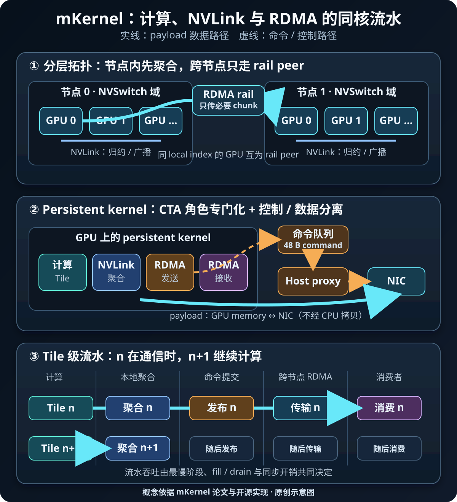

# mKernel：把多 GPU 融合 Kernel 扩展到多节点 RDMA

分布式训练与推理中的常见优化，是把计算与 collective 放到不同 CUDA stream：前一批 chunk 通信时，后一批 chunk 继续计算。这个方案能隐藏一部分通信，却仍受 producer kernel 边界约束——一个 chunk 通常要等对应 kernel 完成，通信才能看见它已经就绪。

[mKernel](https://arxiv.org/abs/2609.13585) 采取更激进的路线：让 persistent kernel 内部的计算 block 以 tile 为单位发布就绪状态，再由专职 block 推进 NVLink、网络发送和接收。这样，一个输出 tile 不必等待整个 GEMM 或 Attention kernel 结束，就能进入节点内聚合与跨节点 RDMA。

难点不只是“把 NCCL 搬进 kernel”。跨节点后同时存在三条速度、语义和控制方式都不同的路径：

- Tensor Core/SM 上的计算；
- NVLink/NVSwitch 上的 peer-memory 访问；
- NIC 上的 message-oriented RDMA request。

mKernel 的价值，在于把三者当作一个资源受限的流水系统来调度。

*图源与许可：本站自绘，原创站点内容，未复用第三方图像。机制依据 Mao 等人的 [mKernel 论文](https://arxiv.org/html/2609.13585)及其 [MIT 许可开源实现](https://github.com/uccl-project/mKernel)整理。实线表示 payload 数据路径，虚线表示命令/控制路径；拓扑和时间宽度仅为示意，不代表实测比例。*

## 1. 背景：为什么跨节点后，双 stream overlap 还不够

可把计算—通信调度粗略分成三类：

1. **先计算、后 collective**：边界清晰，但通信完全暴露；
2. **双 stream chunk pipeline**：完成一个 chunk 的 producer kernel 后，另一条 stream 开始通信；
3. **tile-ready fused kernel**：计算 block 每产出一个 tile 就发布状态，通信 block 立即消费。

第三种方式把可重叠边界从 kernel/chunk 缩小到 tile。不过，粒度越细并不自动越快。跨节点网络请求有固定提交与完成开销；若每个 tile 都生成一条 RDMA request，消息率和 doorbell 成本会吞掉收益。因此 mKernel 实际维护三种粒度：compute tile、节点内 transfer tile、跨节点 network chunk。它们可以独立选择，再通过计数器和 readiness flag 衔接。

一个有用的稳态模型是：

~~~text
T_fused ≈ max(
    T_compute × S / (S - S_comm),
    T_NVLink(S_comm),
    T_network(S_comm)
) + T_fill/drain + T_sync
~~~

其中 <code>S</code> 是可用 SM 数，<code>S_comm</code> 是分给通信角色的 SM 数。通信 SM 太少，NVLink/RDMA backlog 会拖住消费者；通信 SM 太多，计算吞吐又会下降。优化目标不是让某一阶段单独最快，而是尽量平衡最长的流水级。

## 2. 多节点融合必须同时解决的五个约束

### 2.1 带宽不对称

论文测试集群中，每 GPU 的跨节点带宽约为节点内 NVLink 带宽的九分之一。若把节点内与节点间传输当成同一级 ring，网络阶段很容易成为关键路径。合理策略应先在 NVSwitch 域内归约或复制，让每条 RDMA rail 只传必要的数据。

### 2.2 传输语义不对称

节点内路径近似“对 peer memory 做 load/store”；跨节点路径则要描述源地址、目的地址、字节数、peer 和 completion。细粒度 tile 必须聚成能摊薄请求成本的 network chunk，同时不能大到失去早启动优势。

### 2.3 transport ordering 不统一

到达标志必须晚于 payload 可用。InfiniBand RC 可利用同一 connection 上 data write 再 flag write 的顺序；AWS EFA 的 SRD 不应假定独立写入按同样顺序到达。论文的 EFA 路径使用 write-with-immediate，接收侧 proxy 在收到 completion 后再发布 GPU 可见的到达标志。

### 2.4 NIC completion 不等于 GPU 可安全消费

“请求已经 post”“NIC 已完成传输”“远端 GPU memory 对计算 block 可见”是三个不同事件。persistent kernel 需要 epoch/readiness flag、正确的内存顺序与接收侧检查，不能把任意一个 host/NIC completion 直接当成算法级 barrier。

### 2.5 通信也会消耗 GPU 资源

轮询、节点内搬运、归约和网络协调都需要 CTA/SM，并与 GEMM 或 FlashAttention 争抢 SM、register、shared memory、L2、HBM 和功耗预算。融合减少了 kernel 边界，却把资源竞争带进了同一个 kernel。

## 3. 机制：persistent kernel 中的角色专门化

mKernel 让同一个 persistent kernel 的 thread blocks 承担不同角色：

- **Compute**：生成或消费矩阵/Attention tile；
- **Intra-node communication**：通过 NVLink/NVSwitch 做本地归约、广播或复制；
- **Inter-node send**：把已经凑齐的 network chunk 发布到命令队列；
- **Inter-node receive**：轮询到达状态，并把远端数据交给下一阶段。

角色之间通过显式 readiness handoff 推进。例如 GEMM+AllReduce 的简化路径是：

~~~text
计算输出 tile
  -> 节点内 8 GPU 局部归约
  -> 每 4 个已归约 tile 组成 256 KiB network chunk
  -> 负责该 chunk 的 GPU 与另一节点 rail peer 交换
  -> 合并两节点 partial sum
  -> 在本节点广播最终 tile
~~~

这里没有等待完整 GEMM。论文实现用 per-chunk counter 判断组成 chunk 的 tile 是否全部就绪；最后完成的 tile 发布发送条件。接收端则执行反向映射：只在覆盖目标数据的所有 chunk 都到达后，消费者才读取它。

这种骨架能覆盖多种并行模式，但 producer、chunk 与 consumer 不同：

| 并行模式 | 融合 kernel | 就绪对象 | 后续消费者 |
| --- | --- | --- | --- |
| Tensor Parallel | AllGather + GEMM | 输入 shard/chunk | GEMM tile |
| Tensor Parallel | GEMM + ReduceScatter | 输出 tile | owner rank |
| Tensor Parallel | GEMM + AllReduce | 局部归约 tile | 节点内最终广播 |
| Sequence Parallel | Ring Attention | 到达的 KV chunk | FlashAttention step |
| Expert Parallel | MoE Dispatch + GEMM | 到达的 token range | grouped GEMM |

## 4. 分层数据移动：先走 NVLink，再上 RDMA rail

两节点、每节点 8 GPU 的 rail-optimized 拓扑中，同一 local index 的 GPU 互为 rail peer。mKernel 把跨节点流量集中到这些 peer pair，再用 NVSwitch 扩散或聚合。

以 GEMM+AllReduce 为例，每个 GPU 只负责约八分之一的输出 tile：

1. 8 张本地 GPU 先经 NVSwitch 把该部分归约到负责 GPU；
2. 负责 GPU 只把本节点 partial sum 发给另一节点的 rail peer；
3. rail peer 合并两个 partial sum；
4. 完整结果再在节点内广播。

相比每张 GPU 都跨节点发送自己的 contribution，这种层次化调度显著减少网络字节量。AllGather+GEMM 则反过来：一个 shard 每个目标节点只跨网发送一次，落到 rail peer 后再通过 NVLink 广播。

network chunk 是这里最重要的调优旋钮之一：

- **过小**：命令发布、proxy polling、work request、doorbell 与 completion 的固定成本占比过高；
- **过大**：必须等待更多 tile，首个可发送时刻变晚，fill/drain 变长；
- **布局不匹配**：需要 staging buffer 或额外重排，增加 HBM/NVLink 流量。

因此不能把“tile 越小，overlap 越好”当作通则。正确做法是分别 sweep compute tile、local tile 与 network chunk，并观察实际消息率、有效 payload 带宽和流水线空洞。

## 5. GPU 发命令、Host 代提交：控制路径不等于数据中转

mKernel 的可移植路径是 **host-assisted GPU-initiated communication**：

1. send block 在 pinned host memory 的 ring buffer 中写入一条 48-byte command；
2. command 描述 peer、源/目的 offset、字节数和 chunk id；
3. 轻量 host proxy 轮询 command header，并通过 libibverbs/EFA backend 提交；
4. NIC 直接在已注册 GPU memory 与远端 GPU memory 之间搬运 payload。

CPU 位于控制路径，不是 payload bounce buffer。论文实现还会把同一 connection 上最多 8 条 ready command 合并提交；不足一批时使用有界 polling window，避免最后几个 chunk 因“等满 batch”而增加尾延迟。

这种接口让同一个 GPU kernel 可以对接 ConnectX-7/InfiniBand 与 AWS EFA，只把 transport-specific ordering/completion 留给 proxy/session backend。

论文也实现了 ConnectX-7 上的 IBGDA，让 GPU 直接操作 NIC work queue。其 2 节点 × 8 H200 实验中，IBGDA 相对 host-assisted 路径只带来很小的额外收益。作者给出的解释是：host proxy 可与计算并行并批量提交，而其 IBGDA 路径每个 chunk 需要代价较高的 system-scope fence 与 doorbell。

这个结果不能推广为“GPU 直驱 NIC 没价值”。小消息、极端延迟敏感、不同 NIC doorbell 机制、更大节点数或不同 batching 策略，都可能改变结论。这里能确认的只是：在论文的两节点 ConnectX-7 平台、实现和 workload 上，host-assisted 控制路径没有成为主要瓶颈。

## 6. 性能与资源模型：动态 SM 划分与反馈控制

最佳 <code>S_comm</code> 会随 kernel、shape 和执行阶段变化。论文在单节点、8 张 H100 的静态 sweep 中观察到，最佳通信 SM 数跨 workload 分布在 2 到 64；AllReduce 最差划分的延迟约为最佳划分的 25 倍。

mKernel 的自适应模式允许 block 在一个 tile 或 message 等任务边界切换角色。GPU 端 controller 从各角色累计的 cycle counter 估计单位任务成本，再结合剩余任务量，计算让两类工作预测完成时间接近的目标：

~~~text
n_comm* = B × (R_comm × C_comm)
              / (R_compute × C_compute + R_comm × C_comm)
~~~

其中 <code>B</code> 是总 block 预算，<code>R</code> 表示剩余任务数，<code>C</code> 表示估计的单任务成本。若计算正在等待通信提供输入，空闲 compute block 还能临时协助通信，避免严格配额造成停顿。

需要注意两点：

- 论文对自适应控制器的评估只在单节点完成，不应据此宣称多节点 RDMA 场景已经同等验证；
- 在 21 个配置上，它相对逐 shape 搜索得到的最佳固定划分，几何平均延迟为 1.18×。它减少调参成本，但不是 oracle。

对短 kernel，controller 采样与角色切换本身可能来不及收敛；对高度稳定的生产 shape，离线 autotuning 的固定划分仍可能更快。

## 7. 工程接入流程

### 第一步：确认值得融合的边界

用 Nsight Systems 量化 unfused 路径中 collective 暴露时间，并确认 producer/consumer 存在 tile 或 chunk 级就绪条件。若通信占比很低，或单节点已经容纳 workload，跨节点 persistent kernel 的复杂度通常不划算。

### 第二步：明确拓扑与 ownership

记录 GPU—NVSwitch—NIC 映射、rail peer、NUMA placement 和每个 tile 的 owner。先证明“每份数据跨节点只发必要次数”，再讨论 overlap。错误的 ownership 会让网络字节量放大，任何微观调度都补不回来。

### 第三步：分开设计三种粒度

分别确定 compute tile、local transfer tile 和 network chunk。实现 tile counter、chunk epoch 与 backpressure，限制 outstanding request，防止 GPU 生产速度超过 proxy/NIC 消费速度。

### 第四步：把 transport completion 封装在 backend

InfiniBand RC 与 EFA SRD 的 data-before-flag 规则不同。统一的 kernel 侧接口应只暴露“chunk 已安全到达”，而不是把某种 transport 的隐含 ordering 泄漏到算法代码中。

### 第五步：保留逐层 baseline

至少同时维护并比较：

1. cuBLAS/FlashAttention + NCCL；
2. 双 stream chunk pipeline；
3. fused kernel + 固定 SM 划分；
4. fused kernel + 动态 SM 划分；
5. host-assisted 与 device-direct backend（平台支持时）。

这样才能区分收益究竟来自 kernel fusion、层次化通信、grouped compute，还是 backend 差异。

## 8. 如何读论文 benchmark

论文在两套独立集群上评估：二者均为 **2 节点 × 每节点 8 张 H200**，每 GPU 跨节点网络带宽为 400 Gb/s；一套使用 ConnectX-7/InfiniBand，另一套使用 AWS EFA。代码以 CUDA 12.9、<code>sm_90a</code> 构建，每 GPU 一个进程，并以最慢 rank 的时间决定一次迭代完成。

相对 cuBLAS 或 FlashAttention 后接 NCCL 的 unfused baseline，论文报告：

- AllGather+GEMM：EFA 最高 1.41×，ConnectX-7 最高 1.34×；
- GEMM+AllReduce：EFA 最高 1.53×，ConnectX-7 最高 1.72×；
- Ring Attention：EFA 最高 1.78×，ConnectX-7 最高 1.88×；
- GEMM+ReduceScatter：在 <code>M ≥ 16K</code> 的大问题上约 1.02–1.27×。

这些都是特定 shape 中的**最高值或区间**，不是平均值，更不是所有平台的保证。MoE Dispatch+GEMM 对 unfused baseline 的 3.1–4.5× 还同时包含 grouped expert GEMM 组织方式的收益，不能全部归因于通信重叠。不同 baseline 支持的平台也不完全相同；例如论文注明其评估的 DeepEP 实现不支持 EFA，因此相关 EFA 图中的对照来自另一测试床。

迁移前应重测完整 shape 分布，并报告 median、P95/P99、最慢 rank、网络字节量和失败/退化案例，而不是只复制 peak speedup。

## 9. 局限与不适用场景

- 当前公开实现主要面向 Hopper，README 默认 <code>sm_90a</code> 与 CUDA 12.9；Blackwell 支持仍在 roadmap；
- 仓库仍在积极开发，异构 accelerator/NIC、拓扑自动发现、placement 与 routing 尚未完整支持；
- 论文核心实验只有两个节点，不能直接外推到更多节点、更多 hop 或拥塞网络；
- 自适应 SM 划分的论文评估限于单节点；
- persistent kernel 可能与框架调度、CUDA Graph、抢占、功耗策略和其他并发 workload 冲突；
- 极短 kernel 无法摊薄 command、polling、fence 与同步成本；
- compute-bound 且通信占比低时，拿走 SM 反而会降低性能；
- network chunk 难以与模型布局对齐时，staging/reorder 可能抵消 overlap；
- transport ordering、GPU memory visibility 或 epoch flag 任一处理错误，都可能形成低概率数据竞争；
- host proxy 虽不搬 payload，仍需要稳定的 CPU core、NUMA 绑定和及时调度。

## 10. 实践检查表

### 正确性

- [ ] 每个 tile/chunk 有唯一 owner、epoch 和可证明的 producer-consumer 顺序。
- [ ] 区分 request posted、NIC completion、远端 payload 可见和 GPU consumer 放行。
- [ ] InfiniBand 与 EFA backend 分别验证 data-before-flag 语义。
- [ ] 覆盖随机 shape、非整 tile、跨 chunk 边界、队列回绕和长时间压力测试。
- [ ] 与 unfused NCCL baseline 做逐元素数值回归，并覆盖所有 rank。
- [ ] outstanding request、queue credit 和反压路径不会死锁。

### 时间线与资源

- [ ] Nsight Systems 证明 tile-ready 后 NVLink/RDMA 确实提前开始。
- [ ] 分别统计 compute、NVLink、network 的 busy/idle 区间与 fill/drain。
- [ ] 记录通信/计算 SM 比例及其随时间的变化。
- [ ] 检查 occupancy、register、shared memory、L2/HBM 和功耗竞争。
- [ ] 记录有效 payload 带宽、消息率、平均 chunk、queue depth 和 rail balance。
- [ ] 验证 host proxy 的 CPU affinity、NUMA locality、batch size 与 polling 策略。

### A/B 与发布

- [ ] 比较 NCCL 串行、双 stream、固定划分 fused、自适应 fused。
- [ ] 固定 GPU clocks/power policy、驱动、CUDA、固件、网络配置与 warm-up。
- [ ] 报告完整 shape 分布、median、P95/P99 和最慢 rank，而非只报最高加速。
- [ ] 升级 NIC/GPU/driver 或变更拓扑后重新验证 ordering 与性能。
- [ ] 保留安全 fallback；融合路径退化或 backend 不支持时可切回库实现。

## 小结

mKernel 展示的不是一个更大的 collective kernel，而是一种跨层联合调度：计算按 tile 发布进度，NVSwitch 先完成本地聚合或复制，RDMA rail 只承载必要的跨节点数据，GPU 命令队列与 host proxy 把控制路径和 payload 路径分离，再由 SM 角色专门化维持三段流水。

最可复用的思想有四个：**分层数据移动、显式 readiness handoff、控制/数据路径分离、按剩余工作动态平衡资源**。它们确实能逼近 tile-level overlap 的上限，也同时引入拓扑、transport ordering、队列反压和资源竞争等系统复杂度。是否值得采用，最终要由真实时间线、网络计数器和端到端 tail latency 共同回答。

## 参考资料

1. Mao et al., [mKernel: Fast Multi-GPU, Multi-Node Fused Kernels](https://arxiv.org/abs/2609.13585), arXiv:2609.13585，访问于 2026-10-19。
2. UCCL Project, [mKernel source repository](https://github.com/uccl-project/mKernel)，MIT License，访问于 2026-10-19。
3. UCCL Project, [mKernel LICENSE](https://github.com/uccl-project/mKernel/blob/main/LICENSE)。
4. NVIDIA, [GPUDirect RDMA Documentation](https://docs.nvidia.com/cuda/gpudirect-rdma/)，访问于 2026-10-19。
5. NVIDIA, [NCCL User Guide — Overview](https://docs.nvidia.com/deeplearning/nccl/user-guide/docs/overview.html)，访问于 2026-10-19。
6. AWS, [Elastic Fabric Adapter for AI/ML and HPC](https://docs.aws.amazon.com/AWSEC2/latest/UserGuide/efa.html)，访问于 2026-10-19。
